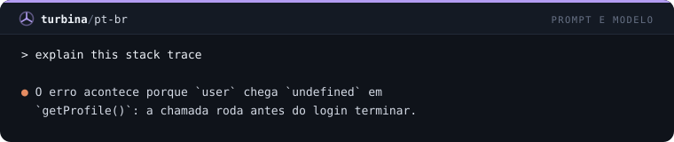

# Turbina

**30 mods para turbinar o Claude Code no terminal.** Segurança, interface, prompt, comandos e foco — cada mod é um plugin pequeno, independente e instalável com uma linha.

```
/plugin marketplace add MatheusChiodi/turbina
/plugin install rm-guard@turbina
```

> Mods são funções TypeScript que rodam dentro do Claude Code e mudam como ele se comporta: interceptam tool calls, reescrevem prompts, desenham painéis e faixas, registram slash commands. Exigem Claude Code **2.1.287+** (testado na 2.1.296).

## Instalação

**Pelo GitHub** (dentro do Claude Code):

```
/plugin marketplace add MatheusChiodi/turbina
/plugin install <mod>@turbina
```

**Por pasta local** (clone o repositório):

```bash
git clone https://github.com/MatheusChiodi/turbina
claude plugin marketplace add ./turbina
claude plugin install git-guard@turbina
```

**Só experimentar**, sem instalar:

```bash
claude --plugin-dir ./turbina/mods/turn-timer
```

Remover: `/plugin uninstall <mod>@turbina`. Desligar tudo de uma vez: `claude --safe-mode`.

## Catálogo

<!-- catalogo:inicio (gerado por scripts/build-docs.mjs, não edite à mão) -->
| Categoria | Mods |
| --- | --- |
| **Segurança** | [`rm-guard`](#rm-guard) · [`env-guard`](#env-guard) · [`git-guard`](#git-guard) · [`secret-scan`](#secret-scan) · [`prompt-secret-guard`](#prompt-secret-guard) · [`lockfile-guard`](#lockfile-guard) · [`path-jail`](#path-jail) · [`main-branch-guard`](#main-branch-guard) |
| **Interface** | [`turn-timer`](#turn-timer) · [`tool-tally`](#tool-tally) · [`file-trail`](#file-trail) · [`cmd-log`](#cmd-log) · [`git-status-line`](#git-status-line) · [`context-meter`](#context-meter) · [`rate-limit-watch`](#rate-limit-watch) · [`session-clock`](#session-clock) |
| **Prompt e modelo** | [`pt-br`](#pt-br) · [`concise-mode`](#concise-mode) · [`persona`](#persona) · [`prompt-shortcuts`](#prompt-shortcuts) · [`tldr`](#tldr) |
| **Comandos** | [`quick-notes`](#quick-notes) · [`pomodoro`](#pomodoro) · [`copy-last`](#copy-last) · [`session-stats`](#session-stats) · [`quote-selection`](#quote-selection) · [`git-peek`](#git-peek) |
| **Foco e notificações** | [`turn-notify`](#turn-notify) · [`break-reminder`](#break-reminder) · [`daily-streak`](#daily-streak) |

## Segurança (8)

### `rm-guard`

Bloqueia rm -rf / Remove-Item -Recurse em raiz, home e drives, além de mkfs, dd e format.

```
/plugin install rm-guard@turbina
```


### `env-guard`

Protege arquivos .env contra leitura e escrita (Read, Edit, Write, cat e @menção).

```
/plugin install env-guard@turbina
```


### `git-guard`

Bloqueia git destrutivo: push --force, reset --hard, clean -f, --no-verify, branch -D.

```
/plugin install git-guard@turbina
```


### `secret-scan`

Recusa Write/Edit cujo conteúdo traz chaves de API, tokens ou chaves privadas.

```
/plugin install secret-scan@turbina
```


### `prompt-secret-guard`

Barra o envio de prompts que contenham segredos colados por engano.

```
/plugin install prompt-secret-guard@turbina
```


### `lockfile-guard`

Impede edição manual de lockfiles (package-lock, yarn.lock, pnpm-lock, Cargo.lock...).

```
/plugin install lockfile-guard@turbina
```


### `path-jail`

Restringe Write/Edit à raiz do projeto, ao temp e a ~/.claude (resolve symlinks).

```
/plugin install path-jail@turbina
```


### `main-branch-guard`

Recusa commit, push, merge e rebase quando a branch atual é main/master.

```
/plugin install main-branch-guard@turbina
```


## Interface (8)

### `turn-timer`

Faixa acima do prompt com duração, tools e tokens do último turno.

```
/plugin install turn-timer@turbina
```


### `tool-tally`

/tally abre um painel com a contagem de chamadas por ferramenta.

```
/plugin install tool-tally@turbina
```


### `file-trail`

/trail abre um painel com os arquivos lidos e alterados na sessão.

```
/plugin install file-trail@turbina
```


### `cmd-log`

/cmdlog abre um painel com os comandos de shell, status e duração.

```
/plugin install cmd-log@turbina
```


### `git-status-line`

Status line com branch, arquivos alterados e commits à frente/atrás.

```
/plugin install git-status-line@turbina
```


### `context-meter`

Status line com barra de contexto e custo; avisa em 80% e 90%.

```
/plugin install context-meter@turbina
```


### `rate-limit-watch`

Toast quando a janela de 5h ou 7 dias passa de 75/90/95%; /limits lista o uso.

```
/plugin install rate-limit-watch@turbina
```


### `session-clock`

Status line com tempo de sessão e número de prompts.

```
/plugin install session-clock@turbina
```


## Prompt e modelo (5)

### `pt-br`

Faz o Claude responder sempre em português do Brasil (seção no system prompt).

```
/plugin install pt-br@turbina
```



### `concise-mode`

/concise liga respostas curtas e diretas, sem introdução nem recapitulação.

```
/plugin install concise-mode@turbina
```


### `persona`

/persona troca a voz do Claude: mentor, senior, rubberduck, pirata, yoda, zen.

```
/plugin install persona@turbina
```


### `prompt-shortcuts`

Atalhos ::fix, ::test, ::review, ::explain, ::refactor, ::doc, ::commit viram prompts completos.

```
/plugin install prompt-shortcuts@turbina
```


### `tldr`

Acrescenta um TL;DR de 2 frases (via haiku) abaixo de respostas longas.

```
/plugin install tldr@turbina
```


## Comandos (6)

### `quick-notes`

/note e /notes: notas rápidas por projeto, persistentes entre sessões.

```
/plugin install quick-notes@turbina
```


### `pomodoro`

/pomodoro [min] com contagem na status line, toast e notificação ao final.

```
/plugin install pomodoro@turbina
```


### `copy-last`

/copy-last copia a última resposta; /copy-code copia o último bloco de código.

```
/plugin install copy-last@turbina
```


### `session-stats`

/stats resume a sessão: tempo, prompts, tools, tokens, contexto e custo.

```
/plugin install session-stats@turbina
```


### `quote-selection`

/quote cita no prompt o trecho selecionado com o mouse.

```
/plugin install quote-selection@turbina
```


### `git-peek`

/gs, /gl e /gd: status, log e diff do git na hora, sem gastar turno do modelo.

```
/plugin install git-peek@turbina
```


## Foco e notificações (3)

### `turn-notify`

Notificação nativa quando um turno de 30s ou mais termina.

```
/plugin install turn-notify@turbina
```


### `break-reminder`

Toast a cada 50 minutos de sessão lembrando de fazer uma pausa.

```
/plugin install break-reminder@turbina
```


### `daily-streak`

Conta seus dias seguidos de Claude Code; toast ao abrir e comando /streak.

```
/plugin install daily-streak@turbina
```


<!-- catalogo:fim -->

## Combos sugeridos

| Objetivo | Mods |
| --- | --- |
| **Cinto de segurança** | `rm-guard` `git-guard` `env-guard` `secret-scan` `prompt-secret-guard` |
| **Painel de bordo** | `git-status-line` `turn-timer` `rate-limit-watch` |
| **Vibe coder BR** | `pt-br` `concise-mode` `prompt-shortcuts` `git-peek` |
| **Foco** | `pomodoro` `turn-notify` `break-reminder` `daily-streak` |

A status line guarda uma entrada por mod, então `git-status-line`, `context-meter`, `session-clock` e `pomodoro` convivem lado a lado.

## O que saber antes de instalar

- **Mods não são sandboxed.** Rodam com o mesmo alcance do Claude Code. Leia o `hooks/register.ts` do mod antes de instalar — todos aqui têm menos de 130 linhas.
- **Os guards são cinto de segurança, não cofre.** Casam padrões conhecidos de comandos e caminhos; um comando ofuscado pode passar. Mantenha as permissões do Claude Code configuradas.
- **`tldr` gasta tokens:** faz uma chamada curta ao haiku por resposta longa.
- **`main-branch-guard` e `path-jail` são restritivos de propósito.** Instale só se o fluxo combinar com o seu.
- **Sem som.** `$.audio.play` só toca no macOS nesta versão; por isso `turn-notify` e `pomodoro` usam a notificação nativa.
- A API de mods é **early access** e pode mudar entre versões do Claude Code.

## Alcance de cada mod

| Alcance | Mods |
| --- | --- |
| Só observa e desenha | `turn-timer` `tool-tally` `file-trail` `cmd-log` `context-meter` `rate-limit-watch` `session-clock` `session-stats` `turn-notify` `break-reminder` |
| Bloqueia chamadas | `rm-guard` `env-guard` `git-guard` `secret-scan` `prompt-secret-guard` `lockfile-guard` `path-jail` `main-branch-guard` |
| Altera prompt | `pt-br` `concise-mode` `persona` `prompt-shortcuts` `quote-selection` |
| Roda `git` no host | `git-status-line` `git-peek` `main-branch-guard` |
| Guarda dados entre sessões | `quick-notes` `concise-mode` `persona` `daily-streak` |
| Chama o modelo | `tldr` |
| Área de transferência | `copy-last` |

## Desenvolvimento

```bash
npm install
npm run build      # gera plugin.json, hooks.json, marketplace.json, prévias SVG e o catálogo deste README
npm run check      # tsc + claude plugin validate em cada mod + claude plugin test onde há testes
```

Estrutura de um mod:

```
mods/<nome>/
  .claude-plugin/plugin.json   # gerado a partir de mods.json
  hooks/hooks.json             # gerado: { "modules": ["./register.ts"] }
  hooks/register.ts(x)         # o mod
  types/index.d.ts             # contrato de $.state (só nos mods com painel/faixa)
  tests/<nome>.test.ts         # roda com `claude plugin test`
```

`mods.json` é a fonte única: nome, categoria, descrição e as linhas da prévia de cada mod.

O type-check usa as declarações da API que o próprio Claude Code escreve. Elas não vão no repositório: rode um mod com `claude --plugin-dir mods/<nome>` e copie `mods/<nome>/.claude-plugin/types/claude-code/index.d.ts` (mais `claude-code-tools/index.d.ts`) para `engine-types/`.

**Cobertura de testes:** `rm-guard`, `env-guard`, `git-guard`, `secret-scan`, `prompt-secret-guard`, `lockfile-guard`, `main-branch-guard` e `prompt-shortcuts` têm testes automatizados. Os outros 22 passam em `tsc` e `claude plugin validate`, mas não têm teste automatizado.

## Pesquisa: o ecossistema de mods

Levantamento feito em 13/10/2026 via `gh api` e documentação oficial. Estrelas são do momento da consulta.

**Oficial**

- Anúncio: [claude.com/blog/claude-code-mods](https://claude.com/blog/claude-code-mods) (01/10/2026)
- Documentação: [code.claude.com/docs/en/plugins/mods/overview](https://code.claude.com/docs/en/plugins/mods/overview)
- Mods embutidos: [anthropics/claude-code/mods](https://github.com/anthropics/claude-code/tree/main/mods)
- Exemplos: [anthropics/claude-code-playground](https://github.com/anthropics/claude-code-playground/tree/main/claude-code/mods)

**Coleções da comunidade**

| Repositório | Estrelas | Destaques |
| --- | --- | --- |
| [karanb192/awesome-claude-code-mods](https://github.com/karanb192/awesome-claude-code-mods) | 560 | Catálogo: 3.836 mods em 1.987 repositórios |
| [YeonwooSung/my-claude-code-mods](https://github.com/YeonwooSung/my-claude-code-mods) | 514 | agent-profiler, context-inspector, time-machine |
| [hamzafer/claude-code-mods](https://github.com/hamzafer/claude-code-mods) | 227 | context-bar, blast-radius, merge-gate, snake |
| [whyashthakker/awesome-claude-code-mods](https://github.com/whyashthakker/awesome-claude-code-mods) | 59 | 100+ mods pequenos |
| [ray-amjad/claude-code-mods](https://github.com/ray-amjad/claude-code-mods) | 46 | cache-clock, prompt-bouncer, secret-box |
| [zenbu-labs/terminal-browser](https://github.com/zenbu-labs/terminal-browser) | 3.854 | Navegador dentro do terminal |
| [jarrodwatts/claude-image-view](https://github.com/jarrodwatts/claude-image-view) | 222 | Imagens no terminal |

**Customização que não é mod** (outros mecanismos)

| Projeto | Estrelas | Mecanismo |
| --- | --- | --- |
| [jarrodwatts/claude-hud](https://github.com/jarrodwatts/claude-hud) | 28.495 | Plugin de statusline/HUD |
| [ccusage/ccusage](https://github.com/ccusage/ccusage) | 19.001 | CLI que lê os transcripts JSONL |
| [sirmalloc/ccstatusline](https://github.com/sirmalloc/ccstatusline) | 13.274 | Script de statusline |
| [PeonPing/peon-ping](https://github.com/PeonPing/peon-ping) | 5.074 | Hooks shell de som |
| [Piebald-AI/tweakcc](https://github.com/Piebald-AI/tweakcc) | 2.544 | Patch da instalação |
| [kenryu42/cc-safety-net](https://github.com/kenryu42/cc-safety-net) | 1.615 | Guard via hook PreToolUse |

**O que a pesquisa mostrou de possibilidades:** faixas e painéis vivos, guards de tool call e de prompt, slash commands instantâneos, seções no system prompt, tools e subagentes registrados pelo mod, timers, chamadas ao modelo, HTTP e processos no host. O espaço de barras de contexto/uso já está saturado; a Turbina aposta em guards em português, comandos sem custo de turno e foco.

## Licença

MIT
