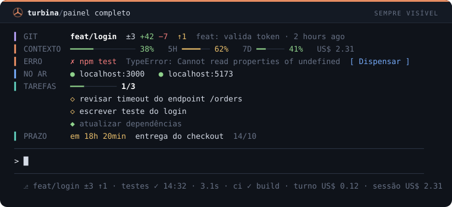

# Cockpit

[English](README.md) · **Português** · [Español](README.es.md)

**Um painel de instrumentos para o Claude Code.** 158 mods para o terminal: 40 painéis que ficam sempre à vista e você liga ou desliga em `/cockpit`, mais guards, automações de prompt, comandos instantâneos e ajudas de foco. Cada mod é um plugin pequeno, instalado com uma linha.



```
/plugin marketplace add MatheusChiodi/cockpit
/plugin install git-band@cockpit
/cockpit
```

> Mods são funções TypeScript que rodam dentro do Claude Code e mudam como ele se comporta: interceptam tool calls, reescrevem prompts, desenham painéis e faixas e registram slash commands. Exigem Claude Code **2.1.287 ou mais novo** (feito sobre a 2.1.296).

## Instalação

**Pelo GitHub**, dentro do Claude Code:

```
/plugin marketplace add MatheusChiodi/cockpit
/plugin install <mod>@cockpit
```

**Por pasta local:**

```bash
git clone https://github.com/MatheusChiodi/cockpit
claude plugin marketplace add ./cockpit
claude plugin install git-guard@cockpit
```

**Só para experimentar um**, sem instalar:

```bash
claude --plugin-dir ./cockpit/mods/turn-timer
```

Remova um mod com `/plugin uninstall <mod>@cockpit`. Desligue todos de uma vez com `claude --safe-mode`.

## Painéis e configurações

Os 40 mods de **Sempre visível** são painéis: faixas acima do prompt ou entradas na status line que se atualizam sozinhas (git, contexto, custo, testes, CI, tarefas, prazo, clima). Nenhum precisa de comando para aparecer.

O mod `cockpit` é o painel de configurações deles e vem junto como dependência de qualquer painel.

| Para | Faça |
| --- | --- |
| Abrir as configurações | `/cockpit` — Tab e setas navegam, Enter ou clique alterna, Esc fecha |
| Desligar ou ligar um painel | `/cockpit off git-band` · `/cockpit on git-band` |
| Alternar todos | `/cockpit off all` · `/cockpit on all` |
| Trocar o idioma | `/cockpit lang en` · `/cockpit lang pt` · `/cockpit lang es` |

As duas escolhas ficam salvas entre sessões. Uma faixa some ou volta na hora; uma entrada de status line some na hora e volta na próxima atualização dela. Painel desligado continua instalado, só não desenha.

As faixas se empilham na ordem em que os mods carregam, e a status line guarda uma entrada por mod. Com muitos painéis ligados o terminal fica cheio: comece com quatro ou cinco e ajuste em `/cockpit`.

## Idioma

Todo mod fala **inglês** por padrão e pode trocar para **português do Brasil** ou **espanhol**. O idioma é definido uma vez, em `/cockpit`, e todos os mods instalados seguem: rótulos das faixas, palavras da status line, saída dos comandos, mensagens dos guards, toasts e notificações. Sem o mod `cockpit` instalado, os mods ficam em inglês.

As descrições dos slash commands no autocompletar são lidas quando a sessão começa, então acompanham a troca de idioma na sessão seguinte. Para o próprio Claude responder no idioma escolhido, instale o `reply-language`.

## Catálogo

| | | |
| --- | --- | --- |
| [**Sempre visível**](docs/catalog/panel.pt-BR.md) | 41 | `cockpit` `git-band` `todo-band` `usage-band` `files-band` `error-band` `goal-band` `agents-band` `activity-status` `test-status` `ci-status` `stash-status` `uncommitted-band` `pr-status` `main-warning-band` `conflict-band` `project-status` `ports-band` `deps-status` `todo-count-status` `quality-status` `model-status` `cost-ticker` `idle-clock` `turn-progress` `last-prompt-band` `compact-nudge` `session-diff-band` `shield-band` `reset-countdown` `spend-today` `focus-band` `deadline-band` `pin-band` `clock-status` `day-timer` `commits-today` `dolar-status` `weather-status` `api-status` `terminal-pet` |
| [**Segurança**](docs/catalog/security.pt-BR.md) | 14 | `rm-guard` `env-guard` `git-guard` `secret-scan` `prompt-secret-guard` `lockfile-guard` `path-jail` `main-branch-guard` `generated-guard` `sql-guard` `prod-guard` `install-ask` `pipe-shell-guard` `big-read-guard` |
| [**Interface**](docs/catalog/interface.pt-BR.md) | 29 | `turn-timer` `tool-tally` `file-trail` `cmd-log` `git-status-line` `context-meter` `rate-limit-watch` `session-clock` `diff-pane` `turn-history` `prompt-history` `agent-pane` `token-chart` `cost-pane` `error-pane` `context-pane` `read-pane` `links-pane` `git-pane` `branch-pane` `stash-pane` `code-todo-pane` `deps-pane` `scripts-pane` `env-keys-pane` `test-pane` `slow-toast` `deny-toast` `big-output-toast` |
| [**Prompt e modelo**](docs/catalog/prompt.pt-BR.md) | 20 | `concise-mode` `persona` `prompt-shortcuts` `tldr` `git-context` `stack-context` `commit-style` `reply-language` `time-context` `os-context` `test-first` `explain-mode` `plan-first` `no-comments` `minimal-diff` `ask-first` `verify-claims` `paste-fence` `file-mention-hint` `trace-helper` |
| [**Comandos**](docs/catalog/commands.pt-BR.md) | 30 | `quick-notes` `pomodoro` `copy-last` `session-stats` `quote-selection` `git-peek` `git-branch` `git-stash` `git-undo` `run-script` `open-path` `ports` `kill-port` `tree` `find-file` `last-error` `env-check` `outdated` `json-tool` `uuid` `timestamp` `base64` `hash` `calc` `color-tool` `regex-test` `http-probe` `snippets` `export-session` `standup` |
| [**Foco e notificações**](docs/catalog/focus.pt-BR.md) | 24 | `turn-notify` `break-reminder` `daily-streak` `error-notify` `needs-you-notify` `agent-done-notify` `long-cmd-notify` `tests-notify` `ci-notify` `pr-review-notify` `rate-limit-notify` `hydrate` `posture` `eye-rest` `stand-up` `alarms` `remind` `timebox` `session-cap` `late-night` `intent-check` `daily-target` `weekly-recap` `breathe` |
| [**Git e GitHub**](docs/catalog/git.pt-BR.md) | 0 |  |
| [**Qualidade**](docs/catalog/quality.pt-BR.md) | 0 |  |
| [**Stacks**](docs/catalog/stack.pt-BR.md) | 0 |  |
| [**Contexto e custo**](docs/catalog/context.pt-BR.md) | 0 |  |

## Linguagem visual

Todo painel é desenhado do mesmo jeito, para que vários juntos leiam como um instrumento só:

- **Linha de instrumento:** trilho colorido, rótulo de largura fixa e valores. Empilhadas, as faixas alinham em colunas.
- **Um matiz por assunto** no trilho: Git, Sessão, Projeto e Dia a dia. Verde, âmbar e vermelho ficam reservados para o estado de um valor.
- **Medidores de linha fina** (`━━━━───`) no lugar de barras de bloco.
- **Status line curta e em minúsculas:** `rótulo estado detalhe`, como `testes ✓ 14:32 · 3.1s`.
- As cores vêm do tema do seu Claude Code. O desenho vive em `kit/kit.tsx`, copiado para cada mod no build.

## Conjuntos sugeridos

| Para | Mods |
| --- | --- |
| **Painel do dia a dia** | `git-band` `usage-band` `todo-band` `error-band` `test-status` |
| **Git sem surpresa** | `git-band` `conflict-band` `uncommitted-band` `main-warning-band` `pr-status` `ci-status` |
| **De olho no gasto** | `usage-band` `cost-ticker` `spend-today` `reset-countdown` `compact-nudge` |
| **Cinto de segurança** | `rm-guard` `git-guard` `env-guard` `secret-scan` `pipe-shell-guard` `prod-guard` `shield-band` |
| **Menos digitação** | `stack-context` `git-context` `commit-style` `prompt-shortcuts` `git-peek` |
| **Foco** | `focus-band` `deadline-band` `pin-band` `turn-notify` `break-reminder` |

## Antes de instalar

- **Mods não são sandboxed.** Rodam com o mesmo alcance do Claude Code. Leia o `hooks/register.ts` do mod antes de instalar; todos aqui são curtos.
- **Guards são cinto de segurança, não cofre.** Casam formatos conhecidos de comandos e caminhos: um comando ofuscado pode passar, e um caminho legítimo pode ser recusado. Mantenha as permissões do Claude Code configuradas.
- **Alguns guards perguntam em vez de bloquear.** `prod-guard`, `install-ask` e os outros que dizem isso forçam o pedido de confirmação mesmo quando o comando já estava liberado.
- **Alguns mods chamam um modelo** e gastam tokens; a descrição deles avisa.
- **Alguns painéis usam rede** e ficam ocultos quando não há resposta: `dolar-status` (AwesomeAPI), `weather-status` (wttr.in, localiza por IP), `api-status` (página de status da Anthropic), `ports-band` (só `localhost`).
- **`ci-status` e `pr-status` precisam do `gh` autenticado.**
- **Os painéis de Git consultam o repositório** a cada 30 a 60 segundos.
- **Sem som.** Nesta versão o `$.audio.play` só toca no macOS, então as notificações usam o canal nativo.
- A API de mods é **early access** e pode mudar entre versões do Claude Code.

## Desenvolvimento

```bash
npm install
npm run build              # manifests, lista de painéis do hub, prévias e os três READMEs
npm run check              # tsc + claude plugin validate em cada mod + claude plugin test onde há testes
node scripts/mod.mjs <mod> # o mesmo ciclo para um mod, sem tocar nos arquivos compartilhados
```

`mods.json` é a fonte única: nome, categoria, descrições nos três idiomas e as linhas da prévia de cada mod.

```
mods/<nome>/
  hooks/register.ts(x)   o mod
  hooks/strings.ts       todo texto voltado ao usuário, em en, pt e es
  types/index.d.ts       o contrato de $.state, nos mods que desenham
  tests/                 rodados pelo `claude plugin test`
```

`plugin.json`, `hooks.json` e a cópia do kit em cada mod são gerados.

**Criando mods com o agente.** O repositório traz um agente do Claude Code, `cockpit-mod-builder` (`.claude/agents/`), que conhece as convenções: o padrão de idiomas, o kit visual, as regras do motor que mais derrubam gente e o ciclo de um mod. Abra o Claude Code no repositório e peça por ele pelo nome, passando a categoria e os mods que você quer.

O type-check usa as declarações da API que o próprio Claude Code escreve. Elas não vão no repositório: rode um mod com `claude --plugin-dir mods/<nome>` e copie `mods/<nome>/.claude-plugin/types/claude-code/index.d.ts` e `claude-code-tools/index.d.ts` para `engine-types/`.

## O ecossistema de mods

Levantamento de 13/10/2026 via `gh api` e documentação oficial. As estrelas são daquele dia.

- Anúncio: [claude.com/blog/claude-code-mods](https://claude.com/blog/claude-code-mods)
- Documentação: [code.claude.com/docs/en/plugins/mods/overview](https://code.claude.com/docs/en/plugins/mods/overview)
- Mods embutidos: [anthropics/claude-code/mods](https://github.com/anthropics/claude-code/tree/main/mods)
- Exemplos oficiais: [anthropics/claude-code-playground](https://github.com/anthropics/claude-code-playground/tree/main/claude-code/mods)

| Coleção da comunidade | Estrelas | Conhecida por |
| --- | --- | --- |
| [karanb192/awesome-claude-code-mods](https://github.com/karanb192/awesome-claude-code-mods) | 560 | Catálogo de 3.836 mods em 1.987 repositórios |
| [YeonwooSung/my-claude-code-mods](https://github.com/YeonwooSung/my-claude-code-mods) | 514 | agent-profiler, context-inspector, time-machine |
| [hamzafer/claude-code-mods](https://github.com/hamzafer/claude-code-mods) | 227 | context-bar, blast-radius, merge-gate |
| [zenbu-labs/terminal-browser](https://github.com/zenbu-labs/terminal-browser) | 3.854 | Navegador dentro do terminal |
| [jarrodwatts/claude-image-view](https://github.com/jarrodwatts/claude-image-view) | 222 | Imagens no terminal |

Outras formas de customizar o Claude Code, que não são mods: [claude-hud](https://github.com/jarrodwatts/claude-hud) e [ccstatusline](https://github.com/sirmalloc/ccstatusline) (scripts de status line), [ccusage](https://github.com/ccusage/ccusage) (CLI sobre os transcripts), [tweakcc](https://github.com/Piebald-AI/tweakcc) (patch da instalação), [cc-safety-net](https://github.com/kenryu42/cc-safety-net) (hook PreToolUse).

## Licença

MIT
