# Cockpit

[English](README.md) · **Português** · [Español](README.es.md)

**Um painel de instrumentos para o Claude Code.** 87 mods para o terminal: 40 painéis que ficam sempre à vista e você liga ou desliga em `/cockpit`, mais guards, automações de prompt, comandos instantâneos e ajudas de foco. Cada mod é um plugin pequeno, instalado com uma linha.


```
/plugin marketplace add MatheusChiodi/cockpit
/plugin install git-band@cockpit
/cockpit
```

> Mods são funções TypeScript que rodam dentro do Claude Code e mudam como ele se comporta: interceptam tool calls, reescrevem prompts, desenham painéis e faixas e registram slash commands. Exigem Claude Code **2.1.287 ou mais novo** (feito sobre a 2.1.296).

## Instalação

**Pelo GitHub**, dentro do Claude Code:

```
/plugin marketplace add MatheusChiodi/cockpit
/plugin install <mod>@cockpit
```

**Por pasta local:**

```bash
git clone https://github.com/MatheusChiodi/cockpit
claude plugin marketplace add ./cockpit
claude plugin install git-guard@cockpit
```

**Só para experimentar um**, sem instalar:

```bash
claude --plugin-dir ./cockpit/mods/turn-timer
```

Remova um mod com `/plugin uninstall <mod>@cockpit`. Desligue todos de uma vez com `claude --safe-mode`.

## Painéis e configurações

Os 40 mods de **Sempre visível** são painéis: faixas acima do prompt ou entradas na status line que se atualizam sozinhas (git, contexto, custo, testes, CI, tarefas, prazo, clima). Nenhum precisa de comando para aparecer.

O mod `cockpit` é o painel de configurações deles e vem junto como dependência de qualquer painel.

| Para | Faça |
| --- | --- |
| Abrir as configurações | `/cockpit` — Tab e setas navegam, Enter ou clique alterna, Esc fecha |
| Desligar ou ligar um painel | `/cockpit off git-band` · `/cockpit on git-band` |
| Alternar todos | `/cockpit off all` · `/cockpit on all` |
| Trocar o idioma | `/cockpit lang en` · `/cockpit lang pt` · `/cockpit lang es` |

As duas escolhas ficam salvas entre sessões. Uma faixa some ou volta na hora; uma entrada de status line some na hora e volta na próxima atualização dela. Painel desligado continua instalado, só não desenha.

As faixas se empilham na ordem em que os mods carregam, e a status line guarda uma entrada por mod. Com muitos painéis ligados o terminal fica cheio: comece com quatro ou cinco e ajuste em `/cockpit`.

## Idioma

Todo mod fala **inglês** por padrão e pode trocar para **português do Brasil** ou **espanhol**. O idioma é definido uma vez, em `/cockpit`, e todos os mods instalados seguem: rótulos das faixas, palavras da status line, saída dos comandos, mensagens dos guards, toasts e notificações. Sem o mod `cockpit` instalado, os mods ficam em inglês.

As descrições dos slash commands no autocompletar são lidas quando a sessão começa, então acompanham a troca de idioma na sessão seguinte. Para o próprio Claude responder no idioma escolhido, instale o `reply-language`.

## Catálogo

| | |
| --- | --- |
| **Sempre visível** (41) | [`cockpit`](#cockpit) · [`git-band`](#git-band) · [`todo-band`](#todo-band) · [`usage-band`](#usage-band) · [`files-band`](#files-band) · [`error-band`](#error-band) · [`goal-band`](#goal-band) · [`agents-band`](#agents-band) · [`activity-status`](#activity-status) · [`test-status`](#test-status) · [`ci-status`](#ci-status) · [`stash-status`](#stash-status) · [`uncommitted-band`](#uncommitted-band) · [`pr-status`](#pr-status) · [`main-warning-band`](#main-warning-band) · [`conflict-band`](#conflict-band) · [`project-status`](#project-status) · [`ports-band`](#ports-band) · [`deps-status`](#deps-status) · [`todo-count-status`](#todo-count-status) · [`quality-status`](#quality-status) · [`model-status`](#model-status) · [`cost-ticker`](#cost-ticker) · [`idle-clock`](#idle-clock) · [`turn-progress`](#turn-progress) · [`last-prompt-band`](#last-prompt-band) · [`compact-nudge`](#compact-nudge) · [`session-diff-band`](#session-diff-band) · [`shield-band`](#shield-band) · [`reset-countdown`](#reset-countdown) · [`spend-today`](#spend-today) · [`focus-band`](#focus-band) · [`deadline-band`](#deadline-band) · [`pin-band`](#pin-band) · [`clock-status`](#clock-status) · [`day-timer`](#day-timer) · [`commits-today`](#commits-today) · [`dolar-status`](#dolar-status) · [`weather-status`](#weather-status) · [`api-status`](#api-status) · [`terminal-pet`](#terminal-pet) |
| **Segurança** (14) | [`rm-guard`](#rm-guard) · [`env-guard`](#env-guard) · [`git-guard`](#git-guard) · [`secret-scan`](#secret-scan) · [`prompt-secret-guard`](#prompt-secret-guard) · [`lockfile-guard`](#lockfile-guard) · [`path-jail`](#path-jail) · [`main-branch-guard`](#main-branch-guard) · [`generated-guard`](#generated-guard) · [`sql-guard`](#sql-guard) · [`prod-guard`](#prod-guard) · [`install-ask`](#install-ask) · [`pipe-shell-guard`](#pipe-shell-guard) · [`big-read-guard`](#big-read-guard) |
| **Interface** (8) | [`turn-timer`](#turn-timer) · [`tool-tally`](#tool-tally) · [`file-trail`](#file-trail) · [`cmd-log`](#cmd-log) · [`git-status-line`](#git-status-line) · [`context-meter`](#context-meter) · [`rate-limit-watch`](#rate-limit-watch) · [`session-clock`](#session-clock) |
| **Prompt e modelo** (8) | [`concise-mode`](#concise-mode) · [`persona`](#persona) · [`prompt-shortcuts`](#prompt-shortcuts) · [`tldr`](#tldr) · [`git-context`](#git-context) · [`stack-context`](#stack-context) · [`commit-style`](#commit-style) · [`reply-language`](#reply-language) |
| **Comandos** (13) | [`quick-notes`](#quick-notes) · [`pomodoro`](#pomodoro) · [`copy-last`](#copy-last) · [`session-stats`](#session-stats) · [`quote-selection`](#quote-selection) · [`git-peek`](#git-peek) · [`git-branch`](#git-branch) · [`git-stash`](#git-stash) · [`git-undo`](#git-undo) · [`run-script`](#run-script) · [`open-path`](#open-path) · [`ports`](#ports) · [`kill-port`](#kill-port) |
| **Foco e notificações** (3) | [`turn-notify`](#turn-notify) · [`break-reminder`](#break-reminder) · [`daily-streak`](#daily-streak) |

## Sempre visível (41)

### `cockpit`

Painel de configurações: /cockpit liga e desliga cada painel e define o idioma de todos os mods.

```
/plugin install cockpit@cockpit
```


### `git-band`

Faixa fixa com branch, arquivos alterados, linhas adicionadas e removidas, ahead/behind e último commit.

```
/plugin install git-band@cockpit
```


### `todo-band`

Lista de tarefas do projeto fixa acima do prompt, clicável e persistente (/todo).

```
/plugin install todo-band@cockpit
```


### `usage-band`

Faixa fixa com barras coloridas de contexto, janelas de 5h e 7 dias e custo.

```
/plugin install usage-band@cockpit
```


### `files-band`

Faixa fixa com os arquivos que o Claude alterou nesta sessão.

```
/plugin install files-band@cockpit
```


### `error-band`

Mantém à vista o último comando que falhou e a linha do erro, até um comando passar.

```
/plugin install error-band@cockpit
```


### `goal-band`

/goal fixa o objetivo do projeto acima do prompt e no contexto do Claude.

```
/plugin install goal-band@cockpit
```


### `agents-band`

Faixa que mostra em tempo real quantos subagentes estão rodando e quais.

```
/plugin install agents-band@cockpit
```


### `activity-status`

Status line ao vivo com a ferramenta que o Claude está executando agora.

```
/plugin install activity-status@cockpit
```


### `test-status`

Entrada na status line com o resultado da última execução de testes: passou ou falhou, hora e duração.

```
/plugin install test-status@cockpit
```


### `ci-status`

Status line com o estado do último workflow do GitHub Actions (via gh).

```
/plugin install ci-status@cockpit
```


### `stash-status`

Status line que lembra quantos stashes estão guardados.

```
/plugin install stash-status@cockpit
```


### `uncommitted-band`

Faixa de aviso quando há alterações sem commit há mais de 45 minutos.

```
/plugin install uncommitted-band@cockpit
```


### `pr-status`

Status line com o pull request da branch atual e o estado do review (via gh).

```
/plugin install pr-status@cockpit
```


### `main-warning-band`

Faixa vermelha enquanto você estiver na main/master.

```
/plugin install main-warning-band@cockpit
```


### `conflict-band`

Faixa que avisa de merge/rebase em andamento e arquivos em conflito.

```
/plugin install conflict-band@cockpit
```


### `project-status`

Status line com nome e versão do projeto, versão do Node e gerenciador de pacotes.

```
/plugin install project-status@cockpit
```


### `ports-band`

Faixa com os servidores de dev que estão no ar em localhost.

```
/plugin install ports-band@cockpit
```


### `deps-status`

Status line com quantas dependências npm estão desatualizadas.

```
/plugin install deps-status@cockpit
```


### `todo-count-status`

Status line com a contagem de TODO, FIXME e HACK no código versionado.

```
/plugin install todo-count-status@cockpit
```


### `quality-status`

Status line com o último resultado de lint, tipos e build.

```
/plugin install quality-status@cockpit
```


### `model-status`

Status line com o modelo em uso na sessão.

```
/plugin install model-status@cockpit
```


### `cost-ticker`

Status line com o custo do último turno e o total da sessão.

```
/plugin install cost-ticker@cockpit
```


### `idle-clock`

Status line com há quanto tempo a sessão está parada.

```
/plugin install idle-clock@cockpit
```


### `turn-progress`

Status line ao vivo com tempo decorrido e tools do turno em andamento.

```
/plugin install turn-progress@cockpit
```


### `last-prompt-band`

Faixa com o seu último pedido, para não se perder depois de respostas longas.

```
/plugin install last-prompt-band@cockpit
```


### `compact-nudge`

Faixa com botão de compactar quando o contexto passa de 75%.

```
/plugin install compact-nudge@cockpit
```


### `session-diff-band`

Faixa com o total de linhas que o Claude escreveu e removeu na sessão.

```
/plugin install session-diff-band@cockpit
```


### `shield-band`

Faixa com a contagem de chamadas bloqueadas pelos guards e o último motivo.

```
/plugin install shield-band@cockpit
```


### `reset-countdown`

Status line com a contagem regressiva até o reset do rate limit mais apertado.

```
/plugin install reset-countdown@cockpit
```


### `spend-today`

Status line com o gasto do dia somando todas as sessões.

```
/plugin install spend-today@cockpit
```


### `focus-band`

/focus inicia um bloco de foco com barra de progresso fixa.

```
/plugin install focus-band@cockpit
```


### `deadline-band`

/deadline fixa uma contagem regressiva para o prazo do projeto.

```
/plugin install deadline-band@cockpit
```


### `pin-band`

/pin fixa até 4 lembretes do projeto acima do prompt.

```
/plugin install pin-band@cockpit
```


### `clock-status`

Status line com dia e hora (útil no modo fullscreen).

```
/plugin install clock-status@cockpit
```


### `day-timer`

Status line com o tempo ativo de Claude Code no dia, somando as sessões.

```
/plugin install day-timer@cockpit
```


### `commits-today`

Status line com quantos commits você fez hoje neste repositório.

```
/plugin install commits-today@cockpit
```


### `dolar-status`

Status line com a cotação do dólar em reais (AwesomeAPI).

```
/plugin install dolar-status@cockpit
```


### `weather-status`

Status line com o clima da sua cidade (wttr.in).

```
/plugin install weather-status@cockpit
```


### `api-status`

Status line com o estado da API da Anthropic pela página pública de status.

```
/plugin install api-status@cockpit
```


### `terminal-pet`

Mascote acima do prompt que reage: trabalhando, feliz, triste ou com sono.

```
/plugin install terminal-pet@cockpit
```


## Segurança (14)

### `rm-guard`

Bloqueia rm -rf e Remove-Item -Recurse em raiz, home e drives, além de mkfs, dd e format.

```
/plugin install rm-guard@cockpit
```

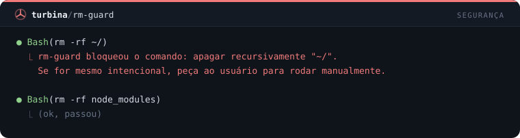

### `env-guard`

Protege arquivos .env contra leitura e escrita (Read, Edit, Write, cat e @menção).

```
/plugin install env-guard@cockpit
```

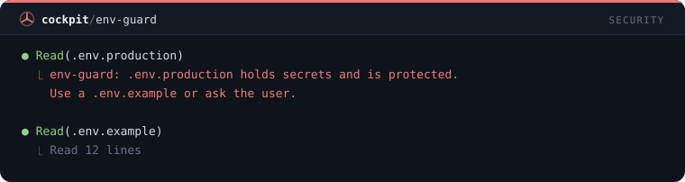

### `git-guard`

Bloqueia git destrutivo: push --force, reset --hard, clean -f, --no-verify, branch -D.

```
/plugin install git-guard@cockpit
```

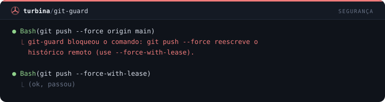

### `secret-scan`

Recusa Write/Edit cujo conteúdo traz chaves de API, tokens ou chaves privadas.

```
/plugin install secret-scan@cockpit
```

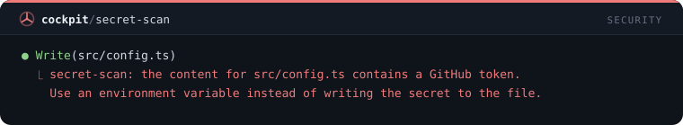

### `prompt-secret-guard`

Barra o envio de prompts que contenham segredos colados por engano.

```
/plugin install prompt-secret-guard@cockpit
```

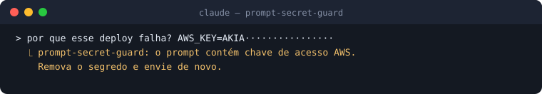

### `lockfile-guard`

Impede edição manual de lockfiles (package-lock, yarn.lock, pnpm-lock, Cargo.lock...).

```
/plugin install lockfile-guard@cockpit
```

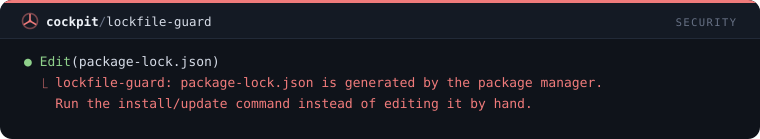

### `path-jail`

Restringe Write/Edit à raiz do projeto, ao temp e a ~/.claude (resolve symlinks).

```
/plugin install path-jail@cockpit
```

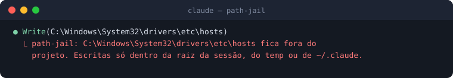

### `main-branch-guard`

Recusa commit, push, merge e rebase quando a branch atual é main/master.

```
/plugin install main-branch-guard@cockpit
```

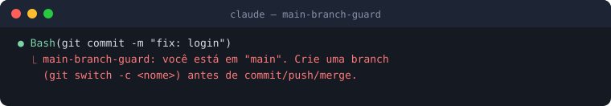

### `generated-guard`

Impede edição em node_modules, dist, build, .next, coverage, .git e afins.

```
/plugin install generated-guard@cockpit
```

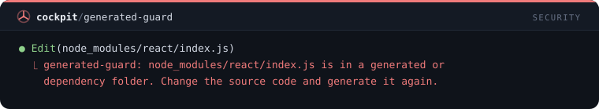

### `sql-guard`

Bloqueia DROP, TRUNCATE e DELETE/UPDATE sem WHERE em comandos de shell.

```
/plugin install sql-guard@cockpit
```

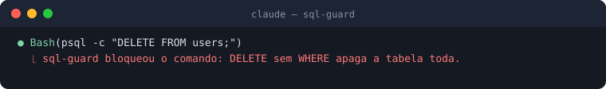

### `prod-guard`

Exige sua confirmação para deploy, publish, terraform apply, kubectl e migrações.

```
/plugin install prod-guard@cockpit
```

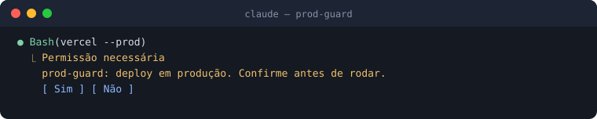

### `install-ask`

Exige sua confirmação sempre que o Claude for instalar uma dependência nova.

```
/plugin install install-ask@cockpit
```

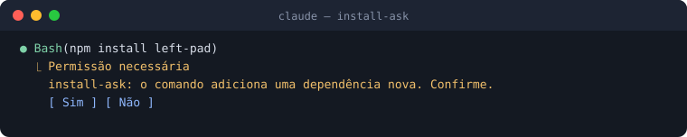

### `pipe-shell-guard`

Bloqueia curl | sh, wget | bash, iwr | iex e variantes.

```
/plugin install pipe-shell-guard@cockpit
```

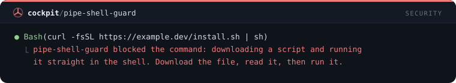

### `big-read-guard`

Recusa ler inteiro um arquivo com mais de 512 KB e pede um recorte.

```
/plugin install big-read-guard@cockpit
```

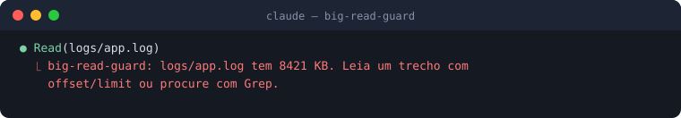

## Interface (8)

### `turn-timer`

Faixa acima do prompt com duração, tools e tokens do último turno.

```
/plugin install turn-timer@cockpit
```


### `tool-tally`

/tally abre um painel com a contagem de chamadas por ferramenta.

```
/plugin install tool-tally@cockpit
```


### `file-trail`

/trail abre um painel com os arquivos lidos e alterados na sessão.

```
/plugin install file-trail@cockpit
```


### `cmd-log`

/cmdlog abre um painel com os comandos de shell, status e duração.

```
/plugin install cmd-log@cockpit
```


### `git-status-line`

Status line com branch, arquivos alterados e commits à frente/atrás.

```
/plugin install git-status-line@cockpit
```


### `context-meter`

Status line com barra de contexto e custo; avisa em 80% e 90%.

```
/plugin install context-meter@cockpit
```


### `rate-limit-watch`

Toast quando a janela de 5h ou 7 dias passa de 75/90/95%; /limits lista o uso.

```
/plugin install rate-limit-watch@cockpit
```


### `session-clock`

Status line com tempo de sessão e número de prompts.

```
/plugin install session-clock@cockpit
```


## Prompt e modelo (8)

### `concise-mode`

/concise liga respostas curtas e diretas, sem introdução nem recapitulação.

```
/plugin install concise-mode@cockpit
```


### `persona`

/persona troca a voz do Claude: mentor, senior, rubberduck, pirata, yoda, zen.

```
/plugin install persona@cockpit
```


### `prompt-shortcuts`

Atalhos ::fix, ::test, ::review, ::explain, ::refactor, ::doc, ::commit viram prompts completos.

```
/plugin install prompt-shortcuts@cockpit
```


### `tldr`

Acrescenta um TL;DR de 2 frases (via haiku) abaixo de respostas longas.

```
/plugin install tldr@cockpit
```


### `git-context`

Anexa o estado do git (branch e arquivos alterados) a cada prompt, como contexto oculto.

```
/plugin install git-context@cockpit
```


### `stack-context`

Detecta a stack do projeto (package.json, pom.xml...) e informa o Claude no system prompt.

```
/plugin install stack-context@cockpit
```


### `commit-style`

Faz o Claude escrever commits em Conventional Commits, curtos e no imperativo.

```
/plugin install commit-style@cockpit
```


### `reply-language`

Faz o Claude responder sempre no idioma definido no hub Cockpit, mantendo código e comandos no original.

```
/plugin install reply-language@cockpit
```


## Comandos (13)

### `quick-notes`

/note e /notes: notas rápidas por projeto, persistentes entre sessões.

```
/plugin install quick-notes@cockpit
```


### `pomodoro`

/pomodoro [min] com contagem na status line, toast e notificação ao final.

```
/plugin install pomodoro@cockpit
```


### `copy-last`

/copy-last copia a última resposta; /copy-code copia o último bloco de código.

```
/plugin install copy-last@cockpit
```


### `session-stats`

/stats resume a sessão: tempo, prompts, tools, tokens, contexto e custo.

```
/plugin install session-stats@cockpit
```


### `quote-selection`

/quote cita no prompt o trecho selecionado com o mouse.

```
/plugin install quote-selection@cockpit
```


### `git-peek`

/gs, /gl e /gd: status, log e diff do git na hora, sem gastar turno do modelo.

```
/plugin install git-peek@cockpit
```


### `git-branch`

/gb lista as branches locais com a atual marcada, ou troca para uma branch e a cria se não existir.

```
/plugin install git-branch@cockpit
```


### `git-stash`

/gst guarda a árvore de trabalho com uma mensagem, aplica o último stash após perguntar, ou lista os stashes.

```
/plugin install git-stash@cockpit
```


### `git-undo`

/gundo mostra o último commit e, após confirmar, desfaz com soft reset; recusa um commit já enviado.

```
/plugin install git-undo@cockpit
```


### `run-script`

/run executa um script do package.json com o gerenciador de pacotes do projeto e mostra o código de saída e as últimas linhas.

```
/plugin install run-script@cockpit
```


### `open-path`

/open abre um arquivo ou pasta do projeto no app padrão do sistema; recusa caminhos fora do projeto.

```
/plugin install open-path@cockpit
```


### `ports`

/ports sonda as portas de desenvolvimento comuns no localhost e lista quais respondem.

```
/plugin install ports@cockpit
```


### `kill-port`

/killport encontra o processo que escuta numa porta, mostra o nome e o encerra após confirmar.

```
/plugin install kill-port@cockpit
```


## Foco e notificações (3)

### `turn-notify`

Notificação nativa quando um turno de 30s ou mais termina.

```
/plugin install turn-notify@cockpit
```


### `break-reminder`

Toast a cada 50 minutos de sessão lembrando de fazer uma pausa.

```
/plugin install break-reminder@cockpit
```


### `daily-streak`

Conta seus dias seguidos de Claude Code; toast ao abrir e comando /streak.

```
/plugin install daily-streak@cockpit
```


## Linguagem visual

Todo painel é desenhado do mesmo jeito, para que vários juntos leiam como um instrumento só:

- **Linha de instrumento:** trilho colorido, rótulo de largura fixa e valores. Empilhadas, as faixas alinham em colunas.
- **Um matiz por assunto** no trilho: Git, Sessão, Projeto e Dia a dia. Verde, âmbar e vermelho ficam reservados para o estado de um valor.
- **Medidores de linha fina** (`━━━━───`) no lugar de barras de bloco.
- **Status line curta e em minúsculas:** `rótulo estado detalhe`, como `testes ✓ 14:32 · 3.1s`.
- As cores vêm do tema do seu Claude Code. O desenho vive em `kit/kit.tsx`, copiado para cada mod no build.

## Conjuntos sugeridos

| Para | Mods |
| --- | --- |
| **Painel do dia a dia** | `git-band` `usage-band` `todo-band` `error-band` `test-status` |
| **Git sem surpresa** | `git-band` `conflict-band` `uncommitted-band` `main-warning-band` `pr-status` `ci-status` |
| **De olho no gasto** | `usage-band` `cost-ticker` `spend-today` `reset-countdown` `compact-nudge` |
| **Cinto de segurança** | `rm-guard` `git-guard` `env-guard` `secret-scan` `pipe-shell-guard` `prod-guard` `shield-band` |
| **Menos digitação** | `stack-context` `git-context` `commit-style` `prompt-shortcuts` `git-peek` |
| **Foco** | `focus-band` `deadline-band` `pin-band` `turn-notify` `break-reminder` |

## Antes de instalar

- **Mods não são sandboxed.** Rodam com o mesmo alcance do Claude Code. Leia o `hooks/register.ts` do mod antes de instalar; todos aqui são curtos.
- **Guards são cinto de segurança, não cofre.** Casam formatos conhecidos de comandos e caminhos: um comando ofuscado pode passar, e um caminho legítimo pode ser recusado. Mantenha as permissões do Claude Code configuradas.
- **Alguns guards perguntam em vez de bloquear.** `prod-guard`, `install-ask` e os outros que dizem isso forçam o pedido de confirmação mesmo quando o comando já estava liberado.
- **Alguns mods chamam um modelo** e gastam tokens; a descrição deles avisa.
- **Alguns painéis usam rede** e ficam ocultos quando não há resposta: `dolar-status` (AwesomeAPI), `weather-status` (wttr.in, localiza por IP), `api-status` (página de status da Anthropic), `ports-band` (só `localhost`).
- **`ci-status` e `pr-status` precisam do `gh` autenticado.**
- **Os painéis de Git consultam o repositório** a cada 30 a 60 segundos.
- **Sem som.** Nesta versão o `$.audio.play` só toca no macOS, então as notificações usam o canal nativo.
- A API de mods é **early access** e pode mudar entre versões do Claude Code.

## Desenvolvimento

```bash
npm install
npm run build              # manifests, lista de painéis do hub, prévias e os três READMEs
npm run check              # tsc + claude plugin validate em cada mod + claude plugin test onde há testes
node scripts/mod.mjs <mod> # o mesmo ciclo para um mod, sem tocar nos arquivos compartilhados
```

`mods.json` é a fonte única: nome, categoria, descrições nos três idiomas e as linhas da prévia de cada mod.

```
mods/<nome>/
  hooks/register.ts(x)   o mod
  hooks/strings.ts       todo texto voltado ao usuário, em en, pt e es
  types/index.d.ts       o contrato de $.state, nos mods que desenham
  tests/                 rodados pelo `claude plugin test`
```

`plugin.json`, `hooks.json` e a cópia do kit em cada mod são gerados.

**Criando mods com o agente.** O repositório traz um agente do Claude Code, `cockpit-mod-builder` (`.claude/agents/`), que conhece as convenções: o padrão de idiomas, o kit visual, as regras do motor que mais derrubam gente e o ciclo de um mod. Abra o Claude Code no repositório e peça por ele pelo nome, passando a categoria e os mods que você quer.

O type-check usa as declarações da API que o próprio Claude Code escreve. Elas não vão no repositório: rode um mod com `claude --plugin-dir mods/<nome>` e copie `mods/<nome>/.claude-plugin/types/claude-code/index.d.ts` e `claude-code-tools/index.d.ts` para `engine-types/`.

## O ecossistema de mods

Levantamento de 13/10/2026 via `gh api` e documentação oficial. As estrelas são daquele dia.

- Anúncio: [claude.com/blog/claude-code-mods](https://claude.com/blog/claude-code-mods)
- Documentação: [code.claude.com/docs/en/plugins/mods/overview](https://code.claude.com/docs/en/plugins/mods/overview)
- Mods embutidos: [anthropics/claude-code/mods](https://github.com/anthropics/claude-code/tree/main/mods)
- Exemplos oficiais: [anthropics/claude-code-playground](https://github.com/anthropics/claude-code-playground/tree/main/claude-code/mods)

| Coleção da comunidade | Estrelas | Conhecida por |
| --- | --- | --- |
| [karanb192/awesome-claude-code-mods](https://github.com/karanb192/awesome-claude-code-mods) | 560 | Catálogo de 3.836 mods em 1.987 repositórios |
| [YeonwooSung/my-claude-code-mods](https://github.com/YeonwooSung/my-claude-code-mods) | 514 | agent-profiler, context-inspector, time-machine |
| [hamzafer/claude-code-mods](https://github.com/hamzafer/claude-code-mods) | 227 | context-bar, blast-radius, merge-gate |
| [zenbu-labs/terminal-browser](https://github.com/zenbu-labs/terminal-browser) | 3.854 | Navegador dentro do terminal |
| [jarrodwatts/claude-image-view](https://github.com/jarrodwatts/claude-image-view) | 222 | Imagens no terminal |

Outras formas de customizar o Claude Code, que não são mods: [claude-hud](https://github.com/jarrodwatts/claude-hud) e [ccstatusline](https://github.com/sirmalloc/ccstatusline) (scripts de status line), [ccusage](https://github.com/ccusage/ccusage) (CLI sobre os transcripts), [tweakcc](https://github.com/Piebald-AI/tweakcc) (patch da instalação), [cc-safety-net](https://github.com/kenryu42/cc-safety-net) (hook PreToolUse).

## Licença

MIT
