# Comandos — 31 mods

[← Volver al README](../../README.es.md)

[`quick-notes`](#quick-notes) · [`pomodoro`](#pomodoro) · [`copy-last`](#copy-last) · [`session-stats`](#session-stats) · [`quote-selection`](#quote-selection) · [`git-peek`](#git-peek) · [`git-branch`](#git-branch) · [`git-stash`](#git-stash) · [`git-undo`](#git-undo) · [`run-script`](#run-script) · [`open-path`](#open-path) · [`ports`](#ports) · [`kill-port`](#kill-port) · [`tree`](#tree) · [`find-file`](#find-file) · [`last-error`](#last-error) · [`env-check`](#env-check) · [`outdated`](#outdated) · [`json-tool`](#json-tool) · [`uuid`](#uuid) · [`timestamp`](#timestamp) · [`base64`](#base64) · [`hash`](#hash) · [`calc`](#calc) · [`color-tool`](#color-tool) · [`regex-test`](#regex-test) · [`http-probe`](#http-probe) · [`snippets`](#snippets) · [`export-session`](#export-session) · [`standup`](#standup) · [`loc-count`](#loc-count)

## `quick-notes`

/note y /notes: notas rápidas por proyecto, que se conservan entre sesiones.

```
/plugin install quick-notes@cockpit
```

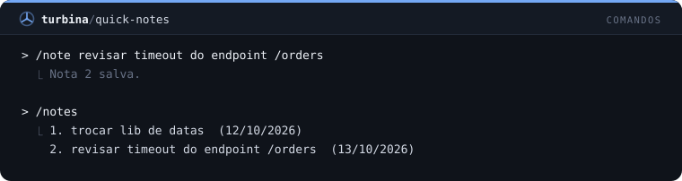

## `pomodoro`

/pomodoro [min] con cuenta atrás en la status line, toast y notificación al final.

```
/plugin install pomodoro@cockpit
```

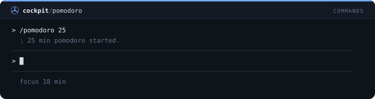

## `copy-last`

/copy-last copia la última respuesta; /copy-code copia el último bloque de código.

```
/plugin install copy-last@cockpit
```

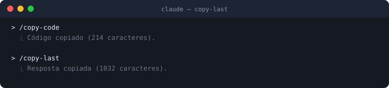

## `session-stats`

/stats resume la sesión: tiempo, prompts, tools, tokens, contexto y coste.

```
/plugin install session-stats@cockpit
```

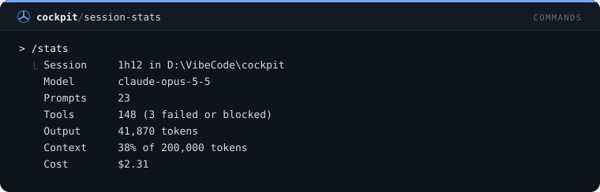

## `quote-selection`

/quote cita en el prompt el fragmento seleccionado con el ratón.

```
/plugin install quote-selection@cockpit
```

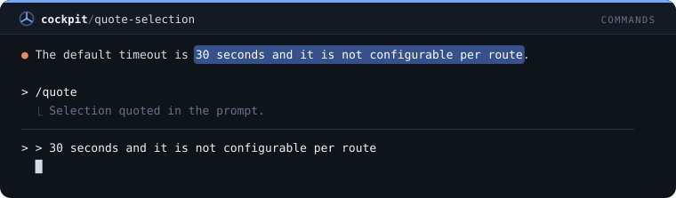

## `git-peek`

/gs, /gl y /gd: status, log y diff de git al instante, sin gastar un turno del modelo.

```
/plugin install git-peek@cockpit
```

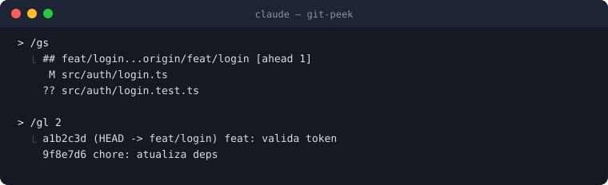

## `git-branch`

/gb lista las ramas locales con la actual marcada, o cambia a una rama y la crea si no existe.

```
/plugin install git-branch@cockpit
```

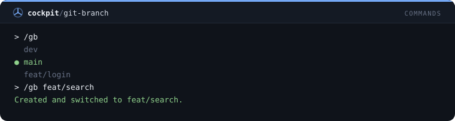

## `git-stash`

/gst guarda el árbol de trabajo con un mensaje, aplica el último stash tras preguntar, o lista los stashes.

```
/plugin install git-stash@cockpit
```

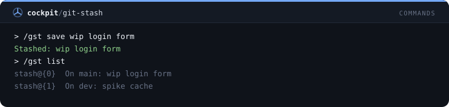

## `git-undo`

/gundo muestra el último commit y, tras confirmar, lo deshace con soft reset; rechaza un commit ya enviado.

```
/plugin install git-undo@cockpit
```

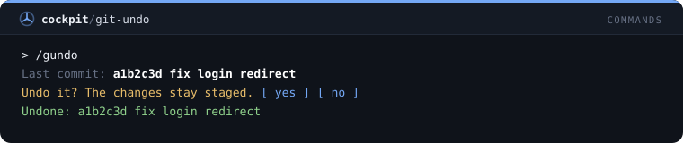

## `run-script`

/run ejecuta un script del package.json con el gestor de paquetes del proyecto y muestra el código de salida y las últimas líneas.

```
/plugin install run-script@cockpit
```

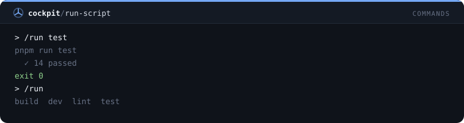

## `open-path`

/open abre un archivo o carpeta del proyecto en la app predeterminada del sistema; rechaza rutas fuera del proyecto.

```
/plugin install open-path@cockpit
```

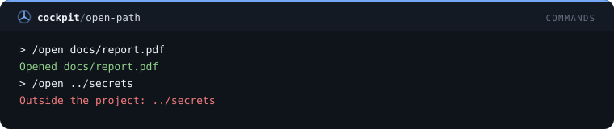

## `ports`

/ports sondea los puertos de desarrollo comunes en localhost y lista cuáles responden.

```
/plugin install ports@cockpit
```

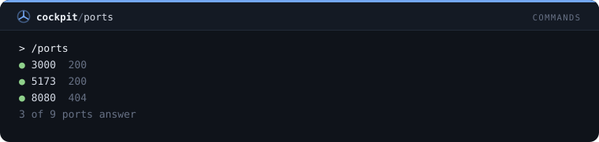

## `kill-port`

/killport encuentra el proceso que escucha en un puerto, muestra su nombre y lo termina tras confirmar.

```
/plugin install kill-port@cockpit
```

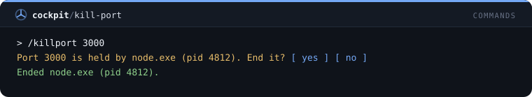

## `tree`

/tree muestra el árbol de directorios del proyecto en dos niveles, sin node_modules, .git, salidas de build ni carpetas con punto.

```
/plugin install tree@cockpit
```

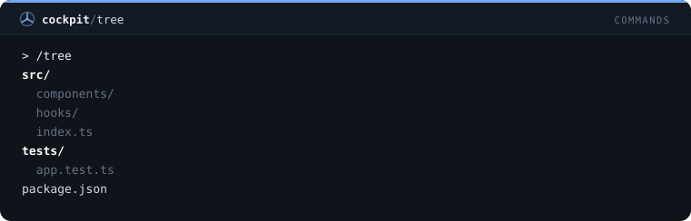

## `find-file`

/ff lista los archivos versionados cuya ruta contiene un texto, los mejores resultados primero.

```
/plugin install find-file@cockpit
```

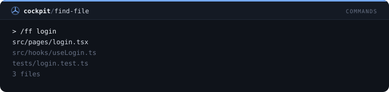

## `last-error`

/lasterr recuerda el último comando de shell que falló en esta sesión y el final de su salida.

```
/plugin install last-error@cockpit
```

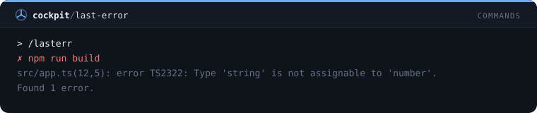

## `env-check`

/envcheck compara las claves de .env.example con .env y lista las que faltan y las sobrantes, nunca un valor.

```
/plugin install env-check@cockpit
```

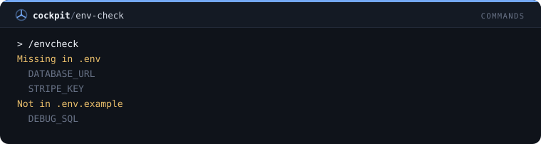

## `outdated`

/outdated muestra npm outdated como tabla alineada y cuenta los saltos de versión mayor.

```
/plugin install outdated@cockpit
```

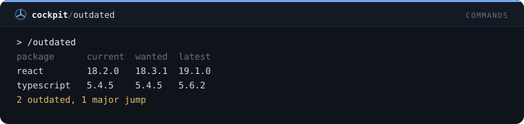

## `json-tool`

/json valida y formatea JSON, e indica la línea y la columna de un error de sintaxis.

```
/plugin install json-tool@cockpit
```

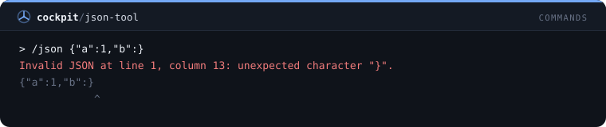

## `uuid`

/uuid genera hasta 20 UUID aleatorios y los copia al portapapeles.

```
/plugin install uuid@cockpit
```

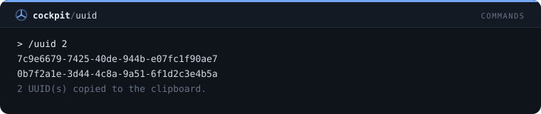

## `timestamp`

/ts convierte epoch en segundos, milisegundos, ISO 8601 y hora local, de ahora o de cualquier epoch o fecha.

```
/plugin install timestamp@cockpit
```

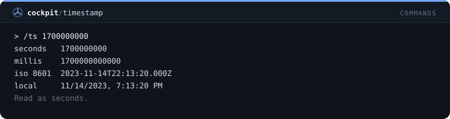

## `base64`

/b64 codifica y decodifica Base64 de forma segura para texto UTF-8 y copia el resultado.

```
/plugin install base64@cockpit
```

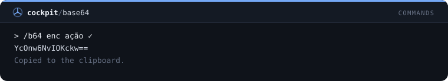

## `hash`

/hash da el SHA-256 y el SHA-1 de un texto en hexadecimal y copia el SHA-256.

```
/plugin install hash@cockpit
```

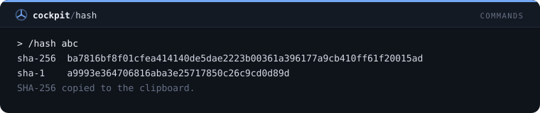

## `calc`

/calc calcula aritmética con paréntesis y decimales, e indica qué falla en una expresión inválida.

```
/plugin install calc@cockpit
```

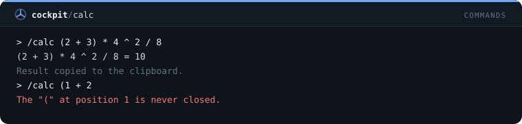

## `color-tool`

/color convierte un color entre hex, rgb y hsl e informa su contraste WCAG sobre blanco y negro.

```
/plugin install color-tool@cockpit
```

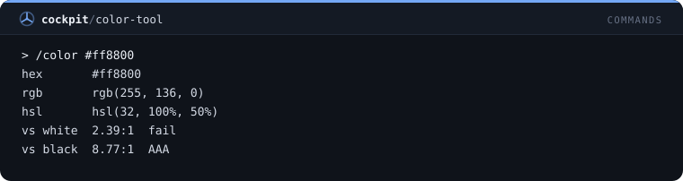

## `regex-test`

/re prueba una expresión regular en un texto y lista cada coincidencia con su posición y grupos de captura.

```
/plugin install regex-test@cockpit
```

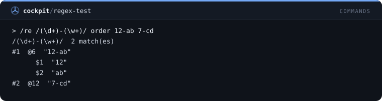

## `http-probe`

/http hace una solicitud GET y muestra estado, tipo de contenido, tamaño y las primeras líneas del cuerpo.

```
/plugin install http-probe@cockpit
```

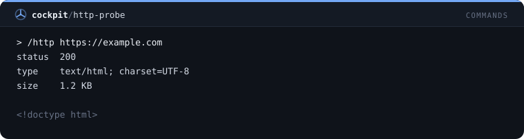

## `snippets`

/snip guarda fragmentos de prompt reutilizables entre sesiones y pone uno en la caja del prompt por nombre.

```
/plugin install snippets@cockpit
```

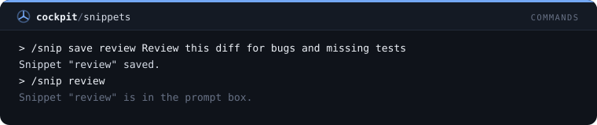

## `export-session`

/save-session guarda la conversación hasta ahora en Markdown en .claude-exports del proyecto.

```
/plugin install export-session@cockpit
```

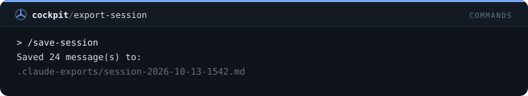

## `standup`

/standup lista tus commits desde ayer por la mañana en este repositorio, agrupados por día y listos para pegar.

```
/plugin install standup@cockpit
```

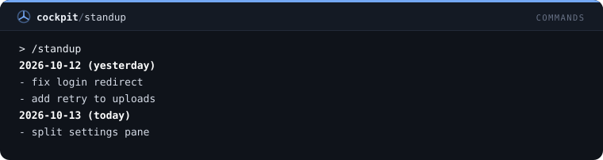

## `loc-count`

/loc cuenta líneas de código por tipo de archivo en el proyecto o en una ruta, con el total.

```
/plugin install loc-count@cockpit
```

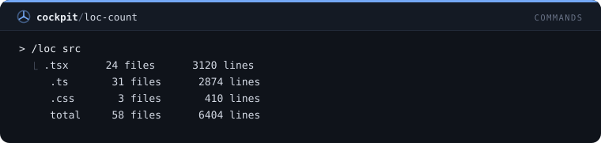
