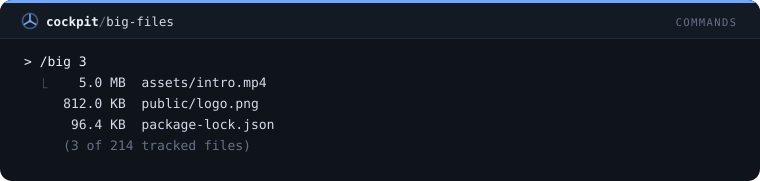
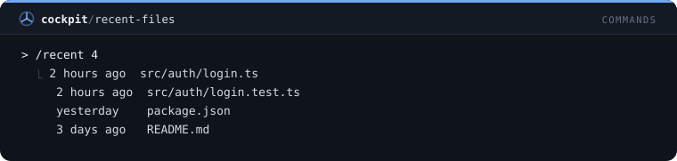
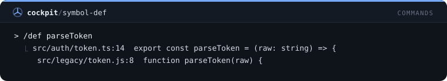
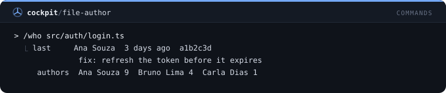
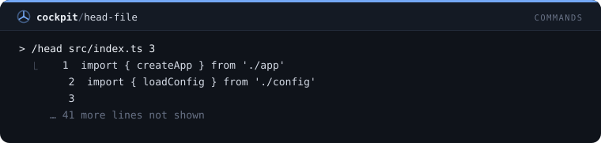
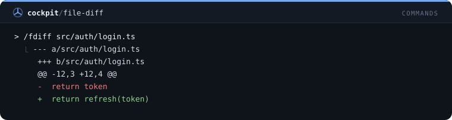

# Comandos — 37 mods

[← Voltar ao README](../../README.pt-BR.md)

[`quick-notes`](#quick-notes) · [`pomodoro`](#pomodoro) · [`copy-last`](#copy-last) · [`session-stats`](#session-stats) · [`quote-selection`](#quote-selection) · [`git-peek`](#git-peek) · [`git-branch`](#git-branch) · [`git-stash`](#git-stash) · [`git-undo`](#git-undo) · [`run-script`](#run-script) · [`open-path`](#open-path) · [`ports`](#ports) · [`kill-port`](#kill-port) · [`tree`](#tree) · [`find-file`](#find-file) · [`last-error`](#last-error) · [`env-check`](#env-check) · [`outdated`](#outdated) · [`json-tool`](#json-tool) · [`uuid`](#uuid) · [`timestamp`](#timestamp) · [`base64`](#base64) · [`hash`](#hash) · [`calc`](#calc) · [`color-tool`](#color-tool) · [`regex-test`](#regex-test) · [`http-probe`](#http-probe) · [`snippets`](#snippets) · [`export-session`](#export-session) · [`standup`](#standup) · [`loc-count`](#loc-count) · [`big-files`](#big-files) · [`recent-files`](#recent-files) · [`symbol-def`](#symbol-def) · [`file-author`](#file-author) · [`head-file`](#head-file) · [`file-diff`](#file-diff)

## `quick-notes`

/note e /notes: notas rápidas por projeto, persistentes entre sessões.

```
/plugin install quick-notes@cockpit
```


## `pomodoro`

/pomodoro [min] com contagem na status line, toast e notificação ao final.

```
/plugin install pomodoro@cockpit
```


## `copy-last`

/copy-last copia a última resposta; /copy-code copia o último bloco de código.

```
/plugin install copy-last@cockpit
```


## `session-stats`

/stats resume a sessão: tempo, prompts, tools, tokens, contexto e custo.

```
/plugin install session-stats@cockpit
```


## `quote-selection`

/quote cita no prompt o trecho selecionado com o mouse.

```
/plugin install quote-selection@cockpit
```


## `git-peek`

/gs, /gl e /gd: status, log e diff do git na hora, sem gastar turno do modelo.

```
/plugin install git-peek@cockpit
```


## `git-branch`

/gb lista as branches locais com a atual marcada, ou troca para uma branch e a cria se não existir.

```
/plugin install git-branch@cockpit
```


## `git-stash`

/gst guarda a árvore de trabalho com uma mensagem, aplica o último stash após perguntar, ou lista os stashes.

```
/plugin install git-stash@cockpit
```


## `git-undo`

/gundo mostra o último commit e, após confirmar, desfaz com soft reset; recusa um commit já enviado.

```
/plugin install git-undo@cockpit
```


## `run-script`

/run executa um script do package.json com o gerenciador de pacotes do projeto e mostra o código de saída e as últimas linhas.

```
/plugin install run-script@cockpit
```


## `open-path`

/open abre um arquivo ou pasta do projeto no app padrão do sistema; recusa caminhos fora do projeto.

```
/plugin install open-path@cockpit
```


## `ports`

/ports sonda as portas de desenvolvimento comuns no localhost e lista quais respondem.

```
/plugin install ports@cockpit
```


## `kill-port`

/killport encontra o processo que escuta numa porta, mostra o nome e o encerra após confirmar.

```
/plugin install kill-port@cockpit
```


## `tree`

/tree mostra a árvore de diretórios do projeto em dois níveis, sem node_modules, .git, saídas de build e pastas com ponto.

```
/plugin install tree@cockpit
```


## `find-file`

/ff lista os arquivos versionados cujo caminho contém um texto, os melhores resultados primeiro.

```
/plugin install find-file@cockpit
```


## `last-error`

/lasterr lembra o último comando de shell que falhou nesta sessão e o final da sua saída.

```
/plugin install last-error@cockpit
```


## `env-check`

/envcheck compara as chaves do .env.example com o .env e lista as que faltam e as extras, nunca um valor.

```
/plugin install env-check@cockpit
```


## `outdated`

/outdated mostra o npm outdated como tabela alinhada e conta os saltos de versão maior.

```
/plugin install outdated@cockpit
```


## `json-tool`

/json valida e formata JSON, e diz a linha e a coluna de um erro de sintaxe.

```
/plugin install json-tool@cockpit
```


## `uuid`

/uuid gera até 20 UUIDs aleatórios e copia para a área de transferência.

```
/plugin install uuid@cockpit
```


## `timestamp`

/ts converte epoch em segundos, milissegundos, ISO 8601 e hora local, de agora ou de qualquer epoch ou data.

```
/plugin install timestamp@cockpit
```


## `base64`

/b64 codifica e decodifica Base64 com segurança para texto UTF-8 e copia o resultado.

```
/plugin install base64@cockpit
```


## `hash`

/hash dá o SHA-256 e o SHA-1 de um texto em hexadecimal e copia o SHA-256.

```
/plugin install hash@cockpit
```


## `calc`

/calc calcula aritmética com parênteses e decimais, e diz o que há de errado numa expressão inválida.

```
/plugin install calc@cockpit
```


## `color-tool`

/color converte uma cor entre hex, rgb e hsl e informa o contraste WCAG sobre branco e preto.

```
/plugin install color-tool@cockpit
```


## `regex-test`

/re testa uma expressão regular num texto e lista cada ocorrência com posição e grupos de captura.

```
/plugin install regex-test@cockpit
```


## `http-probe`

/http faz uma requisição GET e mostra status, tipo de conteúdo, tamanho e as primeiras linhas do corpo.

```
/plugin install http-probe@cockpit
```


## `snippets`

/snip guarda trechos de prompt reutilizáveis entre sessões e coloca um na caixa do prompt pelo nome.

```
/plugin install snippets@cockpit
```


## `export-session`

/save-session grava a conversa até agora em Markdown em .claude-exports no projeto.

```
/plugin install export-session@cockpit
```


## `standup`

/standup lista seus commits desde ontem de manhã neste repositório, agrupados por dia e prontos para colar.

```
/plugin install standup@cockpit
```


## `loc-count`

/loc conta linhas de código por tipo de arquivo no projeto ou em um caminho, com o total.

```
/plugin install loc-count@cockpit
```


## `big-files`

/big lista os maiores arquivos versionados do projeto com tamanhos legíveis.

```
/plugin install big-files@cockpit
```



## `recent-files`

/recent lista os arquivos alterados mais recentemente, com quando, nos últimos 100 commits.

```
/plugin install recent-files@cockpit
```



## `symbol-def`

/def acha onde uma função, classe, tipo ou variável é definida nos arquivos versionados.

```
/plugin install symbol-def@cockpit
```



## `file-author`

/who mostra quem mexeu por último em um arquivo ou pasta, quando, e quem mais o alterou.

```
/plugin install file-author@cockpit
```



## `head-file`

/head mostra as primeiras linhas numeradas de um arquivo do projeto, e nunca exibe arquivos com segredos.

```
/plugin install head-file@cockpit
```



## `file-diff`

/fdiff mostra o que mudou em um arquivo desde o último commit, sem exibir arquivos com segredos.

```
/plugin install file-diff@cockpit
```


