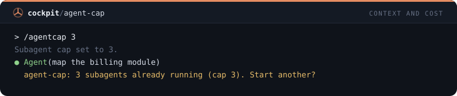
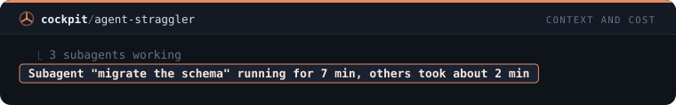
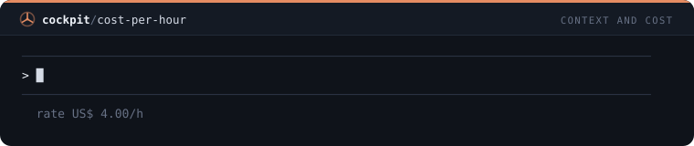

# Context and cost — 15 mods

[← Back to the README](../../README.md)

[`reread-guard`](#reread-guard) · [`grep-limit`](#grep-limit) · [`read-cap`](#read-cap) · [`git-log-limit`](#git-log-limit) · [`paste-size-toast`](#paste-size-toast) · [`cat-guard`](#cat-guard) · [`explore-nudge`](#explore-nudge) · [`fill-toast`](#fill-toast) · [`cache-cold-toast`](#cache-cold-toast) · [`flood-note`](#flood-note) · [`heavy-calls`](#heavy-calls) · [`tree-flood-guard`](#tree-flood-guard) · [`agent-cap`](#agent-cap) · [`agent-straggler`](#agent-straggler) · [`cost-per-hour`](#cost-per-hour)

## `reread-guard`

Refuses reading again a file Claude already read this session when it has not changed, once, with a reason.

```
/plugin install reread-guard@cockpit
```


## `grep-limit`

Caps a Grep that prints matching lines at 100 lines and tells Claude when the cap cut the answer.

```
/plugin install grep-limit@cockpit
```


## `read-cap`

Reads only the first 600 lines of a file over 150 KB and tells Claude how to continue with offset.

```
/plugin install read-cap@cockpit
```


## `git-log-limit`

Adds -n 30 to a git log that has no limit, so the history does not flood the context.

```
/plugin install git-log-limit@cockpit
```


## `paste-size-toast`

A toast when the prompt you send is very large, with its size in lines and tokens, so you can trim a pasted log.

```
/plugin install paste-size-toast@cockpit
```


## `cat-guard`

Refuses cat, type and Get-Content on a file over 100 KB and points to a slice or Grep.

```
/plugin install cat-guard@cockpit
```


## `explore-nudge`

After 15 reads and searches in one turn, a toast and a note to Claude to hand the rest of the exploring to a subagent.

```
/plugin install explore-nudge@cockpit
```


## `fill-toast`

A toast when the context window jumps 10 points or more in one step, naming the last tool that ran.

```
/plugin install fill-toast@cockpit
```


## `cache-cold-toast`

A toast when you send a prompt after the 5 minute prompt-cache window expired on a large context.

```
/plugin install cache-cold-toast@cockpit
```


## `flood-note`

Tells Claude when a search or command returned over 300 lines, so it narrows the next one instead of repeating it.

```
/plugin install flood-note@cockpit
```


## `heavy-calls`

/heavy lists the five tool results that took the most context this session, with tool, target and size.

```
/plugin install heavy-calls@cockpit
```


## `tree-flood-guard`

Refuses an unfiltered find, ls -R or dir /s that would list node_modules, and suggests git ls-files or Glob.

```
/plugin install tree-flood-guard@cockpit
```


## `agent-cap`

/agentcap <n> caps how many subagents run at once and asks before each one past the cap.

```
/plugin install agent-cap@cockpit
```



## `agent-straggler`

A toast when a subagent has been running more than three times as long as the ones that finished.

```
/plugin install agent-straggler@cockpit
```



## `cost-per-hour`

Status line with what the session costs per hour at its pace so far.

```
/plugin install cost-per-hour@cockpit
```


