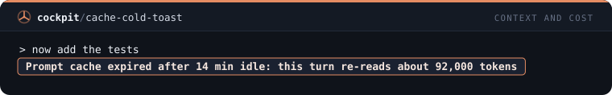

# Context and cost — 9 mods

[← Back to the README](../../README.md)

[`reread-guard`](#reread-guard) · [`grep-limit`](#grep-limit) · [`read-cap`](#read-cap) · [`git-log-limit`](#git-log-limit) · [`paste-size-toast`](#paste-size-toast) · [`cat-guard`](#cat-guard) · [`explore-nudge`](#explore-nudge) · [`fill-toast`](#fill-toast) · [`cache-cold-toast`](#cache-cold-toast)

## `reread-guard`

Refuses reading again a file Claude already read this session when it has not changed, once, with a reason.

```
/plugin install reread-guard@cockpit
```


## `grep-limit`

Caps a Grep that prints matching lines at 100 lines and tells Claude when the cap cut the answer.

```
/plugin install grep-limit@cockpit
```


## `read-cap`

Reads only the first 600 lines of a file over 150 KB and tells Claude how to continue with offset.

```
/plugin install read-cap@cockpit
```


## `git-log-limit`

Adds -n 30 to a git log that has no limit, so the history does not flood the context.

```
/plugin install git-log-limit@cockpit
```


## `paste-size-toast`

A toast when the prompt you send is very large, with its size in lines and tokens, so you can trim a pasted log.

```
/plugin install paste-size-toast@cockpit
```


## `cat-guard`

Refuses cat, type and Get-Content on a file over 100 KB and points to a slice or Grep.

```
/plugin install cat-guard@cockpit
```


## `explore-nudge`

After 15 reads and searches in one turn, a toast and a note to Claude to hand the rest of the exploring to a subagent.

```
/plugin install explore-nudge@cockpit
```


## `fill-toast`

A toast when the context window jumps 10 points or more in one step, naming the last tool that ran.

```
/plugin install fill-toast@cockpit
```


## `cache-cold-toast`

A toast when you send a prompt after the 5 minute prompt-cache window expired on a large context.

```
/plugin install cache-cold-toast@cockpit
```


