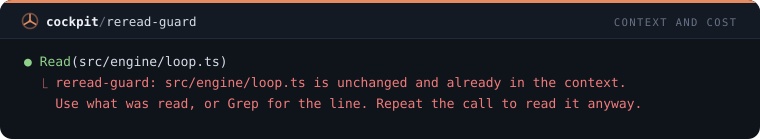
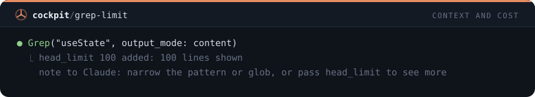
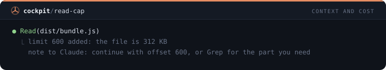
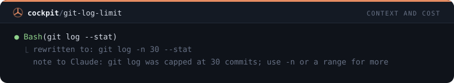
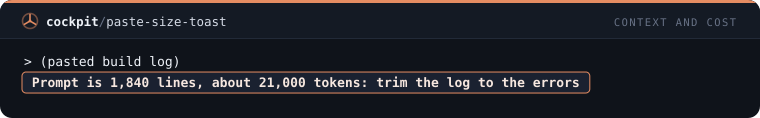
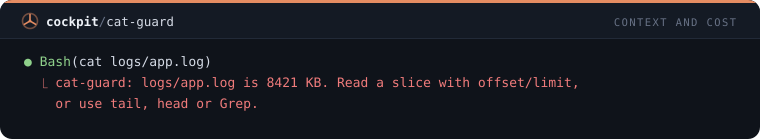
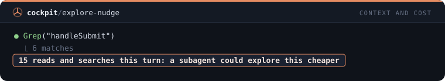
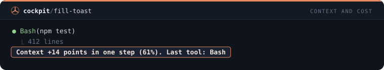

# Contexto e custo — 8 mods

[← Voltar ao README](../../README.pt-BR.md)

[`reread-guard`](#reread-guard) · [`grep-limit`](#grep-limit) · [`read-cap`](#read-cap) · [`git-log-limit`](#git-log-limit) · [`paste-size-toast`](#paste-size-toast) · [`cat-guard`](#cat-guard) · [`explore-nudge`](#explore-nudge) · [`fill-toast`](#fill-toast)

## `reread-guard`

Recusa reler um arquivo que Claude já leu na sessão e que não mudou, uma vez, com o motivo.

```
/plugin install reread-guard@cockpit
```



## `grep-limit`

Limita a 100 linhas um Grep que imprime as linhas encontradas e avisa Claude quando o limite cortou a resposta.

```
/plugin install grep-limit@cockpit
```



## `read-cap`

Lê só as primeiras 600 linhas de um arquivo com mais de 150 KB e diz a Claude como continuar com offset.

```
/plugin install read-cap@cockpit
```



## `git-log-limit`

Acrescenta -n 30 a um git log sem limite, para o histórico não inundar o contexto.

```
/plugin install git-log-limit@cockpit
```



## `paste-size-toast`

Um toast quando o prompt enviado é muito grande, com o tamanho em linhas e tokens, para você enxugar um log colado.

```
/plugin install paste-size-toast@cockpit
```



## `cat-guard`

Recusa cat, type e Get-Content em um arquivo com mais de 100 KB e aponta um trecho ou o Grep.

```
/plugin install cat-guard@cockpit
```



## `explore-nudge`

Depois de 15 leituras e buscas em um turno, um toast e uma nota para Claude passar o resto da exploração a um subagente.

```
/plugin install explore-nudge@cockpit
```



## `fill-toast`

Um toast quando a janela de contexto sobe 10 pontos ou mais de uma vez, com o nome da última ferramenta usada.

```
/plugin install fill-toast@cockpit
```


