# Foco y notificaciones — 26 mods

[← Volver al README](../../README.es.md)

[`turn-notify`](#turn-notify) · [`break-reminder`](#break-reminder) · [`daily-streak`](#daily-streak) · [`error-notify`](#error-notify) · [`needs-you-notify`](#needs-you-notify) · [`agent-done-notify`](#agent-done-notify) · [`long-cmd-notify`](#long-cmd-notify) · [`tests-notify`](#tests-notify) · [`ci-notify`](#ci-notify) · [`pr-review-notify`](#pr-review-notify) · [`rate-limit-notify`](#rate-limit-notify) · [`hydrate`](#hydrate) · [`posture`](#posture) · [`eye-rest`](#eye-rest) · [`stand-up`](#stand-up) · [`alarms`](#alarms) · [`remind`](#remind) · [`timebox`](#timebox) · [`session-cap`](#session-cap) · [`late-night`](#late-night) · [`intent-check`](#intent-check) · [`daily-target`](#daily-target) · [`weekly-recap`](#weekly-recap) · [`breathe`](#breathe) · [`budget-alert`](#budget-alert) · [`daily-budget-alert`](#daily-budget-alert)

## `turn-notify`

Notificación nativa cuando termina un turno de 30s o más.

```
/plugin install turn-notify@cockpit
```


## `break-reminder`

Un toast cada 50 minutos de sesión que te recuerda hacer una pausa.

```
/plugin install break-reminder@cockpit
```


## `daily-streak`

Cuenta tus días seguidos con Claude Code; un toast al abrir y el comando /streak.

```
/plugin install daily-streak@cockpit
```


## `error-notify`

Envía una notificación nativa cuando un turno termina en error o rechazo.

```
/plugin install error-notify@cockpit
```

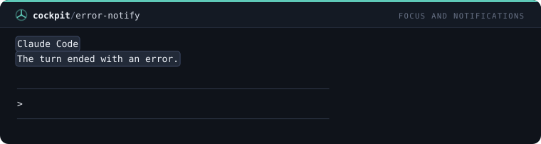

## `needs-you-notify`

Envía una notificación nativa cuando Claude se detiene a preguntarte algo o a pedir permiso.

```
/plugin install needs-you-notify@cockpit
```

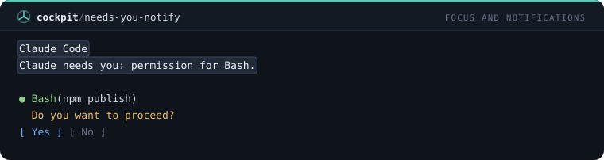

## `agent-done-notify`

Envía una notificación nativa cuando termina un subagente que corrió 30 segundos o más.

```
/plugin install agent-done-notify@cockpit
```

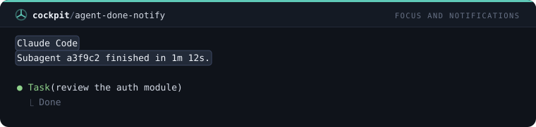

## `long-cmd-notify`

Envía una notificación nativa cuando termina un comando de shell que corrió dos minutos o más.

```
/plugin install long-cmd-notify@cockpit
```

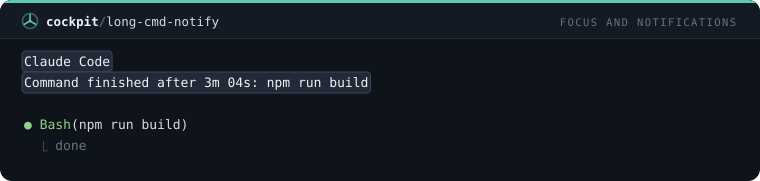

## `tests-notify`

Envía una notificación nativa con aprobado o fallido cuando termina una ejecución de tests de 30 segundos o más.

```
/plugin install tests-notify@cockpit
```

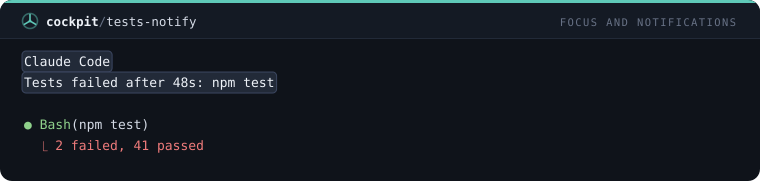

## `ci-notify`

Consulta GitHub Actions cada dos minutos y avisa una vez cuando termina un workflow en curso.

```
/plugin install ci-notify@cockpit
```

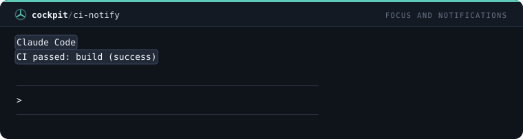

## `pr-review-notify`

Consulta el pull request de la rama actual cada tres minutos y avisa una vez cuando cambia la decisión de revisión.

```
/plugin install pr-review-notify@cockpit
```

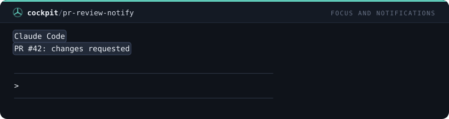

## `rate-limit-notify`

Envía una notificación nativa la primera vez que una ventana de límite de uso supera el 90%, con la hora del reinicio.

```
/plugin install rate-limit-notify@cockpit
```

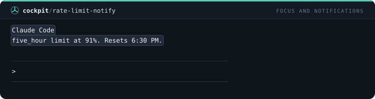

## `hydrate`

Toast cada 60 minutos de uso real recordando beber agua.

```
/plugin install hydrate@cockpit
```


## `posture`

Toast cada 30 minutos de uso con un chequeo breve de postura, rotando entre cuatro.

```
/plugin install posture@cockpit
```

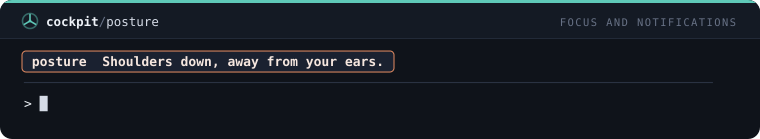

## `eye-rest`

Regla 20-20-20: cada 20 minutos de uso, mira a 6 metros de distancia durante 20 segundos.

```
/plugin install eye-rest@cockpit
```

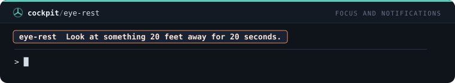

## `stand-up`

Toast tras dos horas de uso sin una pausa de 10 minutos: levántate y camina un poco.

```
/plugin install stand-up@cockpit
```

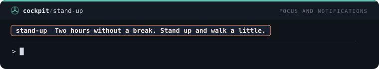

## `alarms`

/alarm crea alarmas diarias a una hora local, conservadas entre sesiones, con toast y notificación.

```
/plugin install alarms@cockpit
```

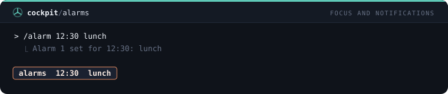

## `remind`

/remind <minutos> <texto> dispara toast y notificación pasado ese tiempo.

```
/plugin install remind@cockpit
```

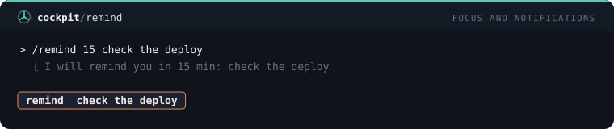

## `timebox`

/timebox <minutos> <qué> cuenta atrás en la línea de estado, avisa al 80% y notifica al final.

```
/plugin install timebox@cockpit
```

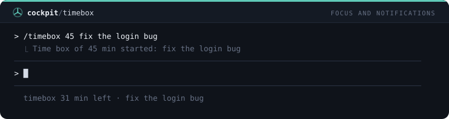

## `session-cap`

Toast tras tres horas de uso continuo en una sesión, y otra vez cada hora.

```
/plugin install session-cap@cockpit
```

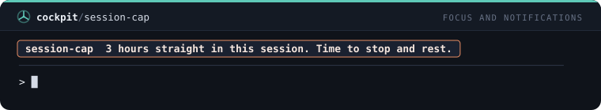

## `late-night`

Un toast por sesión cuando trabajas después de las 23:00 locales: es tarde, deja el trabajo para mañana.

```
/plugin install late-night@cockpit
```

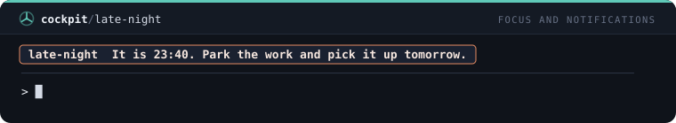

## `intent-check`

/intent dice para qué sirve la sesión; cada 30 minutos de uso un toast pregunta si sigues en ello.

```
/plugin install intent-check@cockpit
```

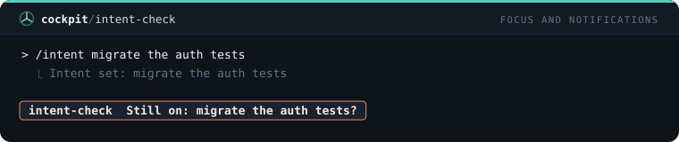

## `daily-target`

/target define una meta diaria de commits en este repositorio; toast a la mitad y al alcanzarla.

```
/plugin install daily-target@cockpit
```

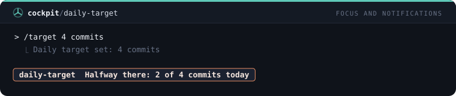

## `weekly-recap`

En la primera sesión de una nueva semana, un toast con los días activos, sesiones y prompts de la semana pasada.

```
/plugin install weekly-recap@cockpit
```

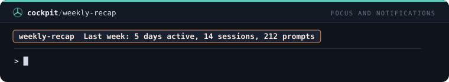

## `breathe`

/breathe guía un minuto de respiración con toasts: inhala 4, sostén 4, exhala 6, cinco rondas.

```
/plugin install breathe@cockpit
```

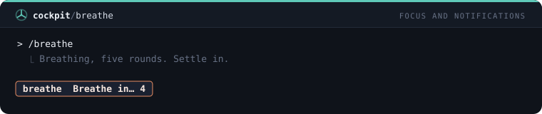

## `budget-alert`

/budget <usd> fija un presupuesto de la sesión: un aviso al 80% y una notificación nativa cuando el costo lo supera.

```
/plugin install budget-alert@cockpit
```

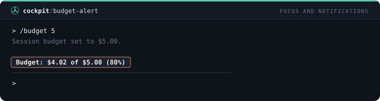

## `daily-budget-alert`

/daybudget <usd> fija un presupuesto del día sumando las sesiones y avisa una vez cuando el total del día lo supera.

```
/plugin install daily-budget-alert@cockpit
```

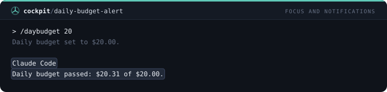
