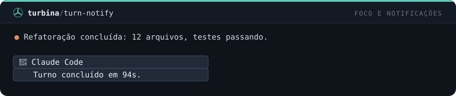
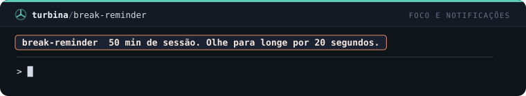
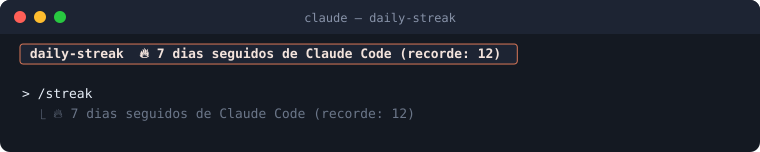

# Focus and notifications — 3 mods

[← Back to the README](../../README.md)

[`turn-notify`](#turn-notify) · [`break-reminder`](#break-reminder) · [`daily-streak`](#daily-streak)

## `turn-notify`

Native notification when a turn of 30s or more finishes.

```
/plugin install turn-notify@cockpit
```



## `break-reminder`

A toast every 50 minutes of session reminding you to take a break.

```
/plugin install break-reminder@cockpit
```



## `daily-streak`

Counts your streak of days using Claude Code; a toast on start and the /streak command.

```
/plugin install daily-streak@cockpit
```


