# Git and GitHub — 16 mods

[← Back to the README](../../README.md)

[`commit-review`](#commit-review) · [`wip-commit-guard`](#wip-commit-guard) · [`marker-guard`](#marker-guard) · [`amend-guard`](#amend-guard) · [`stage-guard`](#stage-guard) · [`git-stage`](#git-stage) · [`git-fixup`](#git-fixup) · [`git-sync`](#git-sync) · [`behind-toast`](#behind-toast) · [`git-switch`](#git-switch) · [`git-tag`](#git-tag) · [`staged-status`](#staged-status) · [`pr-open`](#pr-open) · [`pr-checks`](#pr-checks) · [`pr-comments`](#pr-comments) · [`review-queue`](#review-queue)

## `commit-review`

Asks you to look at the diff before a big commit goes through, showing the files and lines staged.

```
/plugin install commit-review@cockpit
```

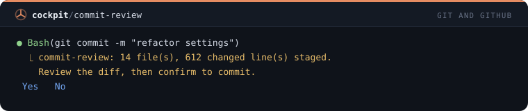

## `wip-commit-guard`

Refuses commits whose message is wip, fix, asdf, a dot or similar, so the history says what changed.

```
/plugin install wip-commit-guard@cockpit
```

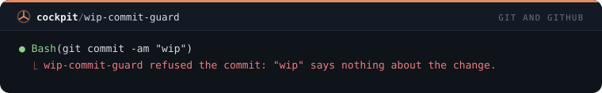

## `marker-guard`

Refuses a commit whose staged changes still hold conflict markers, listing the files.

```
/plugin install marker-guard@cockpit
```

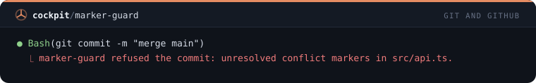

## `amend-guard`

Asks before git commit --amend or git rebase rewrites commits that are already on a remote branch.

```
/plugin install amend-guard@cockpit
```

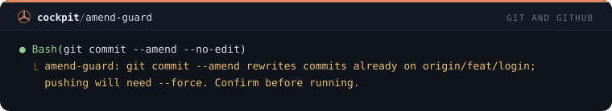

## `stage-guard`

Refuses git add -A, git add . and git commit -a while a .env, key or certificate is waiting to be staged.

```
/plugin install stage-guard@cockpit
```

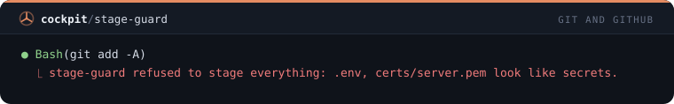

## `git-stage`

/stage lists what is staged, unstaged and new; /stage <paths> stages them and -r unstages, asking first.

```
/plugin install git-stage@cockpit
```

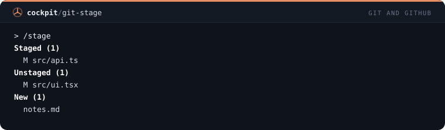

## `git-fixup`

/fixup commits the staged changes as a fixup of HEAD or any commit, ready for rebase --autosquash.

```
/plugin install git-fixup@cockpit
```

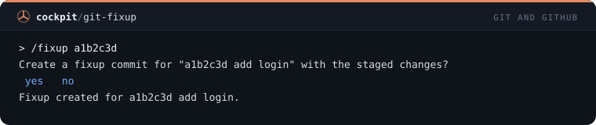

## `git-sync`

/sync fetches and shows how far the branch is from its base; /sync rebase or merge brings the base in after asking.

```
/plugin install git-sync@cockpit
```

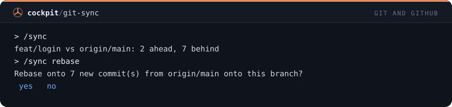

## `behind-toast`

Toast when your branch falls 10, 20, 30 commits behind its base, before the conflicts pile up.

```
/plugin install behind-toast@cockpit
```

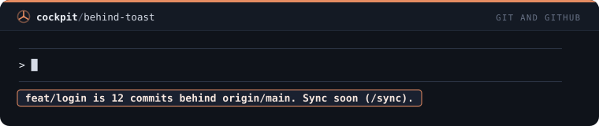

## `git-switch`

/gsw switches branch carrying your uncommitted work: stashes it, switches, and offers it back when you return.

```
/plugin install git-switch@cockpit
```

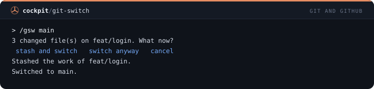

## `git-tag`

/gtag shows the latest tag and the commits since; /gtag patch, minor or major creates the next version tag after asking.

```
/plugin install git-tag@cockpit
```

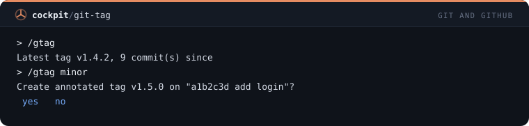

## `staged-status`

Status line with how many files are staged, unstaged and new, hidden when the tree is clean.

```
/plugin install staged-status@cockpit
```

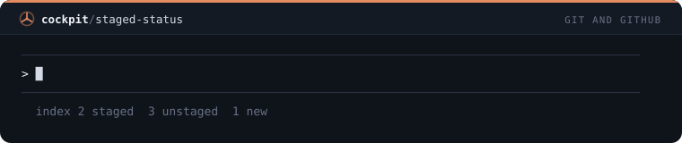

## `pr-open`

/prnew opens a pull request from the current branch with a title and body built from its commits, after asking.

```
/plugin install pr-open@cockpit
```

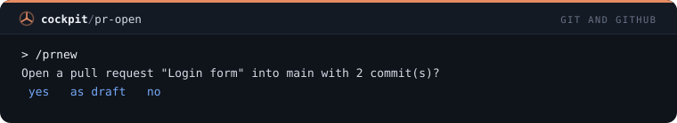

## `pr-checks`

/checks shows the checks of the current pull request and which ones failed, with their links.

```
/plugin install pr-checks@cockpit
```

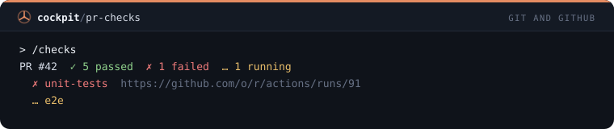

## `pr-comments`

/prcomments lists the review comments on your pull request that nobody from your side has answered yet.

```
/plugin install pr-comments@cockpit
```

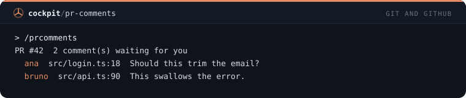

## `review-queue`

Status line with how many pull requests wait for your review, and a toast when a new one is requested.

```
/plugin install review-queue@cockpit
```

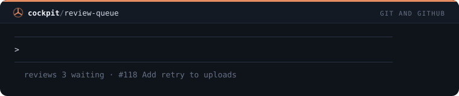
