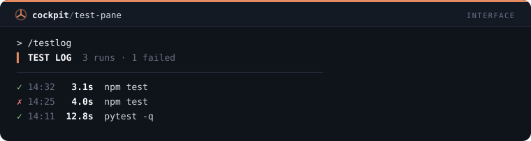
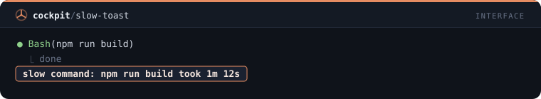
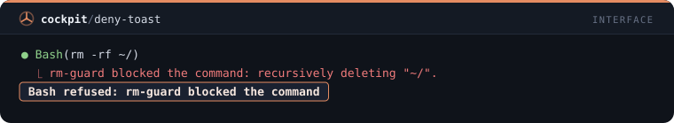
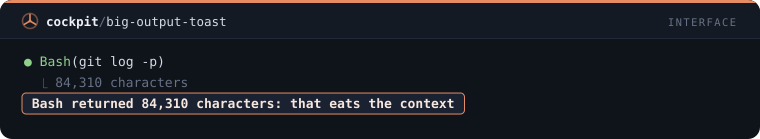
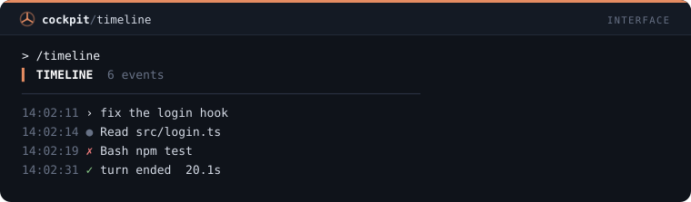

# Interfaz — 30 mods

[← Volver al README](../../README.es.md)

[`turn-timer`](#turn-timer) · [`tool-tally`](#tool-tally) · [`file-trail`](#file-trail) · [`cmd-log`](#cmd-log) · [`git-status-line`](#git-status-line) · [`context-meter`](#context-meter) · [`rate-limit-watch`](#rate-limit-watch) · [`session-clock`](#session-clock) · [`diff-pane`](#diff-pane) · [`turn-history`](#turn-history) · [`prompt-history`](#prompt-history) · [`agent-pane`](#agent-pane) · [`token-chart`](#token-chart) · [`cost-pane`](#cost-pane) · [`error-pane`](#error-pane) · [`context-pane`](#context-pane) · [`read-pane`](#read-pane) · [`links-pane`](#links-pane) · [`git-pane`](#git-pane) · [`branch-pane`](#branch-pane) · [`stash-pane`](#stash-pane) · [`code-todo-pane`](#code-todo-pane) · [`deps-pane`](#deps-pane) · [`scripts-pane`](#scripts-pane) · [`env-keys-pane`](#env-keys-pane) · [`test-pane`](#test-pane) · [`slow-toast`](#slow-toast) · [`deny-toast`](#deny-toast) · [`big-output-toast`](#big-output-toast) · [`timeline`](#timeline)

## `turn-timer`

Banda sobre el prompt con duración, tools y tokens del último turno.

```
/plugin install turn-timer@cockpit
```


## `tool-tally`

/tally abre un panel con el recuento de llamadas por herramienta.

```
/plugin install tool-tally@cockpit
```


## `file-trail`

/trail abre un panel con los archivos leídos y modificados en la sesión.

```
/plugin install file-trail@cockpit
```


## `cmd-log`

/cmdlog abre un panel con los comandos de shell, estado y duración.

```
/plugin install cmd-log@cockpit
```


## `git-status-line`

Status line con rama, archivos modificados y commits por delante/detrás.

```
/plugin install git-status-line@cockpit
```


## `context-meter`

Status line con barra de contexto y coste; avisa al 80% y 90%.

```
/plugin install context-meter@cockpit
```


## `rate-limit-watch`

Toast cuando la ventana de 5h o 7 días supera 75/90/95%; /limits lista el uso.

```
/plugin install rate-limit-watch@cockpit
```


## `session-clock`

Status line con tiempo de sesión y número de prompts.

```
/plugin install session-clock@cockpit
```


## `diff-pane`

/edits abre un panel con cada Edit y Write de la sesión, líneas añadidas y eliminadas, del más nuevo al más antiguo.

```
/plugin install diff-pane@cockpit
```


## `turn-history`

/turns abre un panel con una fila por turno terminado: duración, llamadas de herramienta, tokens de salida y una ✗ en los que fallaron.

```
/plugin install turn-history@cockpit
```


## `prompt-history`

/prompts abre un panel con los prompts escritos en esta sesión; pulsa uno para volver a ponerlo en la caja de prompt.

```
/plugin install prompt-history@cockpit
```


## `agent-pane`

/crew abre un panel con los subagentes de la sesión, su tipo y estado, actualizado mientras alguno se ejecuta.

```
/plugin install agent-pane@cockpit
```


## `token-chart`

/tokens abre un panel con los tokens de salida por turno en medidores finos proporcionales al mayor turno.

```
/plugin install token-chart@cockpit
```


## `cost-pane`

/spend abre un panel con el costo de cada turno, la diferencia del costo de la sesión, y el total.

```
/plugin install cost-pane@cockpit
```


## `error-pane`

/errors abre un panel con cada llamada de herramienta que falló o fue denegada, su entrada y la primera línea del error.

```
/plugin install error-pane@cockpit
```


## `context-pane`

/window abre un panel con la ventana de contexto por categoría, cada una con medidor y participación, y un botón Actualizar.

```
/plugin install context-pane@cockpit
```


## `read-pane`

/reads abre un panel con los archivos leídos en esta sesión y cuántas veces; los leídos 3 o más veces se marcan como contexto desperdiciado.

```
/plugin install read-pane@cockpit
```


## `links-pane`

/links abre un panel con las URLs que aparecieron en las respuestas de Claude; pulsa una para copiarla.

```
/plugin install links-pane@cockpit
```


## `git-pane`

/repo abre un panel con la rama, adelantados y atrasados, los archivos cambiados y los últimos 8 commits.

```
/plugin install git-pane@cockpit
```


## `branch-pane`

/branches abre un panel con las ramas locales, la actual marcada, adelantadas y atrasadas y la edad del último commit.

```
/plugin install branch-pane@cockpit
```


## `stash-pane`

/stashes abre un panel con la lista de stashes: índice, rama, mensaje y la edad de cada uno.

```
/plugin install stash-pane@cockpit
```


## `code-todo-pane`

/codetodo abre un panel con las líneas TODO, FIXME y HACK de los archivos rastreados, agrupadas por etiqueta.

```
/plugin install code-todo-pane@cockpit
```


## `deps-pane`

/deps abre un panel con npm outdated en tabla, saltos major en rojo y minor en ámbar.

```
/plugin install deps-pane@cockpit
```


## `scripts-pane`

/scripts abre un panel con los scripts de package.json; pulsar uno pide a Claude ejecutarlo y corregir lo que falle.

```
/plugin install scripts-pane@cockpit
```


## `env-keys-pane`

/envkeys compara las claves de .env.example con .env y lista las que faltan y las extra, nunca un valor.

```
/plugin install env-keys-pane@cockpit
```


## `test-pane`

/testlog abre un panel con cada ejecución de pruebas de la sesión: comando, pasó o falló, duración y hora.

```
/plugin install test-pane@cockpit
```



## `slow-toast`

Un aviso cuando un comando de shell tardó un minuto o más, con el comando y cuánto tiempo corrió.

```
/plugin install slow-toast@cockpit
```



## `deny-toast`

Un aviso cada vez que se rechaza una llamada a una herramienta, con el nombre de la herramienta y la primera línea del motivo.

```
/plugin install deny-toast@cockpit
```



## `big-output-toast`

Un aviso cuando el resultado de una herramienta supera los 20.000 caracteres, porque tanta salida consume el contexto.

```
/plugin install big-output-toast@cockpit
```



## `timeline`

/timeline abre un registro cronológico de la sesión: prompts, llamadas de herramienta, fallos y fines de turno con su hora.

```
/plugin install timeline@cockpit
```


