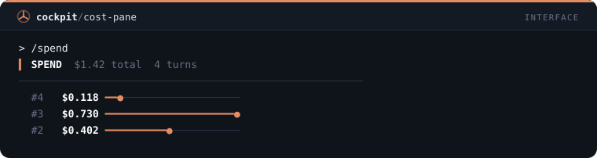
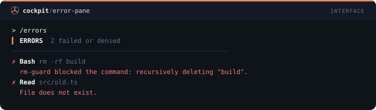
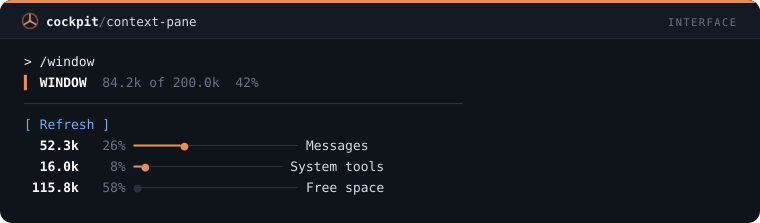
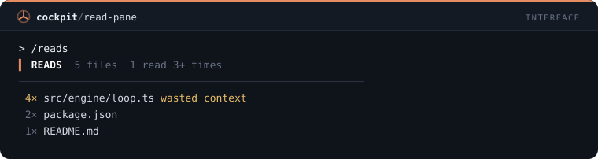
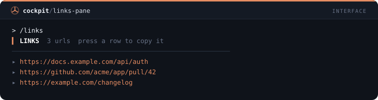
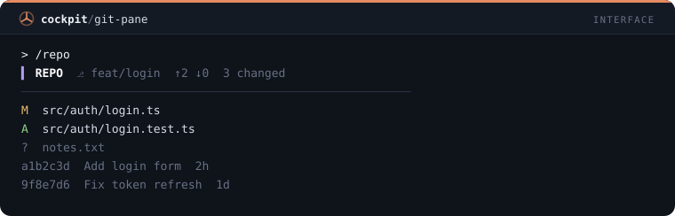
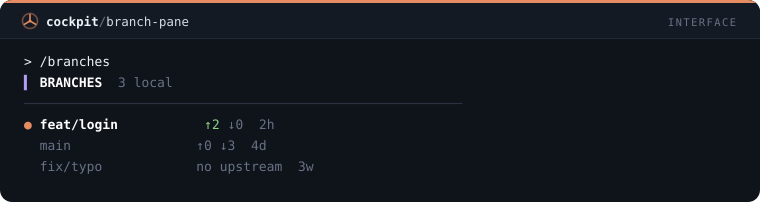

# Interface — 20 mods

[← Back to the README](../../README.md)

[`turn-timer`](#turn-timer) · [`tool-tally`](#tool-tally) · [`file-trail`](#file-trail) · [`cmd-log`](#cmd-log) · [`git-status-line`](#git-status-line) · [`context-meter`](#context-meter) · [`rate-limit-watch`](#rate-limit-watch) · [`session-clock`](#session-clock) · [`diff-pane`](#diff-pane) · [`turn-history`](#turn-history) · [`prompt-history`](#prompt-history) · [`agent-pane`](#agent-pane) · [`token-chart`](#token-chart) · [`cost-pane`](#cost-pane) · [`error-pane`](#error-pane) · [`context-pane`](#context-pane) · [`read-pane`](#read-pane) · [`links-pane`](#links-pane) · [`git-pane`](#git-pane) · [`branch-pane`](#branch-pane)

## `turn-timer`

Band above the prompt with duration, tools and tokens of the last turn.

```
/plugin install turn-timer@cockpit
```


## `tool-tally`

/tally opens a pane with the call count per tool.

```
/plugin install tool-tally@cockpit
```


## `file-trail`

/trail opens a pane with the files read and changed in the session.

```
/plugin install file-trail@cockpit
```


## `cmd-log`

/cmdlog opens a pane with the shell commands, status and duration.

```
/plugin install cmd-log@cockpit
```


## `git-status-line`

Status line with branch, changed files and commits ahead/behind.

```
/plugin install git-status-line@cockpit
```


## `context-meter`

Status line with a context bar and cost; warns at 80% and 90%.

```
/plugin install context-meter@cockpit
```


## `rate-limit-watch`

Toast when the 5h or 7-day window passes 75/90/95%; /limits lists the usage.

```
/plugin install rate-limit-watch@cockpit
```


## `session-clock`

Status line with session time and number of prompts.

```
/plugin install session-clock@cockpit
```


## `diff-pane`

/edits opens a pane with every Edit and Write of the session, lines added and removed, newest first.

```
/plugin install diff-pane@cockpit
```


## `turn-history`

/turns opens a pane with one row per finished turn: duration, tool calls, output tokens and a cross for failed ones.

```
/plugin install turn-history@cockpit
```


## `prompt-history`

/prompts opens a pane with the prompts you typed this session; press one to put it back in the prompt box.

```
/plugin install prompt-history@cockpit
```


## `agent-pane`

/crew opens a pane with the session's subagents, their type and status, refreshed while any is running.

```
/plugin install agent-pane@cockpit
```


## `token-chart`

/tokens opens a pane with output tokens per turn as thin gauges scaled to the largest turn.

```
/plugin install token-chart@cockpit
```


## `cost-pane`

/spend opens a pane with the cost of each turn, the difference of the session cost, and the total.

```
/plugin install cost-pane@cockpit
```



## `error-pane`

/errors opens a pane with every tool call that failed or was denied, its input and the first line of the error.

```
/plugin install error-pane@cockpit
```



## `context-pane`

/window opens a pane with the context window by category, each with a gauge and its share, and a Refresh button.

```
/plugin install context-pane@cockpit
```



## `read-pane`

/reads opens a pane with the files read this session and how often; files read 3 or more times are flagged as wasted context.

```
/plugin install read-pane@cockpit
```



## `links-pane`

/links opens a pane with the URLs that appeared in Claude's answers; press one to copy it.

```
/plugin install links-pane@cockpit
```



## `git-pane`

/repo opens a pane with the branch, ahead and behind, the changed files and the last 8 commits.

```
/plugin install git-pane@cockpit
```



## `branch-pane`

/branches opens a pane with the local branches, the current one marked, ahead and behind and the age of the last commit.

```
/plugin install branch-pane@cockpit
```


