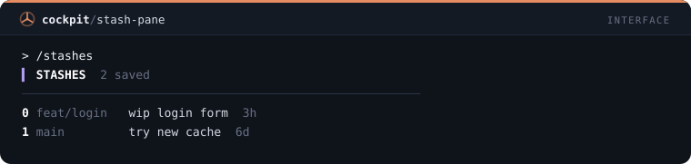
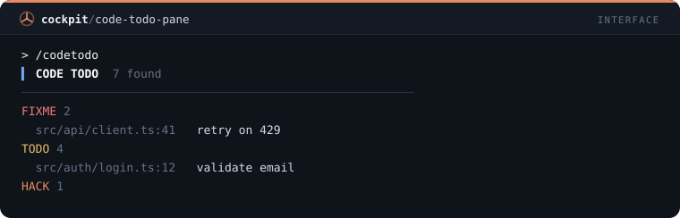
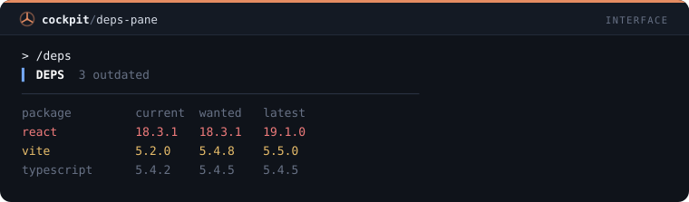
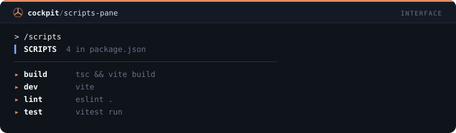
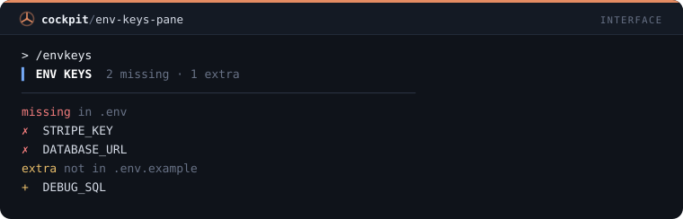

# Interface — 25 mods

[← Voltar ao README](../../README.pt-BR.md)

[`turn-timer`](#turn-timer) · [`tool-tally`](#tool-tally) · [`file-trail`](#file-trail) · [`cmd-log`](#cmd-log) · [`git-status-line`](#git-status-line) · [`context-meter`](#context-meter) · [`rate-limit-watch`](#rate-limit-watch) · [`session-clock`](#session-clock) · [`diff-pane`](#diff-pane) · [`turn-history`](#turn-history) · [`prompt-history`](#prompt-history) · [`agent-pane`](#agent-pane) · [`token-chart`](#token-chart) · [`cost-pane`](#cost-pane) · [`error-pane`](#error-pane) · [`context-pane`](#context-pane) · [`read-pane`](#read-pane) · [`links-pane`](#links-pane) · [`git-pane`](#git-pane) · [`branch-pane`](#branch-pane) · [`stash-pane`](#stash-pane) · [`code-todo-pane`](#code-todo-pane) · [`deps-pane`](#deps-pane) · [`scripts-pane`](#scripts-pane) · [`env-keys-pane`](#env-keys-pane)

## `turn-timer`

Faixa acima do prompt com duração, tools e tokens do último turno.

```
/plugin install turn-timer@cockpit
```


## `tool-tally`

/tally abre um painel com a contagem de chamadas por ferramenta.

```
/plugin install tool-tally@cockpit
```


## `file-trail`

/trail abre um painel com os arquivos lidos e alterados na sessão.

```
/plugin install file-trail@cockpit
```


## `cmd-log`

/cmdlog abre um painel com os comandos de shell, status e duração.

```
/plugin install cmd-log@cockpit
```


## `git-status-line`

Status line com branch, arquivos alterados e commits à frente/atrás.

```
/plugin install git-status-line@cockpit
```


## `context-meter`

Status line com barra de contexto e custo; avisa em 80% e 90%.

```
/plugin install context-meter@cockpit
```


## `rate-limit-watch`

Toast quando a janela de 5h ou 7 dias passa de 75/90/95%; /limits lista o uso.

```
/plugin install rate-limit-watch@cockpit
```


## `session-clock`

Status line com tempo de sessão e número de prompts.

```
/plugin install session-clock@cockpit
```


## `diff-pane`

/edits abre um painel com cada Edit e Write da sessão, linhas adicionadas e removidas, do mais novo ao mais antigo.

```
/plugin install diff-pane@cockpit
```


## `turn-history`

/turns abre um painel com uma linha por turno concluído: duração, chamadas de ferramenta, tokens de saída e um ✗ nos que falharam.

```
/plugin install turn-history@cockpit
```


## `prompt-history`

/prompts abre um painel com os prompts digitados nesta sessão; pressione um para recolocá-lo na caixa de prompt.

```
/plugin install prompt-history@cockpit
```


## `agent-pane`

/crew abre um painel com os subagentes da sessão, o tipo e o status de cada um, atualizado enquanto algum roda.

```
/plugin install agent-pane@cockpit
```


## `token-chart`

/tokens abre um painel com os tokens de saída por turno em medidores finos proporcionais ao maior turno.

```
/plugin install token-chart@cockpit
```


## `cost-pane`

/spend abre um painel com o custo de cada turno, a diferença do custo da sessão, e o total.

```
/plugin install cost-pane@cockpit
```


## `error-pane`

/errors abre um painel com cada chamada de ferramenta que falhou ou foi negada, a entrada e a primeira linha do erro.

```
/plugin install error-pane@cockpit
```


## `context-pane`

/window abre um painel com a janela de contexto por categoria, cada uma com medidor e participação, e um botão Atualizar.

```
/plugin install context-pane@cockpit
```


## `read-pane`

/reads abre um painel com os arquivos lidos nesta sessão e quantas vezes; arquivos lidos 3 vezes ou mais são marcados como contexto desperdiçado.

```
/plugin install read-pane@cockpit
```


## `links-pane`

/links abre um painel com as URLs que apareceram nas respostas de Claude; pressione uma para copiá-la.

```
/plugin install links-pane@cockpit
```


## `git-pane`

/repo abre um painel com a branch, à frente e atrás, os arquivos alterados e os últimos 8 commits.

```
/plugin install git-pane@cockpit
```


## `branch-pane`

/branches abre um painel com as branches locais, a atual marcada, à frente e atrás e a idade do último commit.

```
/plugin install branch-pane@cockpit
```


## `stash-pane`

/stashes abre um painel com a lista de stashes: índice, branch, mensagem e a idade de cada um.

```
/plugin install stash-pane@cockpit
```



## `code-todo-pane`

/codetodo abre um painel com as linhas TODO, FIXME e HACK dos arquivos rastreados, agrupadas por tag.

```
/plugin install code-todo-pane@cockpit
```



## `deps-pane`

/deps abre um painel com o npm outdated em tabela, saltos major em vermelho e minor em âmbar.

```
/plugin install deps-pane@cockpit
```



## `scripts-pane`

/scripts abre um painel com os scripts do package.json; apertar um pede ao Claude para rodá-lo e corrigir o que falhar.

```
/plugin install scripts-pane@cockpit
```



## `env-keys-pane`

/envkeys compara as chaves do .env.example com o .env e lista as que faltam e as extras, nunca um valor.

```
/plugin install env-keys-pane@cockpit
```


