# Interface — 13 mods

[← Voltar ao README](../../README.pt-BR.md)

[`turn-timer`](#turn-timer) · [`tool-tally`](#tool-tally) · [`file-trail`](#file-trail) · [`cmd-log`](#cmd-log) · [`git-status-line`](#git-status-line) · [`context-meter`](#context-meter) · [`rate-limit-watch`](#rate-limit-watch) · [`session-clock`](#session-clock) · [`diff-pane`](#diff-pane) · [`turn-history`](#turn-history) · [`prompt-history`](#prompt-history) · [`agent-pane`](#agent-pane) · [`token-chart`](#token-chart)

## `turn-timer`

Faixa acima do prompt com duração, tools e tokens do último turno.

```
/plugin install turn-timer@cockpit
```

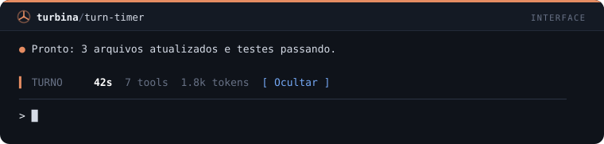

## `tool-tally`

/tally abre um painel com a contagem de chamadas por ferramenta.

```
/plugin install tool-tally@cockpit
```

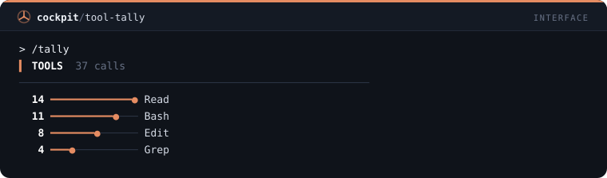

## `file-trail`

/trail abre um painel com os arquivos lidos e alterados na sessão.

```
/plugin install file-trail@cockpit
```

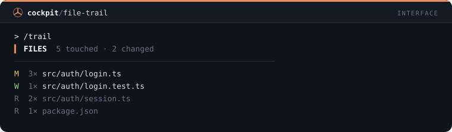

## `cmd-log`

/cmdlog abre um painel com os comandos de shell, status e duração.

```
/plugin install cmd-log@cockpit
```

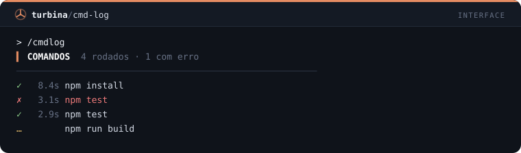

## `git-status-line`

Status line com branch, arquivos alterados e commits à frente/atrás.

```
/plugin install git-status-line@cockpit
```

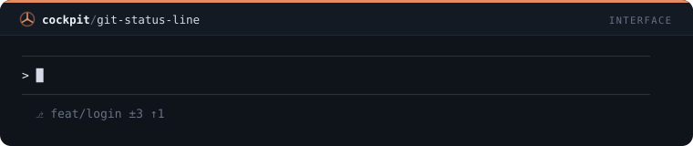

## `context-meter`

Status line com barra de contexto e custo; avisa em 80% e 90%.

```
/plugin install context-meter@cockpit
```

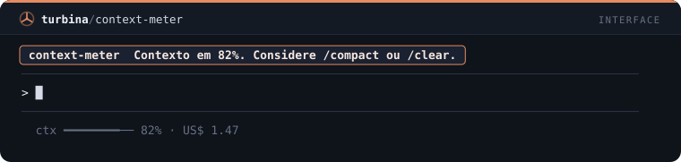

## `rate-limit-watch`

Toast quando a janela de 5h ou 7 dias passa de 75/90/95%; /limits lista o uso.

```
/plugin install rate-limit-watch@cockpit
```

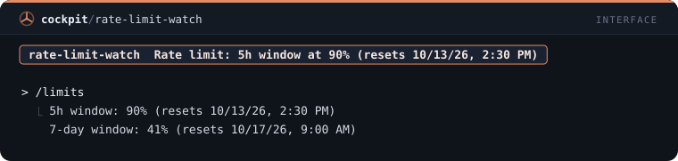

## `session-clock`

Status line com tempo de sessão e número de prompts.

```
/plugin install session-clock@cockpit
```

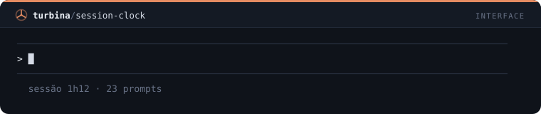

## `diff-pane`

/edits abre um painel com cada Edit e Write da sessão, linhas adicionadas e removidas, do mais novo ao mais antigo.

```
/plugin install diff-pane@cockpit
```

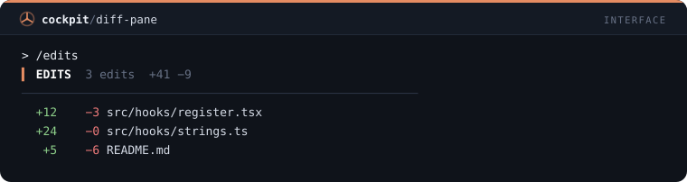

## `turn-history`

/turns abre um painel com uma linha por turno concluído: duração, chamadas de ferramenta, tokens de saída e um ✗ nos que falharam.

```
/plugin install turn-history@cockpit
```

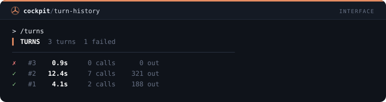

## `prompt-history`

/prompts abre um painel com os prompts digitados nesta sessão; pressione um para recolocá-lo na caixa de prompt.

```
/plugin install prompt-history@cockpit
```

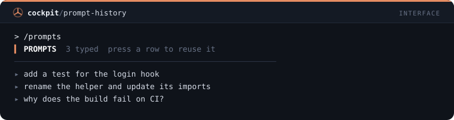

## `agent-pane`

/crew abre um painel com os subagentes da sessão, o tipo e o status de cada um, atualizado enquanto algum roda.

```
/plugin install agent-pane@cockpit
```

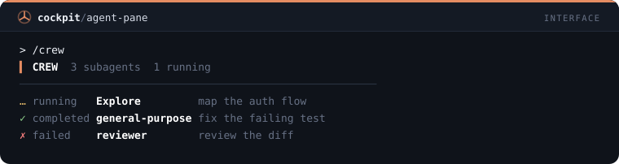

## `token-chart`

/tokens abre um painel com os tokens de saída por turno em medidores finos proporcionais ao maior turno.

```
/plugin install token-chart@cockpit
```

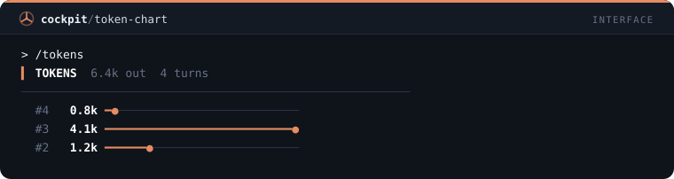
