# Always visible — 43 mods

[← Back to the README](../../README.md)

[`cockpit`](#cockpit) · [`git-band`](#git-band) · [`todo-band`](#todo-band) · [`usage-band`](#usage-band) · [`files-band`](#files-band) · [`error-band`](#error-band) · [`goal-band`](#goal-band) · [`agents-band`](#agents-band) · [`activity-status`](#activity-status) · [`test-status`](#test-status) · [`ci-status`](#ci-status) · [`stash-status`](#stash-status) · [`uncommitted-band`](#uncommitted-band) · [`pr-status`](#pr-status) · [`main-warning-band`](#main-warning-band) · [`conflict-band`](#conflict-band) · [`project-status`](#project-status) · [`ports-band`](#ports-band) · [`deps-status`](#deps-status) · [`todo-count-status`](#todo-count-status) · [`quality-status`](#quality-status) · [`model-status`](#model-status) · [`cost-ticker`](#cost-ticker) · [`idle-clock`](#idle-clock) · [`turn-progress`](#turn-progress) · [`last-prompt-band`](#last-prompt-band) · [`compact-nudge`](#compact-nudge) · [`session-diff-band`](#session-diff-band) · [`shield-band`](#shield-band) · [`reset-countdown`](#reset-countdown) · [`spend-today`](#spend-today) · [`focus-band`](#focus-band) · [`deadline-band`](#deadline-band) · [`pin-band`](#pin-band) · [`clock-status`](#clock-status) · [`day-timer`](#day-timer) · [`commits-today`](#commits-today) · [`dolar-status`](#dolar-status) · [`weather-status`](#weather-status) · [`api-status`](#api-status) · [`terminal-pet`](#terminal-pet) · [`runtime-band`](#runtime-band) · [`docker-band`](#docker-band)

## `cockpit`

Settings pane: /cockpit switches each panel on and off and sets the language of every mod.

```
/plugin install cockpit@cockpit
```

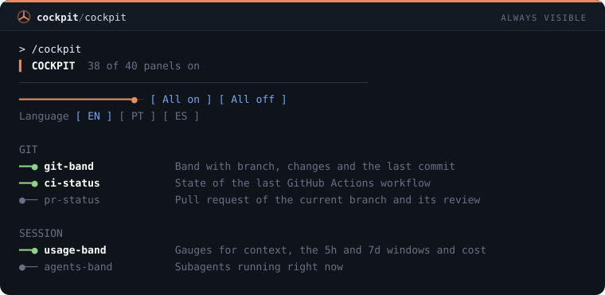

## `git-band`

Band with the branch, changed files, lines added and removed, ahead/behind and the last commit.

```
/plugin install git-band@cockpit
```

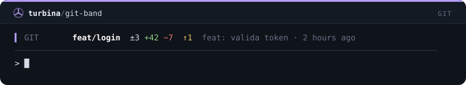

## `todo-band`

Project task list pinned above the prompt, clickable and persistent (/todo).

```
/plugin install todo-band@cockpit
```

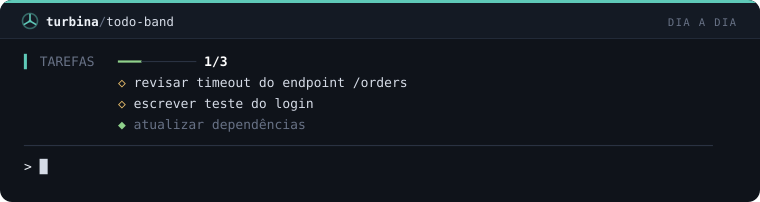

## `usage-band`

Fixed band with colored bars for context, the 5h and 7 day windows, and cost.

```
/plugin install usage-band@cockpit
```

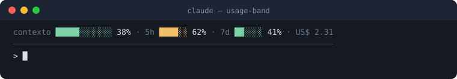

## `files-band`

Fixed band with the files Claude changed in this session.

```
/plugin install files-band@cockpit
```

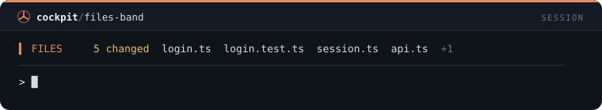

## `error-band`

Keeps the last failed command and its error line in view until a command passes.

```
/plugin install error-band@cockpit
```

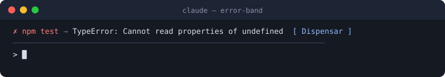

## `goal-band`

/goal pins the project goal above the prompt and in Claude's context.

```
/plugin install goal-band@cockpit
```

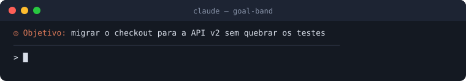

## `agents-band`

Band showing in real time how many subagents are running and which ones.

```
/plugin install agents-band@cockpit
```

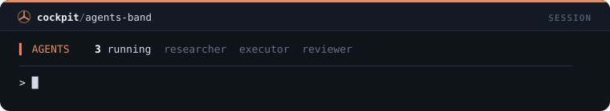

## `activity-status`

Live status line with the tool Claude is running right now.

```
/plugin install activity-status@cockpit
```

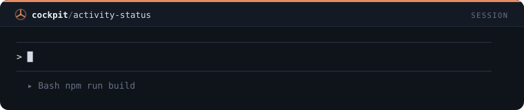

## `test-status`

Status line entry with the result of the last test run: passed or failed, time and duration.

```
/plugin install test-status@cockpit
```

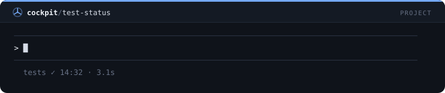

## `ci-status`

Status line with the state of the last GitHub Actions workflow (via gh).

```
/plugin install ci-status@cockpit
```

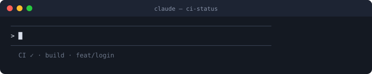

## `stash-status`

Status line that reminds you how many stashes are saved.

```
/plugin install stash-status@cockpit
```


## `uncommitted-band`

Warning band when changes have gone uncommitted for more than 45 minutes.

```
/plugin install uncommitted-band@cockpit
```

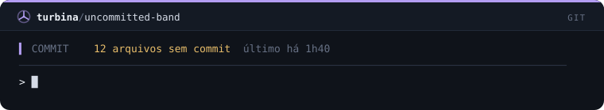

## `pr-status`

Status line with the current branch pull request and its review state (via gh).

```
/plugin install pr-status@cockpit
```


## `main-warning-band`

Red band while you are on main or master.

```
/plugin install main-warning-band@cockpit
```

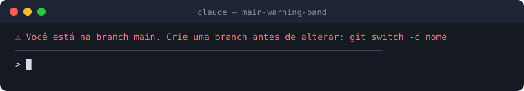

## `conflict-band`

Band that warns about a merge or rebase in progress and files in conflict.

```
/plugin install conflict-band@cockpit
```

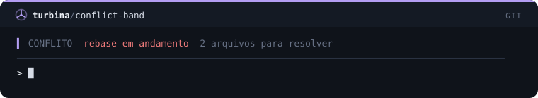

## `project-status`

Status line with the project name and version, Node version and package manager.

```
/plugin install project-status@cockpit
```

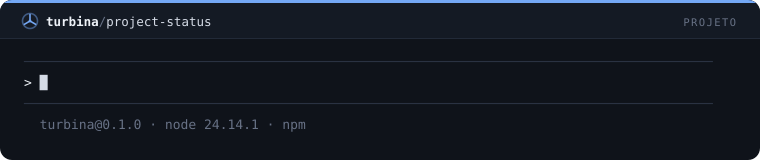

## `ports-band`

Band with the dev servers running on localhost.

```
/plugin install ports-band@cockpit
```

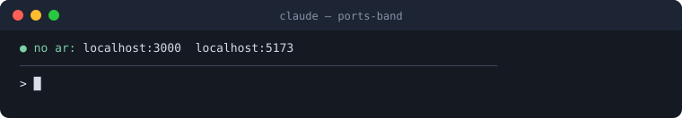

## `deps-status`

Status line with how many npm dependencies are outdated.

```
/plugin install deps-status@cockpit
```

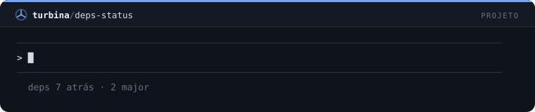

## `todo-count-status`

Status line counting TODO, FIXME and HACK in tracked code.

```
/plugin install todo-count-status@cockpit
```

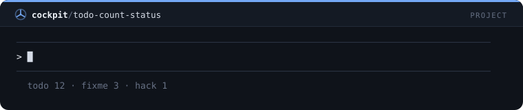

## `quality-status`

Status line with the latest lint, types and build results.

```
/plugin install quality-status@cockpit
```

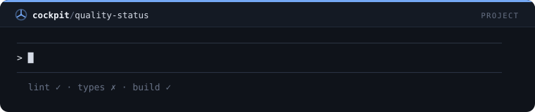

## `model-status`

Status line with the model in use in the session.

```
/plugin install model-status@cockpit
```


## `cost-ticker`

Status line with the cost of the last turn and the session total.

```
/plugin install cost-ticker@cockpit
```

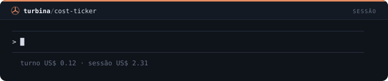

## `idle-clock`

Status line with how long the session has been idle.

```
/plugin install idle-clock@cockpit
```


## `turn-progress`

Live status line with the elapsed time and tool count of the turn in progress.

```
/plugin install turn-progress@cockpit
```


## `last-prompt-band`

Band with your last request, so you do not lose it after long answers.

```
/plugin install last-prompt-band@cockpit
```

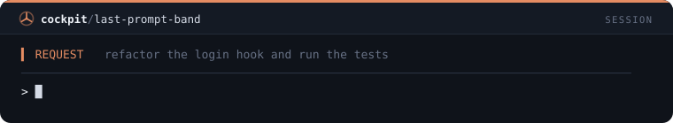

## `compact-nudge`

Band with a compact button when context passes 75%.

```
/plugin install compact-nudge@cockpit
```

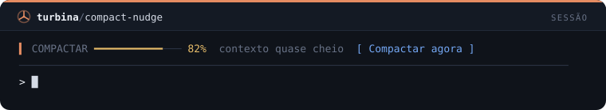

## `session-diff-band`

Band with the total lines Claude wrote and removed in the session.

```
/plugin install session-diff-band@cockpit
```

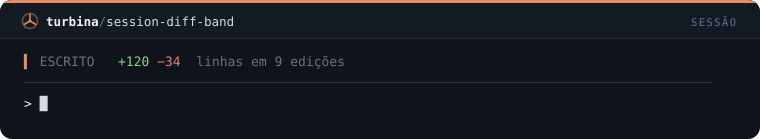

## `shield-band`

Band with the count of calls blocked by guards and the last reason.

```
/plugin install shield-band@cockpit
```

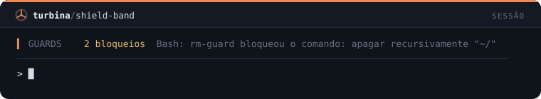

## `reset-countdown`

Status line counting down to the reset of the tightest rate limit.

```
/plugin install reset-countdown@cockpit
```

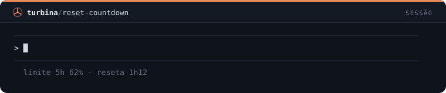

## `spend-today`

Status line with today's spend summed across all sessions.

```
/plugin install spend-today@cockpit
```

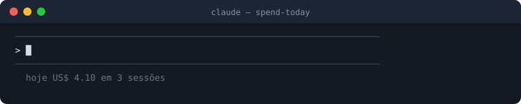

## `focus-band`

/focus starts a focus block with a pinned progress bar.

```
/plugin install focus-band@cockpit
```

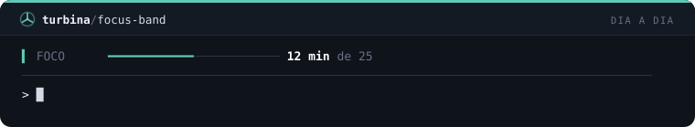

## `deadline-band`

/deadline pins a countdown to the project deadline.

```
/plugin install deadline-band@cockpit
```

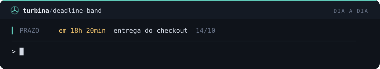

## `pin-band`

/pin pins up to 4 project reminders above the prompt.

```
/plugin install pin-band@cockpit
```

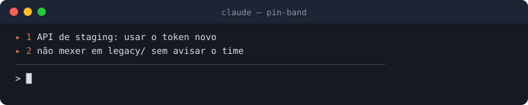

## `clock-status`

Status line with the day and time (useful in fullscreen mode).

```
/plugin install clock-status@cockpit
```

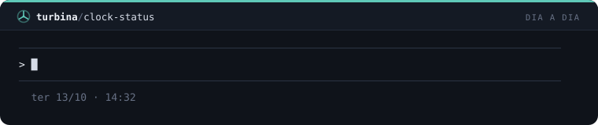

## `day-timer`

Status line with your active Claude Code time today, summed across sessions.

```
/plugin install day-timer@cockpit
```

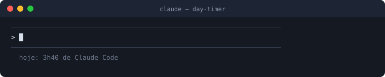

## `commits-today`

Status line with how many commits you made today in this repository.

```
/plugin install commits-today@cockpit
```

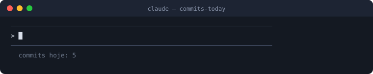

## `dolar-status`

Status line with the dollar rate in Brazilian reais (AwesomeAPI).

```
/plugin install dolar-status@cockpit
```


## `weather-status`

Status line with the weather in your city (wttr.in).

```
/plugin install weather-status@cockpit
```


## `api-status`

Status line with the state of the Anthropic API from its public status page.

```
/plugin install api-status@cockpit
```

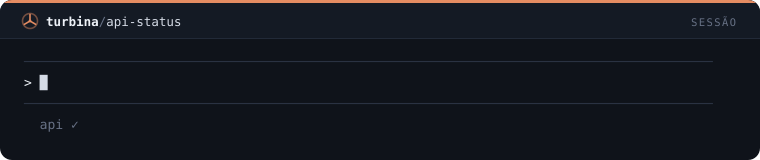

## `terminal-pet`

A mascot above the prompt that reacts: working, happy, sad or sleepy.

```
/plugin install terminal-pet@cockpit
```

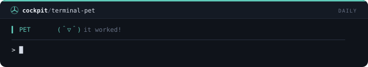

## `runtime-band`

Band that appears when the Node, Python or Java version the project asks for differs from the one installed.

```
/plugin install runtime-band@cockpit
```

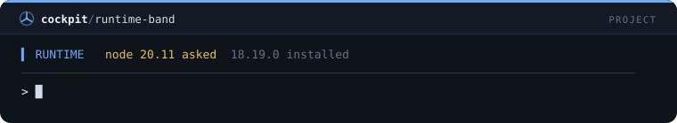

## `docker-band`

Band that warns when the Docker daemon is down or a compose stack has services stopped.

```
/plugin install docker-band@cockpit
```

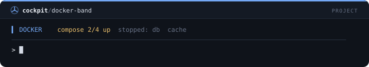
