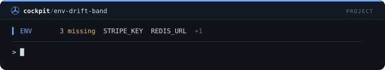
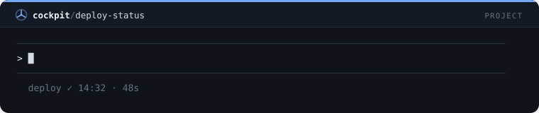
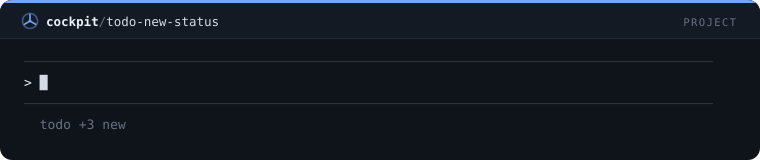
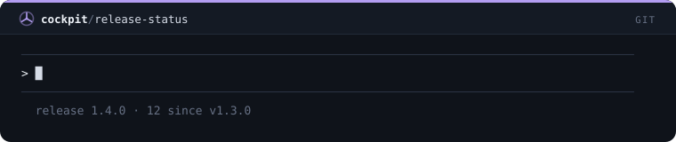
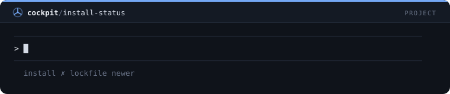

# Sempre visível — 50 mods

[← Voltar ao README](../../README.pt-BR.md)

[`cockpit`](#cockpit) · [`git-band`](#git-band) · [`todo-band`](#todo-band) · [`usage-band`](#usage-band) · [`files-band`](#files-band) · [`error-band`](#error-band) · [`goal-band`](#goal-band) · [`agents-band`](#agents-band) · [`activity-status`](#activity-status) · [`test-status`](#test-status) · [`ci-status`](#ci-status) · [`stash-status`](#stash-status) · [`uncommitted-band`](#uncommitted-band) · [`pr-status`](#pr-status) · [`main-warning-band`](#main-warning-band) · [`conflict-band`](#conflict-band) · [`project-status`](#project-status) · [`ports-band`](#ports-band) · [`deps-status`](#deps-status) · [`todo-count-status`](#todo-count-status) · [`quality-status`](#quality-status) · [`model-status`](#model-status) · [`cost-ticker`](#cost-ticker) · [`idle-clock`](#idle-clock) · [`turn-progress`](#turn-progress) · [`last-prompt-band`](#last-prompt-band) · [`compact-nudge`](#compact-nudge) · [`session-diff-band`](#session-diff-band) · [`shield-band`](#shield-band) · [`reset-countdown`](#reset-countdown) · [`spend-today`](#spend-today) · [`focus-band`](#focus-band) · [`deadline-band`](#deadline-band) · [`pin-band`](#pin-band) · [`clock-status`](#clock-status) · [`day-timer`](#day-timer) · [`commits-today`](#commits-today) · [`dolar-status`](#dolar-status) · [`weather-status`](#weather-status) · [`api-status`](#api-status) · [`terminal-pet`](#terminal-pet) · [`runtime-band`](#runtime-band) · [`docker-band`](#docker-band) · [`env-drift-band`](#env-drift-band) · [`deploy-status`](#deploy-status) · [`todo-new-status`](#todo-new-status) · [`release-status`](#release-status) · [`license-status`](#license-status) · [`install-status`](#install-status) · [`db-port-status`](#db-port-status)

## `cockpit`

Painel de configurações: /cockpit liga e desliga cada painel e define o idioma de todos os mods.

```
/plugin install cockpit@cockpit
```


## `git-band`

Faixa fixa com branch, arquivos alterados, linhas adicionadas e removidas, ahead/behind e último commit.

```
/plugin install git-band@cockpit
```


## `todo-band`

Lista de tarefas do projeto fixa acima do prompt, clicável e persistente (/todo).

```
/plugin install todo-band@cockpit
```


## `usage-band`

Faixa fixa com barras coloridas de contexto, janelas de 5h e 7 dias e custo.

```
/plugin install usage-band@cockpit
```


## `files-band`

Faixa fixa com os arquivos que o Claude alterou nesta sessão.

```
/plugin install files-band@cockpit
```


## `error-band`

Mantém à vista o último comando que falhou e a linha do erro, até um comando passar.

```
/plugin install error-band@cockpit
```


## `goal-band`

/goal fixa o objetivo do projeto acima do prompt e no contexto do Claude.

```
/plugin install goal-band@cockpit
```


## `agents-band`

Faixa que mostra em tempo real quantos subagentes estão rodando e quais.

```
/plugin install agents-band@cockpit
```


## `activity-status`

Status line ao vivo com a ferramenta que o Claude está executando agora.

```
/plugin install activity-status@cockpit
```


## `test-status`

Entrada na status line com o resultado da última execução de testes: passou ou falhou, hora e duração.

```
/plugin install test-status@cockpit
```


## `ci-status`

Status line com o estado do último workflow do GitHub Actions (via gh).

```
/plugin install ci-status@cockpit
```


## `stash-status`

Status line que lembra quantos stashes estão guardados.

```
/plugin install stash-status@cockpit
```


## `uncommitted-band`

Faixa de aviso quando há alterações sem commit há mais de 45 minutos.

```
/plugin install uncommitted-band@cockpit
```


## `pr-status`

Status line com o pull request da branch atual e o estado do review (via gh).

```
/plugin install pr-status@cockpit
```


## `main-warning-band`

Faixa vermelha enquanto você estiver na main/master.

```
/plugin install main-warning-band@cockpit
```


## `conflict-band`

Faixa que avisa de merge/rebase em andamento e arquivos em conflito.

```
/plugin install conflict-band@cockpit
```


## `project-status`

Status line com nome e versão do projeto, versão do Node e gerenciador de pacotes.

```
/plugin install project-status@cockpit
```


## `ports-band`

Faixa com os servidores de dev que estão no ar em localhost.

```
/plugin install ports-band@cockpit
```


## `deps-status`

Status line com quantas dependências npm estão desatualizadas.

```
/plugin install deps-status@cockpit
```


## `todo-count-status`

Status line com a contagem de TODO, FIXME e HACK no código versionado.

```
/plugin install todo-count-status@cockpit
```


## `quality-status`

Status line com o último resultado de lint, tipos e build.

```
/plugin install quality-status@cockpit
```


## `model-status`

Status line com o modelo em uso na sessão.

```
/plugin install model-status@cockpit
```


## `cost-ticker`

Status line com o custo do último turno e o total da sessão.

```
/plugin install cost-ticker@cockpit
```


## `idle-clock`

Status line com há quanto tempo a sessão está parada.

```
/plugin install idle-clock@cockpit
```


## `turn-progress`

Status line ao vivo com tempo decorrido e tools do turno em andamento.

```
/plugin install turn-progress@cockpit
```


## `last-prompt-band`

Faixa com o seu último pedido, para não se perder depois de respostas longas.

```
/plugin install last-prompt-band@cockpit
```


## `compact-nudge`

Faixa com botão de compactar quando o contexto passa de 75%.

```
/plugin install compact-nudge@cockpit
```


## `session-diff-band`

Faixa com o total de linhas que o Claude escreveu e removeu na sessão.

```
/plugin install session-diff-band@cockpit
```


## `shield-band`

Faixa com a contagem de chamadas bloqueadas pelos guards e o último motivo.

```
/plugin install shield-band@cockpit
```


## `reset-countdown`

Status line com a contagem regressiva até o reset do rate limit mais apertado.

```
/plugin install reset-countdown@cockpit
```


## `spend-today`

Status line com o gasto do dia somando todas as sessões.

```
/plugin install spend-today@cockpit
```


## `focus-band`

/focus inicia um bloco de foco com barra de progresso fixa.

```
/plugin install focus-band@cockpit
```


## `deadline-band`

/deadline fixa uma contagem regressiva para o prazo do projeto.

```
/plugin install deadline-band@cockpit
```


## `pin-band`

/pin fixa até 4 lembretes do projeto acima do prompt.

```
/plugin install pin-band@cockpit
```


## `clock-status`

Status line com dia e hora (útil no modo fullscreen).

```
/plugin install clock-status@cockpit
```


## `day-timer`

Status line com o tempo ativo de Claude Code no dia, somando as sessões.

```
/plugin install day-timer@cockpit
```


## `commits-today`

Status line com quantos commits você fez hoje neste repositório.

```
/plugin install commits-today@cockpit
```


## `dolar-status`

Status line com a cotação do dólar em reais (AwesomeAPI).

```
/plugin install dolar-status@cockpit
```


## `weather-status`

Status line com o clima da sua cidade (wttr.in).

```
/plugin install weather-status@cockpit
```


## `api-status`

Status line com o estado da API da Anthropic pela página pública de status.

```
/plugin install api-status@cockpit
```


## `terminal-pet`

Mascote acima do prompt que reage: trabalhando, feliz, triste ou com sono.

```
/plugin install terminal-pet@cockpit
```


## `runtime-band`

Faixa que aparece quando a versão de Node, Python ou Java que o projeto pede difere da instalada.

```
/plugin install runtime-band@cockpit
```


## `docker-band`

Faixa que avisa quando o daemon do Docker está parado ou uma stack compose tem serviços parados.

```
/plugin install docker-band@cockpit
```


## `env-drift-band`

Faixa com as chaves que o .env.example tem e o .env não, só os nomes, nunca os valores.

```
/plugin install env-drift-band@cockpit
```



## `deploy-status`

Entrada na status line com o resultado do último comando de deploy: vercel, netlify, eas, firebase, fly e outros.

```
/plugin install deploy-status@cockpit
```



## `todo-new-status`

Status line contando as linhas TODO, FIXME e HACK adicionadas ao código nesta sessão.

```
/plugin install todo-new-status@cockpit
```



## `release-status`

Status line com a versão do pacote, a última tag e os commits que esperam o próximo release.

```
/plugin install release-status@cockpit
```



## `license-status`

Status line que avisa quando o projeto não tem arquivo de licença nem campo license no package.json.

```
/plugin install license-status@cockpit
```


## `install-status`

Status line que avisa quando o node_modules não existe ou está mais velho que o lockfile.

```
/plugin install install-status@cockpit
```



## `db-port-status`

Status line que avisa quando o banco ou cache local para o qual o projeto aponta não está escutando.

```
/plugin install db-port-status@cockpit
```


