# Prompt e modelo — 30 mods

[← Voltar ao README](../../README.pt-BR.md)

[`concise-mode`](#concise-mode) · [`persona`](#persona) · [`prompt-shortcuts`](#prompt-shortcuts) · [`tldr`](#tldr) · [`git-context`](#git-context) · [`stack-context`](#stack-context) · [`commit-style`](#commit-style) · [`reply-language`](#reply-language) · [`time-context`](#time-context) · [`os-context`](#os-context) · [`test-first`](#test-first) · [`explain-mode`](#explain-mode) · [`plan-first`](#plan-first) · [`no-comments`](#no-comments) · [`minimal-diff`](#minimal-diff) · [`ask-first`](#ask-first) · [`verify-claims`](#verify-claims) · [`paste-fence`](#paste-fence) · [`file-mention-hint`](#file-mention-hint) · [`trace-helper`](#trace-helper) · [`branch-naming`](#branch-naming) · [`pr-style`](#pr-style) · [`a11y-rules`](#a11y-rules) · [`security-rules`](#security-rules) · [`react-rules`](#react-rules) · [`tailwind-rules`](#tailwind-rules) · [`rn-rules`](#rn-rules) · [`java-rules`](#java-rules) · [`oracle-rules`](#oracle-rules) · [`answer-format`](#answer-format)

## `concise-mode`

/concise liga respostas curtas e diretas, sem introdução nem recapitulação.

```
/plugin install concise-mode@cockpit
```

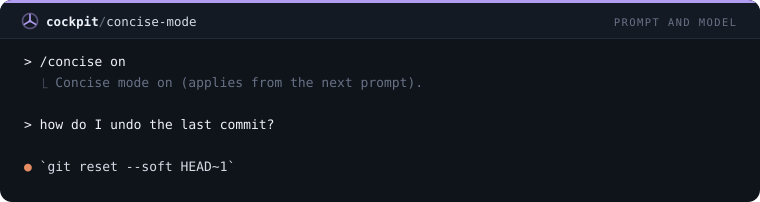

## `persona`

/persona troca a voz do Claude: mentor, senior, rubberduck, pirata, yoda, zen.

```
/plugin install persona@cockpit
```

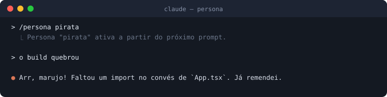

## `prompt-shortcuts`

Atalhos ::fix, ::test, ::review, ::explain, ::refactor, ::doc, ::commit viram prompts completos.

```
/plugin install prompt-shortcuts@cockpit
```

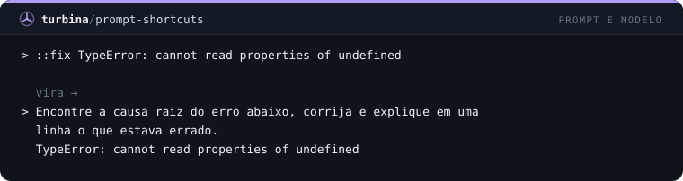

## `tldr`

Acrescenta um TL;DR de 2 frases (via haiku) abaixo de respostas longas.

```
/plugin install tldr@cockpit
```

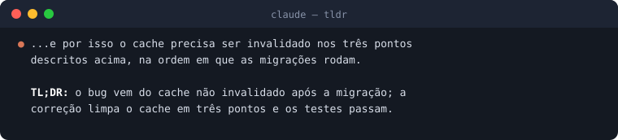

## `git-context`

Anexa o estado do git (branch e arquivos alterados) a cada prompt, como contexto oculto.

```
/plugin install git-context@cockpit
```

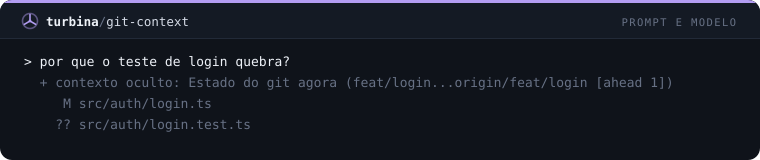

## `stack-context`

Detecta a stack do projeto (package.json, pom.xml...) e informa o Claude no system prompt.

```
/plugin install stack-context@cockpit
```

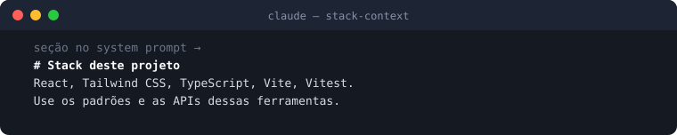

## `commit-style`

Faz o Claude escrever commits em Conventional Commits, curtos e no imperativo.

```
/plugin install commit-style@cockpit
```

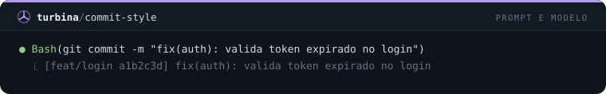

## `reply-language`

Faz o Claude responder sempre no idioma definido no hub Cockpit, mantendo código e comandos no original.

```
/plugin install reply-language@cockpit
```

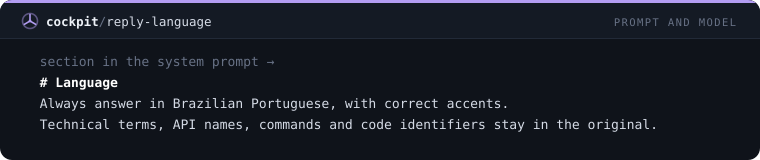

## `time-context`

Todo prompt leva a data, o dia da semana, a hora e o fuso locais para as datas relativas saírem certas.

```
/plugin install time-context@cockpit
```

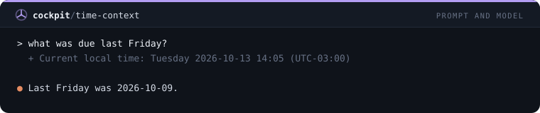

## `os-context`

Informa ao Claude seu sistema operacional, shell e as versões instaladas de node, python, java e git.

```
/plugin install os-context@cockpit
```

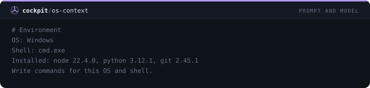

## `test-first`

/tdd liga o trabalho test-first: um teste que falha antes do código, rodado antes e depois.

```
/plugin install test-first@cockpit
```

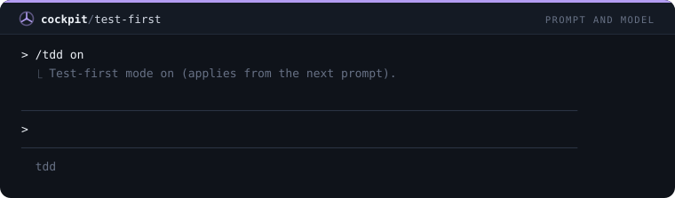

## `explain-mode`

/explain faz o Claude explicar cada mudança em uma ou duas frases, para quem está aprendendo o código.

```
/plugin install explain-mode@cockpit
```

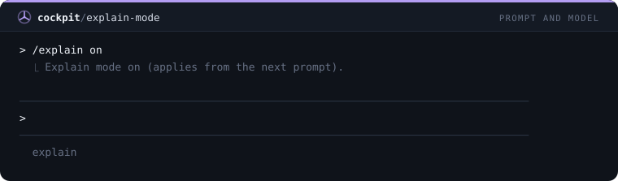

## `plan-first`

/plan-first faz o Claude listar os arquivos e a ordem antes de editar uma mudança em mais de dois arquivos.

```
/plugin install plan-first@cockpit
```

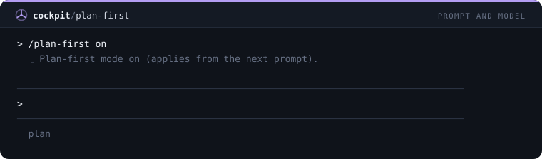

## `no-comments`

Tira do código comentários que repetem o código, banners e código comentado; fica só o porquê.

```
/plugin install no-comments@cockpit
```

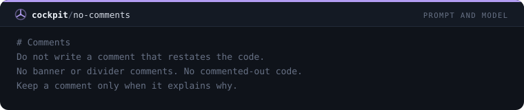

## `minimal-diff`

Pede a menor mudança que resolve o pedido, sem refatorações de carona; o que for notado é apenas mencionado.

```
/plugin install minimal-diff@cockpit
```

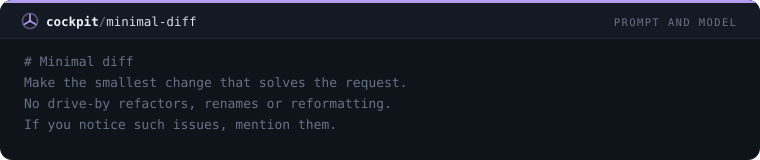

## `ask-first`

Quando um pedido tem duas leituras que levam a códigos diferentes, o Claude faz uma pergunta curta antes.

```
/plugin install ask-first@cockpit
```

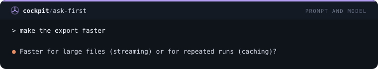

## `verify-claims`

O Claude não diz que algo funciona sem rodar, e termina dizendo o que foi e o que não foi verificado.

```
/plugin install verify-claims@cockpit
```

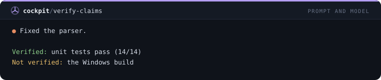

## `paste-fence`

Envolve em um bloco de código o trecho colado de 6+ linhas de código ou log antes do envio, deixando suas frases de fora.

```
/plugin install paste-fence@cockpit
```

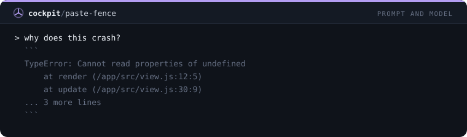

## `file-mention-hint`

Quando o prompt cita um arquivo sem caminho, adiciona os caminhos rastreados que combinam para o Claude abrir o arquivo certo.

```
/plugin install file-mention-hint@cockpit
```

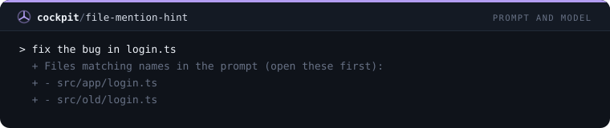

## `trace-helper`

Adiciona uma dica oculta aos prompts com stack trace: achar o primeiro frame do projeto, ler o código e dizer a causa raiz.

```
/plugin install trace-helper@cockpit
```

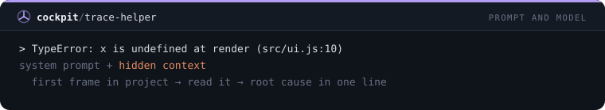

## `branch-naming`

Ensina ao Claude a convenção de nomes de branch: feat/, fix/, chore/, refactor/, docs/ e nunca trabalho novo na main.

```
/plugin install branch-naming@cockpit
```

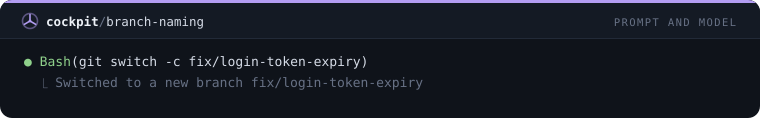

## `pr-style`

Faz as descrições de pull request seguirem o que mudou, por quê, como foi testado e riscos, com título em Conventional Commits.

```
/plugin install pr-style@cockpit
```

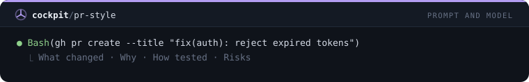

## `a11y-rules`

Em projetos web, mantém o Claude nas regras de acessibilidade ao editar markup: labels, alt, teclado, foco e contraste.

```
/plugin install a11y-rules@cockpit
```

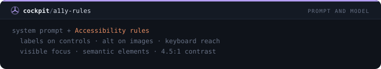

## `security-rules`

Regras de segurança sempre ativas: validar entrada, queries parametrizadas, sem segredos em código ou logs, privilégio mínimo, TLS ligado.

```
/plugin install security-rules@cockpit
```

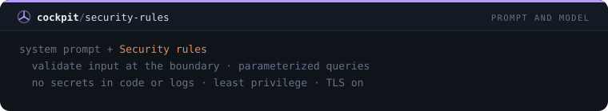

## `react-rules`

Em projetos React, mantém o Claude nas regras de hooks, keys estáveis, estado derivado e effects só para sincronização.

```
/plugin install react-rules@cockpit
```

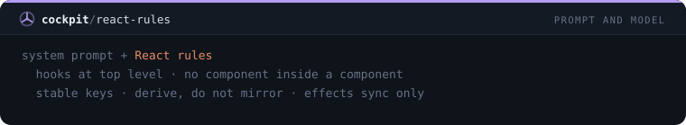

## `tailwind-rules`

Em projetos Tailwind, mantém o Claude nos tokens do tema, nos passos da escala e no mobile-first, sem estilos inline.

```
/plugin install tailwind-rules@cockpit
```

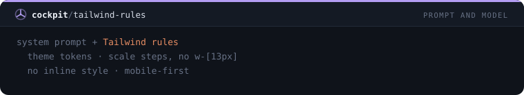

## `rn-rules`

Em projetos React Native e Expo, mantém o Claude em FlatList, StyleSheet, checagens via Platform e config compatível com EAS.

```
/plugin install rn-rules@cockpit
```

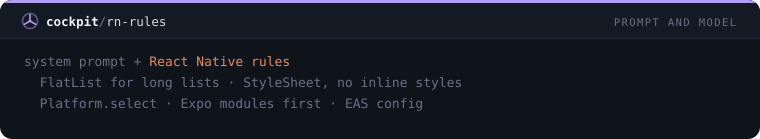

## `java-rules`

Em projetos Java, mantém o Claude em injeção por construtor, try-with-resources, sem exceções engolidas e na versão de Java declarada.

```
/plugin install java-rules@cockpit
```

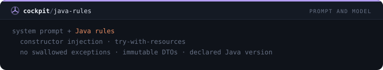

## `oracle-rules`

Em projetos Oracle, faz o Claude escrever SQL que roda no Oracle 11g: ROWNUM, sequence com trigger, bind variables, MERGE.

```
/plugin install oracle-rules@cockpit
```

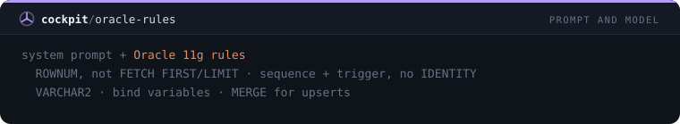

## `answer-format`

/format define o formato das respostas (bullets, steps, table ou prose) e mostra na linha de status.

```
/plugin install answer-format@cockpit
```

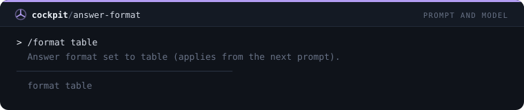
