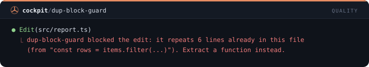

# Calidad — 7 mods

[← Volver al README](../../README.es.md)

[`untested-turn-toast`](#untested-turn-toast) · [`red-turn-toast`](#red-turn-toast) · [`debugger-guard`](#debugger-guard) · [`leftovers-toast`](#leftovers-toast) · [`any-guard`](#any-guard) · [`long-file-toast`](#long-file-toast) · [`dup-block-guard`](#dup-block-guard)

## `untested-turn-toast`

Toast al final de un turno que cambió código sin ejecutar ningún test.

```
/plugin install untested-turn-toast@cockpit
```


## `red-turn-toast`

Toast cuando un turno termina con la última ejecución de tests aún fallando.

```
/plugin install red-turn-toast@cockpit
```


## `debugger-guard`

Rechaza ediciones que añaden debugger, breakpoint(), pdb o binding.pry.

```
/plugin install debugger-guard@cockpit
```


## `leftovers-toast`

Toast al final del turno contando los logs de depuración y TODOs que añadieron las ediciones.

```
/plugin install leftovers-toast@cockpit
```


## `any-guard`

Pregunta antes de que una edición añada any a TypeScript: ": any", "as any", "<any>" o any[].

```
/plugin install any-guard@cockpit
```


## `long-file-toast`

Toast cuando una edición lleva un archivo más allá de 500 líneas, y otra vez cada 100 más.

```
/plugin install long-file-toast@cockpit
```


## `dup-block-guard`

Rechaza una edición cuyo código nuevo repite un bloque de 6 o más líneas que ya está en el mismo archivo.

```
/plugin install dup-block-guard@cockpit
```


