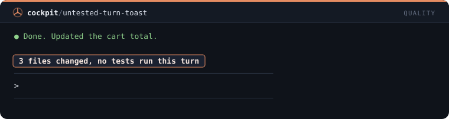
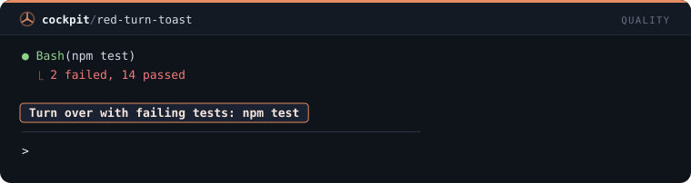
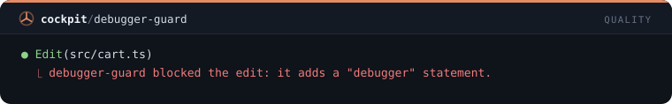
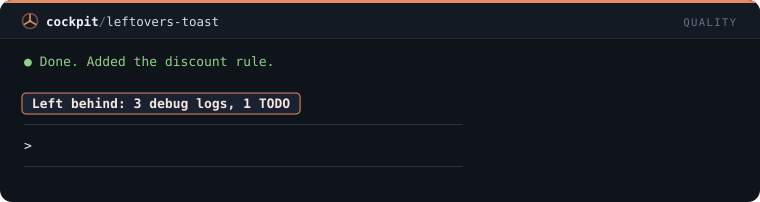
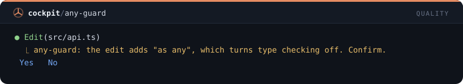
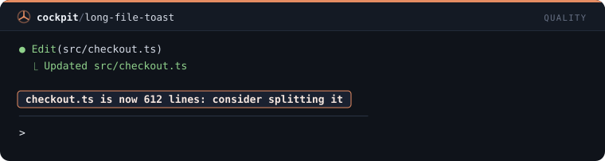

# Quality — 6 mods

[← Back to the README](../../README.md)

[`untested-turn-toast`](#untested-turn-toast) · [`red-turn-toast`](#red-turn-toast) · [`debugger-guard`](#debugger-guard) · [`leftovers-toast`](#leftovers-toast) · [`any-guard`](#any-guard) · [`long-file-toast`](#long-file-toast)

## `untested-turn-toast`

Toast at the end of a turn that changed code without running a single test.

```
/plugin install untested-turn-toast@cockpit
```



## `red-turn-toast`

Toast when a turn ends while the last test run is still failing.

```
/plugin install red-turn-toast@cockpit
```



## `debugger-guard`

Refuses edits that add a debugger statement, breakpoint(), pdb or binding.pry.

```
/plugin install debugger-guard@cockpit
```



## `leftovers-toast`

Toast at the end of a turn counting the debug logs and TODOs the edits added.

```
/plugin install leftovers-toast@cockpit
```



## `any-guard`

Asks before an edit adds any to TypeScript: ": any", "as any", "<any>" or any[].

```
/plugin install any-guard@cockpit
```



## `long-file-toast`

Toast when an edit takes a file past 500 lines, and again at every 100 more.

```
/plugin install long-file-toast@cockpit
```


