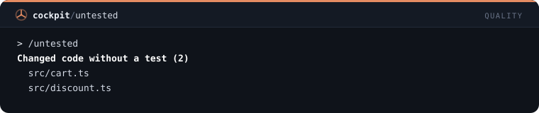
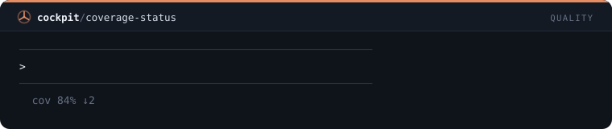
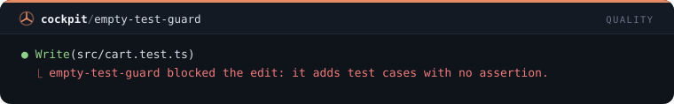
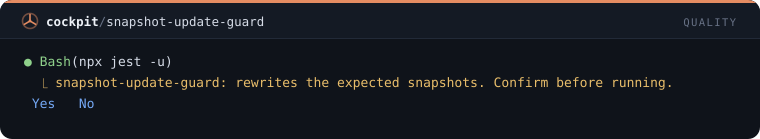
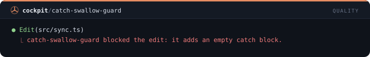

# Qualidade — 12 mods

[← Voltar ao README](../../README.pt-BR.md)

[`untested-turn-toast`](#untested-turn-toast) · [`red-turn-toast`](#red-turn-toast) · [`debugger-guard`](#debugger-guard) · [`leftovers-toast`](#leftovers-toast) · [`any-guard`](#any-guard) · [`long-file-toast`](#long-file-toast) · [`dup-block-guard`](#dup-block-guard) · [`untested`](#untested) · [`coverage-status`](#coverage-status) · [`empty-test-guard`](#empty-test-guard) · [`snapshot-update-guard`](#snapshot-update-guard) · [`catch-swallow-guard`](#catch-swallow-guard)

## `untested-turn-toast`

Toast no fim de um turno que alterou código sem rodar nenhum teste.

```
/plugin install untested-turn-toast@cockpit
```


## `red-turn-toast`

Toast quando um turno termina com a última execução de testes ainda falhando.

```
/plugin install red-turn-toast@cockpit
```


## `debugger-guard`

Recusa edições que adicionam debugger, breakpoint(), pdb ou binding.pry.

```
/plugin install debugger-guard@cockpit
```


## `leftovers-toast`

Toast no fim do turno contando os logs de debug e TODOs que as edições adicionaram.

```
/plugin install leftovers-toast@cockpit
```


## `any-guard`

Pergunta antes de uma edição adicionar any ao TypeScript: ": any", "as any", "<any>" ou any[].

```
/plugin install any-guard@cockpit
```


## `long-file-toast`

Toast quando uma edição leva um arquivo além de 500 linhas, e de novo a cada 100 a mais.

```
/plugin install long-file-toast@cockpit
```


## `dup-block-guard`

Recusa uma edição cujo código novo repete um bloco de 6 ou mais linhas que já está no mesmo arquivo.

```
/plugin install dup-block-guard@cockpit
```


## `untested`

/untested lista os arquivos alterados que não têm arquivo de teste, sem gastar um turno do modelo.

```
/plugin install untested@cockpit
```



## `coverage-status`

Linha de status com a cobertura de linhas do último relatório do projeto e quanto ela mudou.

```
/plugin install coverage-status@cockpit
```



## `empty-test-guard`

Recusa uma edição em arquivo de teste que adiciona casos de teste sem nenhuma asserção.

```
/plugin install empty-test-guard@cockpit
```



## `snapshot-update-guard`

Pergunta antes de um comando reescrever snapshots de teste: jest -u, vitest -u, --snapshot-update, insta accept.

```
/plugin install snapshot-update-guard@cockpit
```



## `catch-swallow-guard`

Recusa edições que adicionam um bloco catch vazio ou um except que só faz pass.

```
/plugin install catch-swallow-guard@cockpit
```


