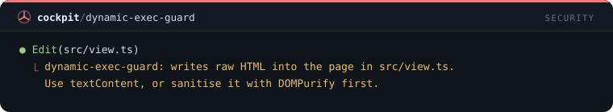
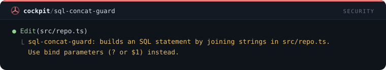
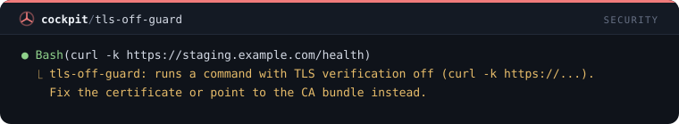
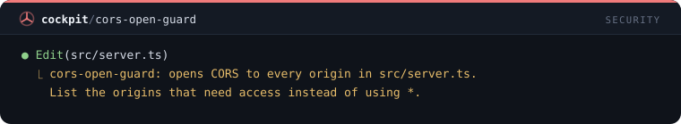
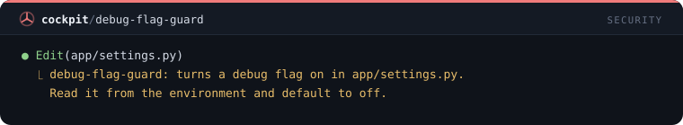
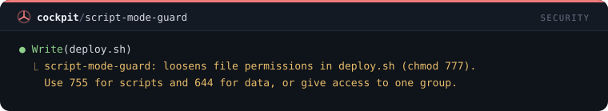
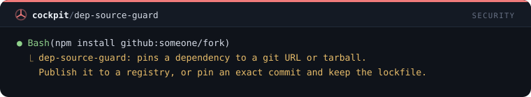

# Seguridad — 39 mods

[← Volver al README](../../README.es.md)

[`rm-guard`](#rm-guard) · [`env-guard`](#env-guard) · [`git-guard`](#git-guard) · [`secret-scan`](#secret-scan) · [`prompt-secret-guard`](#prompt-secret-guard) · [`lockfile-guard`](#lockfile-guard) · [`path-jail`](#path-jail) · [`main-branch-guard`](#main-branch-guard) · [`generated-guard`](#generated-guard) · [`sql-guard`](#sql-guard) · [`prod-guard`](#prod-guard) · [`install-ask`](#install-ask) · [`pipe-shell-guard`](#pipe-shell-guard) · [`big-read-guard`](#big-read-guard) · [`sudo-guard`](#sudo-guard) · [`chmod-guard`](#chmod-guard) · [`docker-guard`](#docker-guard) · [`kill-guard`](#kill-guard) · [`credential-file-guard`](#credential-file-guard) · [`upload-guard`](#upload-guard) · [`env-dump-guard`](#env-dump-guard) · [`registry-guard`](#registry-guard) · [`persistence-guard`](#persistence-guard) · [`dotfile-guard`](#dotfile-guard) · [`ci-config-guard`](#ci-config-guard) · [`test-skip-guard`](#test-skip-guard) · [`suppress-guard`](#suppress-guard) · [`migration-guard`](#migration-guard) · [`large-write-guard`](#large-write-guard) · [`tunnel-guard`](#tunnel-guard) · [`hardcoded-secret-guard`](#hardcoded-secret-guard) · [`private-host-guard`](#private-host-guard) · [`dynamic-exec-guard`](#dynamic-exec-guard) · [`sql-concat-guard`](#sql-concat-guard) · [`tls-off-guard`](#tls-off-guard) · [`cors-open-guard`](#cors-open-guard) · [`debug-flag-guard`](#debug-flag-guard) · [`script-mode-guard`](#script-mode-guard) · [`dep-source-guard`](#dep-source-guard)

## `rm-guard`

Bloquea rm -rf y Remove-Item -Recurse en raíz, home y unidades, además de mkfs, dd y format.

```
/plugin install rm-guard@cockpit
```


## `env-guard`

Protege los archivos .env contra lectura y escritura (Read, Edit, Write, cat y @mención).

```
/plugin install env-guard@cockpit
```


## `git-guard`

Bloquea git destructivo: push --force, reset --hard, clean -f, --no-verify, branch -D.

```
/plugin install git-guard@cockpit
```


## `secret-scan`

Rechaza Write/Edit cuyo contenido trae claves de API, tokens o claves privadas.

```
/plugin install secret-scan@cockpit
```


## `prompt-secret-guard`

Impide el envío de prompts que contengan secretos pegados por error.

```
/plugin install prompt-secret-guard@cockpit
```


## `lockfile-guard`

Impide la edición manual de lockfiles (package-lock, yarn.lock, pnpm-lock, Cargo.lock...).

```
/plugin install lockfile-guard@cockpit
```


## `path-jail`

Restringe Write/Edit a la raíz del proyecto, al temp y a ~/.claude (resuelve symlinks).

```
/plugin install path-jail@cockpit
```


## `main-branch-guard`

Rechaza commit, push, merge y rebase cuando la rama actual es main/master.

```
/plugin install main-branch-guard@cockpit
```


## `generated-guard`

Impide la edición en node_modules, dist, build, .next, coverage, .git y similares.

```
/plugin install generated-guard@cockpit
```


## `sql-guard`

Bloquea DROP, TRUNCATE y DELETE/UPDATE sin WHERE en comandos de shell.

```
/plugin install sql-guard@cockpit
```


## `prod-guard`

Exige tu confirmación para deploy, publish, terraform apply, kubectl y migraciones.

```
/plugin install prod-guard@cockpit
```


## `install-ask`

Exige tu confirmación siempre que Claude vaya a instalar una dependencia nueva.

```
/plugin install install-ask@cockpit
```


## `pipe-shell-guard`

Bloquea curl | sh, wget | bash, iwr | iex y variantes.

```
/plugin install pipe-shell-guard@cockpit
```


## `big-read-guard`

Rechaza leer entero un archivo de más de 512 KB y pide un fragmento.

```
/plugin install big-read-guard@cockpit
```


## `sudo-guard`

Bloquea la elevación de privilegios: sudo, doas, su -c, runas y Start-Process -Verb RunAs.

```
/plugin install sudo-guard@cockpit
```


## `chmod-guard`

Bloquea permisos de escritura para todos, chown recursivo en raíz o home e icacls para Everyone.

```
/plugin install chmod-guard@cockpit
```


## `docker-guard`

Pide confirmación antes de comandos Docker destructivos: system prune, volume rm o prune, rm -f, rmi -f y compose down -v.

```
/plugin install docker-guard@cockpit
```


## `kill-guard`

Bloquea el cierre masivo de procesos: kill -1, killall, pkill suelto, taskkill sobre nombres de sistema o con comodín, Stop-Process -Name *.

```
/plugin install kill-guard@cockpit
```


## `credential-file-guard`

Bloquea leer o copiar claves SSH, credenciales de nube y de registries e historiales de shell, con Read y en el shell.

```
/plugin install credential-file-guard@cockpit
```


## `upload-guard`

Pide confirmación antes de que un comando envíe un archivo local al exterior: subidas con curl, wget --post-file, scp o rsync a un host, nc.

```
/plugin install upload-guard@cockpit
```


## `env-dump-guard`

Bloquea volcar todo el entorno: env, printenv, set y export -p sin argumentos, Get-ChildItem Env:.

```
/plugin install env-dump-guard@cockpit
```


## `registry-guard`

Pide confirmación antes de que un comando cambie de dónde vienen los paquetes: registry o index de npm, pnpm, yarn y pip.

```
/plugin install registry-guard@cockpit
```


## `persistence-guard`

Pregunta antes de un comando que hace que algo se ejecute solo después: cron, schtasks, systemd, launchd o carpeta Startup.

```
/plugin install persistence-guard@cockpit
```


## `dotfile-guard`

Bloquea ediciones en tus perfiles de shell y herramientas: .bashrc, .zshrc, .gitconfig, .ssh/config y el perfil de PowerShell.

```
/plugin install dotfile-guard@cockpit
```


## `ci-config-guard`

Pregunta antes de editar la configuración de pipeline y deploy: workflows de GitHub, GitLab CI, Jenkinsfile, vercel.json, eas.json.

```
/plugin install ci-config-guard@cockpit
```


## `test-skip-guard`

Rechaza una edición que añade un test omitido o enfocado: .skip, .only, xit, fit, @Ignore, @Disabled, @pytest.mark.skip.

```
/plugin install test-skip-guard@cockpit
```


## `suppress-guard`

Rechaza una edición que añade una supresión genérica: eslint-disable, @ts-ignore, @ts-nocheck, # noqa o # type: ignore sin código.

```
/plugin install suppress-guard@cockpit
```


## `migration-guard`

Rechaza ediciones en migraciones de base de datos existentes (Prisma, Rails, Django, Alembic, Flyway); el arreglo es un archivo nuevo.

```
/plugin install migration-guard@cockpit
```


## `large-write-guard`

Rechaza un Write de más de 1.500 líneas o 200 KB y pide dividir el archivo o generarlo con un script.

```
/plugin install large-write-guard@cockpit
```


## `tunnel-guard`

Pregunta antes de un comando que expone tu máquina a internet: ngrok, cloudflared, ssh -R, tailscale funnel, servidor de dev en 0.0.0.0.

```
/plugin install tunnel-guard@cockpit
```


## `hardcoded-secret-guard`

Pregunta antes de que una edición ponga una contraseña fija, cadena de conexión o JWT en el código.

```
/plugin install hardcoded-secret-guard@cockpit
```


## `private-host-guard`

Pregunta antes de que una edición agregue una IP privada o un hostname interno al código.

```
/plugin install private-host-guard@cockpit
```


## `dynamic-exec-guard`

Pregunta antes de que una edición agregue eval, new Function, innerHTML o un comando de shell armado con una variable.

```
/plugin install dynamic-exec-guard@cockpit
```



## `sql-concat-guard`

Pregunta antes de que una edición arme SQL uniendo strings o interpolando valores.

```
/plugin install sql-concat-guard@cockpit
```



## `tls-off-guard`

Pregunta antes de desactivar la verificación del certificado TLS en el código o en un comando.

```
/plugin install tls-off-guard@cockpit
```



## `cors-open-guard`

Pregunta antes de que una edición abra CORS a cualquier origen con * o un cors() sin opciones.

```
/plugin install cors-open-guard@cockpit
```



## `debug-flag-guard`

Pregunta antes de que una edición deje una bandera de debug activa, exponga todos los endpoints del actuator o ponga modo desarrollo en un archivo de producción.

```
/plugin install debug-flag-guard@cockpit
```



## `script-mode-guard`

Pregunta antes de que un script o configuración reciba un modo escribible por todos, umask 0 o un permiso para Everyone.

```
/plugin install script-mode-guard@cockpit
```



## `dep-source-guard`

Pregunta antes de que una dependencia se fije a una URL git o tarball, o se descargue por http plano.

```
/plugin install dep-source-guard@cockpit
```


