# Security — 32 mods

[← Back to the README](../../README.md)

[`rm-guard`](#rm-guard) · [`env-guard`](#env-guard) · [`git-guard`](#git-guard) · [`secret-scan`](#secret-scan) · [`prompt-secret-guard`](#prompt-secret-guard) · [`lockfile-guard`](#lockfile-guard) · [`path-jail`](#path-jail) · [`main-branch-guard`](#main-branch-guard) · [`generated-guard`](#generated-guard) · [`sql-guard`](#sql-guard) · [`prod-guard`](#prod-guard) · [`install-ask`](#install-ask) · [`pipe-shell-guard`](#pipe-shell-guard) · [`big-read-guard`](#big-read-guard) · [`sudo-guard`](#sudo-guard) · [`chmod-guard`](#chmod-guard) · [`docker-guard`](#docker-guard) · [`kill-guard`](#kill-guard) · [`credential-file-guard`](#credential-file-guard) · [`upload-guard`](#upload-guard) · [`env-dump-guard`](#env-dump-guard) · [`registry-guard`](#registry-guard) · [`persistence-guard`](#persistence-guard) · [`dotfile-guard`](#dotfile-guard) · [`ci-config-guard`](#ci-config-guard) · [`test-skip-guard`](#test-skip-guard) · [`suppress-guard`](#suppress-guard) · [`migration-guard`](#migration-guard) · [`large-write-guard`](#large-write-guard) · [`tunnel-guard`](#tunnel-guard) · [`hardcoded-secret-guard`](#hardcoded-secret-guard) · [`private-host-guard`](#private-host-guard)

## `rm-guard`

Blocks rm -rf and Remove-Item -Recurse on root, home and drives, plus mkfs, dd and format.

```
/plugin install rm-guard@cockpit
```


## `env-guard`

Protects .env files from reading and writing (Read, Edit, Write, cat and @mention).

```
/plugin install env-guard@cockpit
```


## `git-guard`

Blocks destructive git: push --force, reset --hard, clean -f, --no-verify, branch -D.

```
/plugin install git-guard@cockpit
```


## `secret-scan`

Refuses Write/Edit whose content carries API keys, tokens or private keys.

```
/plugin install secret-scan@cockpit
```


## `prompt-secret-guard`

Stops prompts that contain secrets pasted by mistake from being sent.

```
/plugin install prompt-secret-guard@cockpit
```


## `lockfile-guard`

Prevents hand edits to lockfiles (package-lock, yarn.lock, pnpm-lock, Cargo.lock...).

```
/plugin install lockfile-guard@cockpit
```


## `path-jail`

Restricts Write/Edit to the project root, the temp folder and ~/.claude (resolves symlinks).

```
/plugin install path-jail@cockpit
```


## `main-branch-guard`

Refuses commit, push, merge and rebase while the current branch is main/master.

```
/plugin install main-branch-guard@cockpit
```


## `generated-guard`

Prevents edits in node_modules, dist, build, .next, coverage, .git and the like.

```
/plugin install generated-guard@cockpit
```


## `sql-guard`

Blocks DROP, TRUNCATE and DELETE/UPDATE without WHERE in shell commands.

```
/plugin install sql-guard@cockpit
```


## `prod-guard`

Requires your confirmation for deploys, publishes, terraform apply, kubectl and migrations.

```
/plugin install prod-guard@cockpit
```


## `install-ask`

Requires your confirmation whenever Claude is about to install a new dependency.

```
/plugin install install-ask@cockpit
```


## `pipe-shell-guard`

Blocks curl | sh, wget | bash, iwr | iex and variants.

```
/plugin install pipe-shell-guard@cockpit
```


## `big-read-guard`

Refuses reading a file over 512 KB whole and asks for a slice.

```
/plugin install big-read-guard@cockpit
```


## `sudo-guard`

Blocks privilege elevation: sudo, doas, su -c, runas and Start-Process -Verb RunAs.

```
/plugin install sudo-guard@cockpit
```

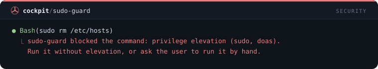

## `chmod-guard`

Blocks world-writable permissions, recursive chown on root or home, and icacls grants to Everyone.

```
/plugin install chmod-guard@cockpit
```

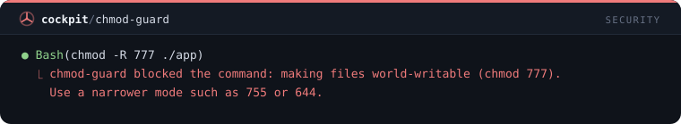

## `docker-guard`

Asks before destructive Docker commands: system prune, volume rm or prune, rm -f, rmi -f and compose down -v.

```
/plugin install docker-guard@cockpit
```

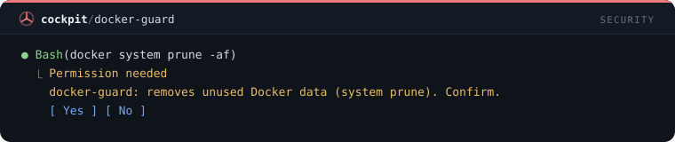

## `kill-guard`

Blocks broad process kills: kill -1, killall, loose pkill, taskkill on system or wildcard names, Stop-Process -Name *.

```
/plugin install kill-guard@cockpit
```

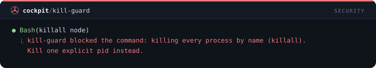

## `credential-file-guard`

Blocks reading or copying SSH keys, cloud and registry credentials and shell history, with Read and in the shell.

```
/plugin install credential-file-guard@cockpit
```

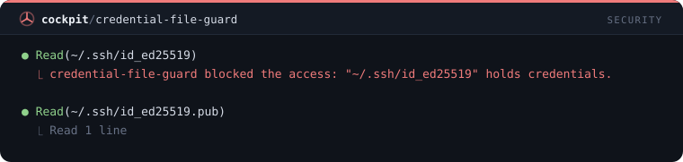

## `upload-guard`

Asks before a command sends a local file out: curl uploads, wget --post-file, scp or rsync to a host, nc.

```
/plugin install upload-guard@cockpit
```

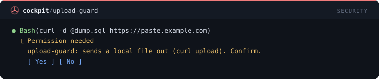

## `env-dump-guard`

Blocks dumping the whole environment: bare env, printenv, set and export -p, Get-ChildItem Env:.

```
/plugin install env-dump-guard@cockpit
```

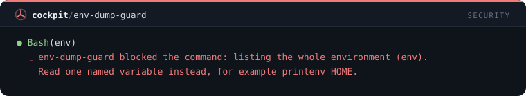

## `registry-guard`

Asks before a command changes where packages come from: npm, pnpm, yarn and pip registry or index settings.

```
/plugin install registry-guard@cockpit
```


## `persistence-guard`

Asks before a command that makes something run on its own later: cron, schtasks, systemd, launchd or a Startup folder.

```
/plugin install persistence-guard@cockpit
```

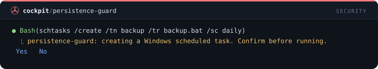

## `dotfile-guard`

Blocks edits to your shell and tool profiles: .bashrc, .zshrc, .gitconfig, .ssh/config and the PowerShell profile.

```
/plugin install dotfile-guard@cockpit
```

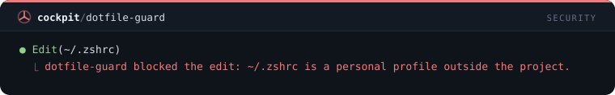

## `ci-config-guard`

Asks before an edit to pipeline and deploy configuration: GitHub workflows, GitLab CI, Jenkinsfile, vercel.json, eas.json.

```
/plugin install ci-config-guard@cockpit
```

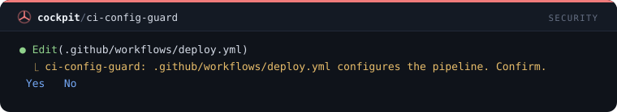

## `test-skip-guard`

Refuses an edit that adds a skipped or focused test: .skip, .only, xit, fit, @Ignore, @Disabled, @pytest.mark.skip.

```
/plugin install test-skip-guard@cockpit
```

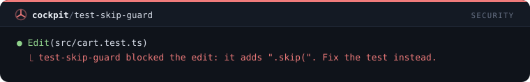

## `suppress-guard`

Refuses an edit that adds a blanket suppression: eslint-disable, @ts-ignore, @ts-nocheck, bare # noqa or # type: ignore.

```
/plugin install suppress-guard@cockpit
```

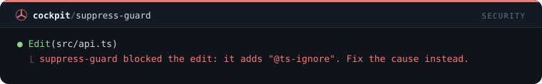

## `migration-guard`

Refuses edits to existing database migrations (Prisma, Rails, Django, Alembic, Flyway); a new file is the fix.

```
/plugin install migration-guard@cockpit
```

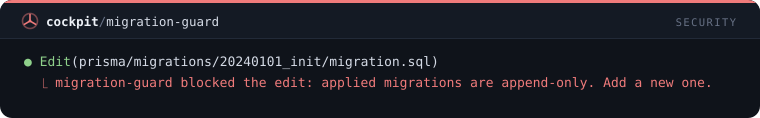

## `large-write-guard`

Refuses a Write over 1,500 lines or 200 KB and asks for the file to be split or generated by a script.

```
/plugin install large-write-guard@cockpit
```

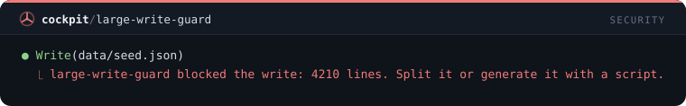

## `tunnel-guard`

Asks before a command that exposes your machine to the internet: ngrok, cloudflared, ssh -R, tailscale funnel, a dev server on 0.0.0.0.

```
/plugin install tunnel-guard@cockpit
```

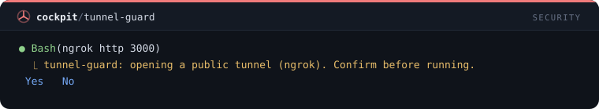

## `hardcoded-secret-guard`

Asks before an edit puts a hardcoded password, connection string or JWT into source.

```
/plugin install hardcoded-secret-guard@cockpit
```

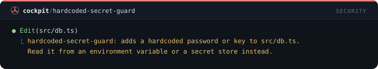

## `private-host-guard`

Asks before an edit adds a private IP address or an internal hostname to source.

```
/plugin install private-host-guard@cockpit
```

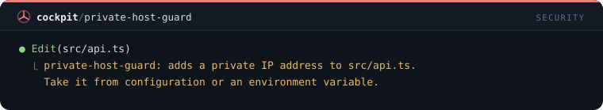
