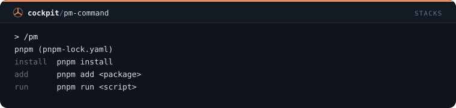

# Stacks — 12 mods

[← Volver al README](../../README.es.md)

[`pm-guard`](#pm-guard) · [`script-guard`](#script-guard) · [`missing-import-guard`](#missing-import-guard) · [`client-env-guard`](#client-env-guard) · [`next-boundary-guard`](#next-boundary-guard) · [`esm-guard`](#esm-guard) · [`alias-import-guard`](#alias-import-guard) · [`dev-server-guard`](#dev-server-guard) · [`ts-config-context`](#ts-config-context) · [`env-undeclared-toast`](#env-undeclared-toast) · [`node-version-status`](#node-version-status) · [`pm-command`](#pm-command)

## `pm-guard`

Rechaza comandos npm, pnpm, yarn o bun de un gestor distinto al lockfile del proyecto e indica el correcto.

```
/plugin install pm-guard@cockpit
```


## `script-guard`

Rechaza npm run o pnpm run de un script que package.json no declara y lista los que sí declara.

```
/plugin install script-guard@cockpit
```


## `missing-import-guard`

Rechaza una edición que importa un paquete que no está en package.json ni en node_modules.

```
/plugin install missing-import-guard@cockpit
```


## `client-env-guard`

Rechaza código de navegador en Vite y Next.js que lee una variable de entorno que el bundler nunca expone.

```
/plugin install client-env-guard@cockpit
```


## `next-boundary-guard`

Rechaza ediciones del app router de Next.js que rompen la frontera cliente/servidor: hooks sin 'use client' o código de servidor en un archivo cliente.

```
/plugin install next-boundary-guard@cockpit
```


## `esm-guard`

Rechaza require, module.exports y __dirname en archivos .js de un paquete que declara "type": "module".

```
/plugin install esm-guard@cockpit
```


## `alias-import-guard`

Rechaza imports profundos con ../../ cuando tsconfig paths tiene un alias para la carpeta e indica el alias.

```
/plugin install alias-import-guard@cockpit
```


## `dev-server-guard`

Pregunta antes de que npm run dev, next dev o vite arranque cuando algo ya responde en el puerto de ese servidor de desarrollo.

```
/plugin install dev-server-guard@cockpit
```


## `ts-config-context`

Pasa a Claude tu tsconfig en el prompt del sistema: flags strict, alias de path, resolución de módulos e imports solo de tipo.

```
/plugin install ts-config-context@cockpit
```


## `env-undeclared-toast`

Un toast cuando una edición lee variables de process.env o import.meta.env que .env.example no declara.

```
/plugin install env-undeclared-toast@cockpit
```


## `node-version-status`

Entrada en la status line que solo aparece cuando el Node en uso no cumple engines.node, .nvmrc o .node-version.

```
/plugin install node-version-status@cockpit
```


## `pm-command`

/pm indica el gestor de paquetes del proyecto y muestra sus comandos de install, add, remove, run y exec.

```
/plugin install pm-command@cockpit
```


