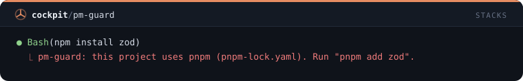
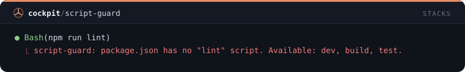
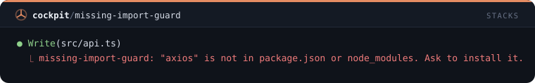
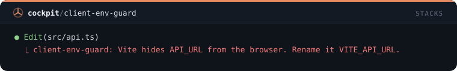
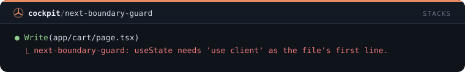

# Stacks — 5 mods

[← Volver al README](../../README.es.md)

[`pm-guard`](#pm-guard) · [`script-guard`](#script-guard) · [`missing-import-guard`](#missing-import-guard) · [`client-env-guard`](#client-env-guard) · [`next-boundary-guard`](#next-boundary-guard)

## `pm-guard`

Rechaza comandos npm, pnpm, yarn o bun de un gestor distinto al lockfile del proyecto e indica el correcto.

```
/plugin install pm-guard@cockpit
```



## `script-guard`

Rechaza npm run o pnpm run de un script que package.json no declara y lista los que sí declara.

```
/plugin install script-guard@cockpit
```



## `missing-import-guard`

Rechaza una edición que importa un paquete que no está en package.json ni en node_modules.

```
/plugin install missing-import-guard@cockpit
```



## `client-env-guard`

Rechaza código de navegador en Vite y Next.js que lee una variable de entorno que el bundler nunca expone.

```
/plugin install client-env-guard@cockpit
```



## `next-boundary-guard`

Rechaza ediciones del app router de Next.js que rompen la frontera cliente/servidor: hooks sin 'use client' o código de servidor en un archivo cliente.

```
/plugin install next-boundary-guard@cockpit
```


