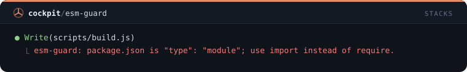
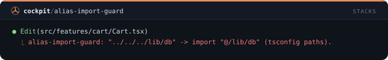
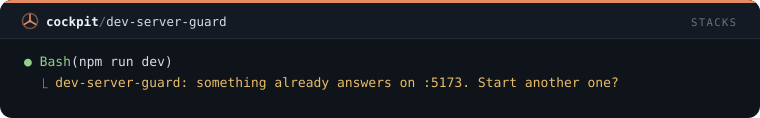
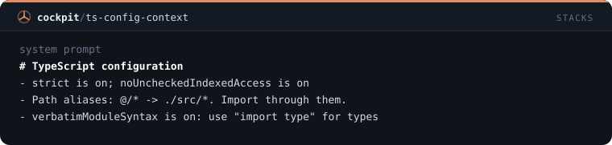
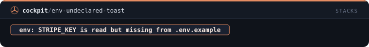
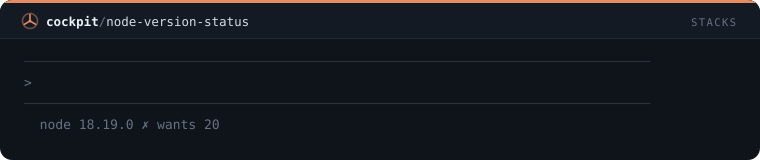

# Stacks — 11 mods

[← Voltar ao README](../../README.pt-BR.md)

[`pm-guard`](#pm-guard) · [`script-guard`](#script-guard) · [`missing-import-guard`](#missing-import-guard) · [`client-env-guard`](#client-env-guard) · [`next-boundary-guard`](#next-boundary-guard) · [`esm-guard`](#esm-guard) · [`alias-import-guard`](#alias-import-guard) · [`dev-server-guard`](#dev-server-guard) · [`ts-config-context`](#ts-config-context) · [`env-undeclared-toast`](#env-undeclared-toast) · [`node-version-status`](#node-version-status)

## `pm-guard`

Recusa comandos npm, pnpm, yarn ou bun de um gerenciador diferente do lockfile do projeto e indica o certo.

```
/plugin install pm-guard@cockpit
```


## `script-guard`

Recusa npm run ou pnpm run de um script que o package.json não declara e lista os que ele declara.

```
/plugin install script-guard@cockpit
```


## `missing-import-guard`

Recusa uma edição que importa um pacote que não está no package.json nem no node_modules.

```
/plugin install missing-import-guard@cockpit
```


## `client-env-guard`

Recusa código de navegador em Vite e Next.js que lê uma variável de ambiente que o bundler nunca expõe.

```
/plugin install client-env-guard@cockpit
```


## `next-boundary-guard`

Recusa edições no app router do Next.js que quebram a fronteira cliente/servidor: hooks sem 'use client' ou código de servidor num arquivo cliente.

```
/plugin install next-boundary-guard@cockpit
```


## `esm-guard`

Recusa require, module.exports e __dirname em arquivos .js de um pacote que declara "type": "module".

```
/plugin install esm-guard@cockpit
```



## `alias-import-guard`

Recusa imports profundos com ../../ quando o tsconfig paths tem um alias para a pasta e indica o alias.

```
/plugin install alias-import-guard@cockpit
```



## `dev-server-guard`

Pergunta antes de npm run dev, next dev ou vite subir quando algo já responde na porta daquele servidor de desenvolvimento.

```
/plugin install dev-server-guard@cockpit
```



## `ts-config-context`

Passa ao Claude o seu tsconfig no prompt do sistema: flags strict, aliases de path, resolução de módulos e imports só de tipo.

```
/plugin install ts-config-context@cockpit
```



## `env-undeclared-toast`

Um toast quando uma edição lê variáveis de process.env ou import.meta.env que o .env.example não declara.

```
/plugin install env-undeclared-toast@cockpit
```



## `node-version-status`

Entrada na status line que só aparece quando o Node em uso não atende engines.node, .nvmrc ou .node-version.

```
/plugin install node-version-status@cockpit
```


